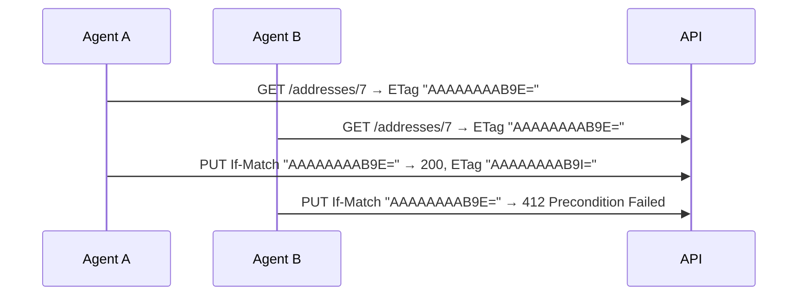

# Idempotency, concurrency, long-running operations, and webhooks
[← Overview](00-overview.md)

## Why it matters
- A mobile app retries `POST /orders` after a timeout; the first request had succeeded. Two orders, two charges.
- Two support agents edit the same delivery address; the second save overwrites the first agent's fix (lost update).
- An "export all orders" request runs for four minutes; the ingress cuts it at 240 s, the client retries, and now two exports run.

## Concepts

### Idempotency keys for POST
The client sends `Idempotency-Key: <uuid>` with each logical operation; retries reuse the key.
| Case | Server behavior |
|:--|:--|
| first time | process, store `(key, user, request hash, status, response body)` |
| same key, same body, finished | ⭐ return the stored response (same status and body) |
| same key, still processing | 409 Conflict (client retries later) |
| same key, different body | 422 (key reused for a different operation) |
| keys expire | e.g. after 24 h |

Store keys in SQL with a unique index on `(UserId, Key)`, inserted **in the same transaction** as the business change when possible, so "order created" and "key recorded" can't diverge. An endpoint filter keeps endpoints clean.

### Optimistic concurrency with ETags
SQL Server `rowversion` changes on every update. Expose it as an `ETag`; require `If-Match` on updates.

EF Core: mark the property `[Timestamp]`/`IsRowVersion()`; set its original value to the client's version before saving; a mismatch throws `DbUpdateConcurrencyException` → 412. Missing `If-Match` on a required update → 428 Precondition Required.

### Long-running operations
| Step | Response |
|:--|:--|
| client starts work | `202 Accepted`, `Location: /operations/{id}`, optional `Retry-After: 5` |
| client polls | `GET /operations/{id}` → `{ "status": "running", "progress": 40 }` |
| done | `{ "status": "succeeded", "resultUrl": "/exports/abc.csv" }` (or `303 See Other` to the result) |
| failed | `{ "status": "failed", "error": { problem details } }` |

The work runs in a background job (Hangfire, 03-backend/07), never in the request. SSE can push progress instead of polling (01-foundations/02).

### Webhooks you send
| Concern | Practice |
|:--|:--|
| ⭐ signing | HMAC-SHA256 over `timestamp.body` with a per-subscriber secret; send `Webhook-Signature`, `Webhook-Timestamp`, `Webhook-Id` |
| replay protection | consumers reject old timestamps (> 5 min) |
| ⭐ retries | exponential backoff over hours (Hangfire), stop after N attempts, then disable/alert |
| idempotency for consumers | stable event IDs; at-least-once delivery |
| ordering | don't promise it; include `occurredAt` and resource versions |
| SSRF | subscriber URLs are user input: HTTPS only, block private IP ranges (01-foundations/06) |
| timeouts | short (5–10 s); slow consumers don't block your workers |
| delivery log | per attempt: status, latency, response snippet; visible to customers |

Also seen: the Standard Webhooks specification for headers and signatures.

## Example
`src/Shop.Api/Idempotency/IdempotencyFilter.cs` (simplified)
```csharp
using System.Security.Cryptography;
using System.Text.Json;
using Microsoft.EntityFrameworkCore;

public sealed class IdempotencyFilter(ShopDb db, TimeProvider time) : IEndpointFilter
{
    public async ValueTask<object?> InvokeAsync(EndpointFilterInvocationContext ctx, EndpointFilterDelegate next)
    {
        var http = ctx.HttpContext;
        if (!Guid.TryParse(http.Request.Headers["Idempotency-Key"], out var key))
            return TypedResults.Problem(statusCode: 400, title: "Idempotency-Key header (UUID) is required.");

        var userId = http.User.GetUserId();
        var body = ctx.Arguments.FirstOrDefault(a => a is not null && a.GetType().Name.EndsWith("Request"));
        var hash = Convert.ToHexString(SHA256.HashData(JsonSerializer.SerializeToUtf8Bytes(body)));

        var existing = await db.IdempotencyKeys.AsNoTracking()
            .SingleOrDefaultAsync(k => k.UserId == userId && k.Key == key, http.RequestAborted);
        if (existing is not null)
        {
            if (existing.RequestHash != hash) return TypedResults.Problem(statusCode: 422, title: "Idempotency-Key was used with a different request.");
            if (existing.StatusCode is null) return TypedResults.Problem(statusCode: 409, title: "A request with this key is still in progress.");
            return Results.Text(existing.ResponseBody!, "application/json", statusCode: existing.StatusCode);
        }

        db.IdempotencyKeys.Add(new IdempotencyKey(userId, key, hash, time.GetUtcNow()));
        await db.SaveChangesAsync(http.RequestAborted);       // unique index (UserId, Key) catches concurrent duplicates → 409

        var result = await next(ctx);
        // store status + serialized body for replays (omitted: capture from IResult / response)
        return result;
    }
}
```
`src/Shop.Api/Features/Addresses/UpdateAddress.cs` (ETag / If-Match)
```csharp
private static async Task<IResult> UpdateAddress(Guid id, UpdateAddressRequest body, HttpRequest req, HttpResponse res,
    ShopDb db, ClaimsPrincipal user, CancellationToken ct)
{
    var ifMatch = req.Headers.IfMatch.ToString().Trim('"');
    if (string.IsNullOrEmpty(ifMatch)) return TypedResults.Problem(statusCode: 428, title: "If-Match header required.");

    var address = await db.Addresses.SingleOrDefaultAsync(a => a.Id == id && a.CustomerId == user.GetUserId(), ct);
    if (address is null) return TypedResults.NotFound();

    db.Entry(address).Property(a => a.RowVersion).OriginalValue = Convert.FromBase64String(ifMatch);
    address.Update(body.Street, body.PostalCode, body.City);
    try
    {
        await db.SaveChangesAsync(ct);
    }
    catch (DbUpdateConcurrencyException)
    {
        return TypedResults.Problem(statusCode: 412, title: "The address was changed by someone else. Reload and try again.");
    }
    res.Headers.ETag = $"\"{Convert.ToBase64String(address.RowVersion)}\"";
    return TypedResults.NoContent();
}
```
Signing a webhook:
```csharp
var timestamp = time.GetUtcNow().ToUnixTimeSeconds().ToString(CultureInfo.InvariantCulture);
var payload = Encoding.UTF8.GetBytes($"{timestamp}.{json}");
var signature = Convert.ToBase64String(HMACSHA256.HashData(subscriberSecret, payload));
request.Headers.Add("Webhook-Id", eventId.ToString());
request.Headers.Add("Webhook-Timestamp", timestamp);
request.Headers.Add("Webhook-Signature", $"v1,{signature}");
```

## Production patterns
- Every POST that creates something accepts an `Idempotency-Key`; the frontend sends one per form instance (02-frontend/04).
- `rowversion` on aggregates that people edit concurrently; ETag/If-Match on their update endpoints.
- Anything slower than a few seconds becomes a 202 + operation resource + background job.
- Outgoing webhooks: signed, retried with backoff by a job system, logged per attempt, SSRF-safe.

## Mistakes
Wrong: "the client shouldn't retry".
Right: assume retries; make creates idempotent.

Wrong: last write wins on shared records.
Right: optimistic concurrency with `rowversion` and 412 responses.

## Check yourself
1. What should the API return for a retried request whose original already succeeded?
2. Why is 428 different from 412?
3. Why must webhook consumers be idempotent?

<details><summary>Answers</summary>

1. The stored original response: same status code and body.
2. 428 means the required precondition header (`If-Match`) is missing; 412 means it was sent but didn't match the current version.
3. Delivery is at-least-once: retries after timeouts or network errors can deliver the same event more than once.
</details>

## Sources
- [IETF draft — The Idempotency-Key HTTP Header Field](https://datatracker.ietf.org/doc/draft-ietf-httpapi-idempotency-key-header/)
- [EF Core — Handling concurrency conflicts](https://learn.microsoft.com/ef/core/saving/concurrency)
- [RFC 9110 — Conditional requests (412) / RFC 6585 (428)](https://www.rfc-editor.org/rfc/rfc9110#name-412-precondition-failed)
- [Microsoft REST guidelines — Long-running operations](https://github.com/microsoft/api-guidelines/blob/vNext/azure/Guidelines.md#long-running-operations--jobs)
- [Standard Webhooks](https://www.standardwebhooks.com/)
