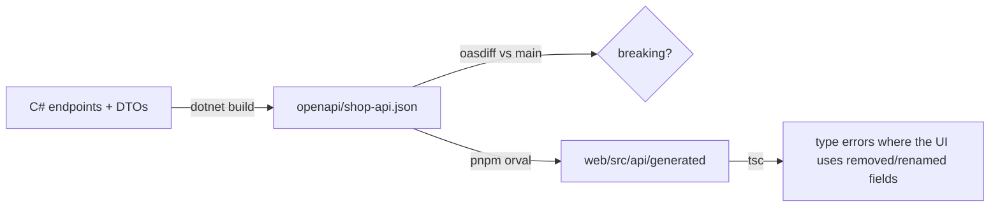

# Contracts, controllers, and API styles
[← Overview](00-overview.md)

## Why it matters
- A backend developer renames `unitPrice` to `unitPriceMinor`; the build is green, the API deploys, and the storefront shows `NaN` for every price.
- You join a team with 300 controllers, action filters, and `[ApiController]` conventions; Minimal API knowledge alone doesn't explain why requests return 400 before the action runs.
- A team builds GraphQL for an internal service-to-service call that only ever fetches one object by ID.

## Concepts

### The API contract
The OpenAPI 3.1 document generated from the code (01-foundations/08) is the contract:
1. ASP.NET Core build writes `openapi/shop-api.json`.
2. CI fails if the committed file is stale and runs a breaking-change diff against `main` (`oasdiff`).
3. The frontend runs Orval on the same file: types, TanStack Query hooks, Zod schemas, MSW mocks (02-frontend/05, /10, /13).
4. A breaking change needs a label, owner approval, and a coordinated frontend change in the same PR or a deprecation period.


In a monorepo, one PR can change the C# DTO, regenerate the client, and fix the frontend, and CI type-checks both sides together.

### Controllers
Many existing .NET codebases use MVC controllers.
| Feature | Controllers | Minimal APIs equivalent |
|:--|:--|:--|
| registration | `AddControllers()` + `MapControllers()` | `MapGet/MapPost…` |
| routing | `[Route("orders")]`, `[HttpGet("{id:guid}")]` | route templates in `Map*` |
| ⭐ `[ApiController]` | automatic 400 `ValidationProblemDetails` from model state, binding source inference, Problem Details for error codes | `AddValidation()`, `TypedResults` |
| return types | `ActionResult<OrderDto>`, `IActionResult`, `Ok()`, `NotFound()` | `Results<Ok<T>, NotFound>` |
| filters | action, result, exception, resource, authorization filters | endpoint filters, middleware |
| model binding | `[FromBody]`, `[FromQuery]`, `[FromRoute]`, `[FromServices]` | same attributes or inference |
| conventions | `ControllerBase`, constructor injection | parameter injection |
| validation | DataAnnotations through model state (`ModelState.IsValid`) | built-in validation |

When maintaining controllers: keep them thin, put logic in services, use `[ProducesResponseType]` for OpenAPI, and prefer `ActionResult<T>`. New features in an existing controller-based app can stay controllers for consistency, or be added as Minimal API groups side by side (both can coexist).

### REST vs GraphQL vs RPC
| Style | Strengths | Costs | Fits |
|:--|:--|:--|:--|
| ⭐ REST + OpenAPI | HTTP caching, simple tooling, wide support | over/under-fetching, many endpoints | public APIs, this shop's frontend |
| GraphQL (HotChocolate in .NET) | clients choose fields, one endpoint, schema | caching, N+1 and query-cost control, auth per field | many clients with different data needs |
| gRPC (`Grpc.AspNetCore`) | fast binary (Protobuf), streaming, contracts | browsers need gRPC-Web, less human-friendly | internal service-to-service |
| async messaging | decoupling, buffering | eventual consistency | events between services (03-backend/07) |

Choose by consumer: a Next.js storefront and partners → REST; internal low-latency calls between .NET services → gRPC; a large ecosystem of differing clients → GraphQL.

## Example
`src/Shop.Api/Controllers/LegacyOrdersController.cs` (what you'll meet in existing code)
```csharp
using Microsoft.AspNetCore.Authorization;
using Microsoft.AspNetCore.Mvc;

namespace Shop.Api.Controllers;

[ApiController]
[Route("legacy/orders")]
[Authorize]
public sealed class LegacyOrdersController(OrderService orders) : ControllerBase
{
    [HttpGet("{id:guid}")]
    [ProducesResponseType<OrderDto>(StatusCodes.Status200OK)]
    [ProducesResponseType(StatusCodes.Status404NotFound)]
    public async Task<ActionResult<OrderDto>> Get(Guid id, CancellationToken ct) =>
        await orders.FindAsync(id, ct) is { } dto ? Ok(dto) : NotFound();

    [HttpPost]
    public async Task<ActionResult<OrderDto>> Create(CreateOrderRequest body, CancellationToken ct)
    {
        // [ApiController] already returned 400 if DataAnnotations failed
        var dto = await orders.PlaceAsync(body, ct);
        return CreatedAtAction(nameof(Get), new { id = dto.Id }, dto);
    }
}
```
`src/Shop.Api/Program.cs` (both styles together)
```csharp
builder.Services.AddControllers();
// ...
app.MapControllers();
app.MapOrderEndpoints();      // Minimal API group
```
`.github/workflows/contract.yml` (excerpt)
```yaml
- run: dotnet build src/Shop.Api -c Release           # writes openapi/shop-api.json
- run: git diff --exit-code -- openapi/
- run: pnpm -C web orval && git diff --exit-code -- web/src/api/generated
- run: pnpm -C web typecheck                           # frontend compiles against the new contract
```

## Production patterns
- The generated OpenAPI file and the generated TypeScript client are committed and diffed in CI.
- API and frontend changes that break the contract go in the same PR (monorepo) or follow a deprecation window.
- In controller codebases: `[ApiController]`, `ActionResult<T>`, thin actions, `[ProducesResponseType]` for accurate docs.
- REST for the shop; gRPC only where internal performance and streaming justify it.

## Mistakes
Wrong: hand-maintained TypeScript types for the API.
Right: Orval-generated types from the committed OpenAPI document.

Wrong: `if (!ModelState.IsValid) return BadRequest(ModelState);` in every action of an `[ApiController]`.
Right: `[ApiController]` does it automatically and returns `ValidationProblemDetails`.

## Check yourself
1. Where does a renamed DTO property get caught in this setup?
2. What three things does `[ApiController]` add?
3. When would you choose gRPC over REST?

<details><summary>Answers</summary>

1. In CI: the OpenAPI diff flags a breaking change, and regenerating the Orval client makes the frontend type-check fail where the old name is used.
2. Automatic 400 responses for invalid model state, binding source inference (`[FromBody]` for complex types), and Problem Details for error status codes (plus attribute routing requirement).
3. For internal service-to-service calls needing low latency, strong contracts, or streaming, where browsers aren't direct clients.
</details>

## Sources
- [Create web APIs with ASP.NET Core (controllers)](https://learn.microsoft.com/aspnet/core/web-api/)
- [ApiController attribute](https://learn.microsoft.com/aspnet/core/web-api/#apicontroller-attribute)
- [gRPC on .NET](https://learn.microsoft.com/aspnet/core/grpc/)
- [HotChocolate (GraphQL for .NET)](https://chillicream.com/docs/hotchocolate)
- [oasdiff](https://github.com/oasdiff/oasdiff) · [Orval](https://orval.dev/)
