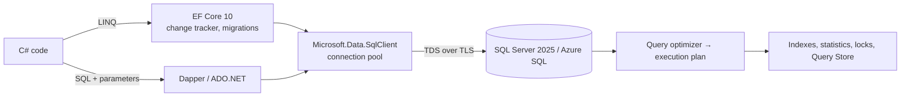

# Databases — Overview
[← Topic](../README.md)

**TECH:** SQL Server 2025 (Docker locally) and Azure SQL Database in the cloud; EF Core 10 as the main data access layer; Dapper and ADO.NET for hand-tuned queries and stored procedures; SSMS and the VS Code mssql extension
**LEVEL:** intermediate (mid-level, new to C# and .NET)

## Why this matters in production
- Most slow endpoints are slow queries: a missing index, an N+1 loop, or LINQ that EF Core turns into something unexpected.
- Data outlives code. A bad schema or a careless migration costs more than any bug in a handler.
- Concurrency bugs (lost updates, deadlocks, double-spending stock) only appear under real load, and they corrupt data quietly.
- Most .NET employers run SQL Server or Azure SQL. Execution plans, Query Store, and T-SQL are everyday skills there.

## Mental model

EF Core writes SQL for you; you are still responsible for what that SQL does.

## Prerequisites
- [01-language-runtime](../../01-language-runtime/README.md) lesson 03 (LINQ, `IQueryable`), [02-api-design](../../02-api-design/README.md).
- SQL Server 2025 running in Docker ([01-foundations/07](../../../01-foundations/07-config-environments/README.md) lesson 04).

## Lesson map
| Lesson | Checklist items |
|:--|:--|
| [01 · Relational modeling, data types, SQL you must know, and tools](01-modeling-sql-tools.md) | 1, 2, 9, 16 |
| [02 · Indexes, execution plans, and SQL Server operations](02-indexes-plans-operations.md) | 3, 15 |
| [03 · Transactions, isolation, locking, and optimistic concurrency](03-transactions-concurrency.md) | 4, 8 |
| [04 · EF Core: model, change tracking, and migrations](04-ef-core-model-migrations.md) | 6, 7 |
| [05 · Query performance: N+1, EF Core tuning, Dapper, stored procedures](05-query-performance-dapper-procs.md) | 5, 10, 11, 12 |
| [06 · Connections, security, and choosing a database](06-connections-security-choice.md) | 13, 14, 17 |
| [Cheatsheet](cheatsheet.md) | all |

## Suggested order
1. 01 → 06. Write raw SQL in SSMS or the mssql extension before letting EF Core write it for you.
2. Then [04-auth](../../04-auth/README.md) (Identity uses EF Core) and [04-shipping/05-data-safety](../../../04-shipping/05-data-safety/README.md).
3. Ready to build: `/learn csharp/03-backend/03-databases mode=tasks`.

## Version notes
- SQL Server 2025: native `json` data type, `vector` type and vector search functions, regular-expression functions (`REGEXP_LIKE`, …), and optimized locking (fewer locks held, less blocking). Azure SQL Database gets these features first.
- EF Core 10: `LeftJoin`/`RightJoin` operators, named query filters (several filters per entity, disable by name), complex types mapped to JSON columns (including the SQL Server `json` type), `ExecuteUpdate` with regular lambdas and on JSON properties, vector search support for SQL Server 2025/Azure SQL.
- Azure Data Studio was retired in February 2026; use SSMS 21+ (Windows) or the VS Code mssql extension.

## Sources
- [What's new in SQL Server 2025](https://learn.microsoft.com/sql/sql-server/what-s-new-in-sql-server-2025)
- [What's new in EF Core 10](https://learn.microsoft.com/ef/core/what-is-new/ef-core-10.0/whatsnew)
- [EF Core documentation](https://learn.microsoft.com/ef/core/)
- [Dapper](https://github.com/DapperLib/Dapper)
- [Azure SQL Database documentation](https://learn.microsoft.com/azure/azure-sql/database/)
