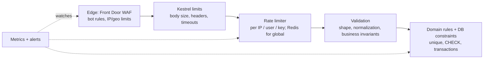

# Validation & Abuse Protection — Overview
[← Topic](../README.md)

**TECH:** built-in Minimal API validation + FluentValidation, normalization helpers, Kestrel/JSON/regex limits, the ASP.NET Core rate limiting middleware with Redis for distributed limits, Front Door WAF at the edge, signed webhook verification (Stripe)
**LEVEL:** intermediate (mid-level, new to C# and .NET)

## Why this matters in production
- Every public endpoint will be called with inputs nobody intended: huge bodies, malformed Unicode, negative quantities, 10,000-item arrays.
- Abuse is a business problem as much as a security one: card testing costs fees and gets your Stripe account flagged, SMS pumping burns the budget overnight, coupon abuse eats margins.
- Rate limits that only exist per instance disappear when you scale out; real protection needs shared state or the edge.

## Mental model

Each layer is cheaper than the next: reject early, but keep the final rules in the domain and database.

## Prerequisites
- [02-api-design](../../02-api-design/README.md) lesson 03 (validation), [01-foundations/06-security](../../../01-foundations/06-security/README.md) lesson 04 (rate limiting basics), [04-auth](../../04-auth/README.md).

## Lesson map
| Lesson | Checklist items |
|:--|:--|
| [01 · Validating at the boundary, normalization, limits, and over-posting](01-boundary-normalization-limits.md) | 1, 2, 3, 4, 9 |
| [02 · Rate limiting: strategies, the middleware, and Redis](02-rate-limiting.md) | 5, 6, 7 |
| [03 · Webhooks, bots, business-logic abuse, and monitoring](03-webhooks-bots-business-abuse.md) | 8, 10, 11, 12 |
| [Cheatsheet](cheatsheet.md) | all |

## Suggested order
1. 01 → 03.
2. Then [06-caching](../../06-caching/README.md) (Redis basics used here) and [12-integrations](../../12-integrations/README.md) (Stripe).
3. Ready to build: `/learn csharp/03-backend/05-validation-abuse mode=tasks`.

## Version notes
- ASP.NET Core 10's `AddValidation()` validates Minimal API parameters with DataAnnotations; FluentValidation 12 is still free.
- The built-in rate limiters are in-memory per instance; distributed limits need Redis (custom limiter or a library such as RedisRateLimiting) or edge rules.
- .NET's `Regex` supports `matchTimeout` and `RegexOptions.NonBacktracking` (linear time) to prevent ReDoS.
- The IETF `RateLimit` / `RateLimit-Policy` header fields are a draft standard; many APIs still send `RateLimit-Limit/-Remaining/-Reset`.

## Sources
- [Rate limiting middleware](https://learn.microsoft.com/aspnet/core/performance/rate-limit)
- [OWASP — Input Validation Cheat Sheet](https://cheatsheetseries.owasp.org/cheatsheets/Input_Validation_Cheat_Sheet.html)
- [OWASP — Automated Threats to Web Applications](https://owasp.org/www-project-automated-threats-to-web-applications/)
- [Stripe — Webhook signatures](https://docs.stripe.com/webhooks#verify-events)
- [Azure Front Door WAF](https://learn.microsoft.com/azure/web-application-firewall/afds/afds-overview)
