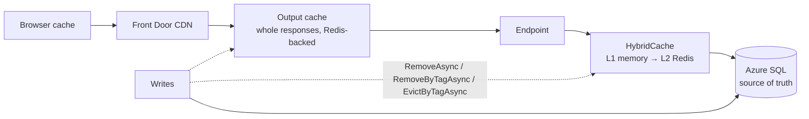

# Caching — Overview
[← Topic](../README.md)

**TECH:** `HybridCache` (in-memory L1 + Redis L2) as the default application cache, `IMemoryCache` for tiny local lookups, the output caching middleware (Redis-backed) for whole responses, HTTP caching headers for browsers/CDN; Redis 8 locally, Azure Managed Redis in the cloud
**LEVEL:** intermediate (mid-level, new to C# and .NET)

## Why this matters in production
- The course's performance module centers on caching: a cache in front of a hot query can cut SQL load by 90% and p99 latency by an order of magnitude.
- Done wrong, caches serve stale prices, leak personalized data between users, or collapse the database when a hot key expires (stampede).
- .NET has several caching APIs that look alike. Choosing the right layer matters more than tuning any of them.

## Mental model

Every cache entry needs answers to three questions: how is it keyed, when does it become wrong, and what happens when it's missing.

## Prerequisites
- [01-foundations/02-http-networking](../../../01-foundations/02-http-networking/README.md) lesson 04 (HTTP caching), [03-databases](../../03-databases/README.md), Redis running locally (Compose).

## Lesson map
| Lesson | Checklist items |
|:--|:--|
| [01 · Where to cache, cache-aside, and the .NET caching APIs](01-where-cache-aside-apis.md) | 1, 2, 3 |
| [02 · Invalidation, stampedes, and write patterns](02-invalidation-stampedes-writes.md) | 4, 5, 7 |
| [03 · Output caching and HTTP caching for APIs](03-output-http-caching.md) | 8, 9 |
| [04 · Redis structures, operations, measurement, and pitfalls](04-redis-ops-measuring-pitfalls.md) | 6, 10, 11, 12 |
| [Cheatsheet](cheatsheet.md) | all |

## Suggested order
1. 01 → 04.
2. Then [09-scalability](../../09-scalability/README.md) and [07-background-jobs](../../07-background-jobs/README.md).
3. Ready to build: `/learn csharp/03-backend/06-caching mode=tasks`.

## Version notes
- `HybridCache` (GA with .NET 9, package `Microsoft.Extensions.Caching.Hybrid`) combines L1 memory and L2 `IDistributedCache`, adds stampede protection, configurable serialization, and tag-based invalidation (`RemoveByTagAsync`).
- Output caching middleware (.NET 7+) supports tags, vary-by rules, locking, and a Redis store (`Microsoft.AspNetCore.OutputCaching.StackExchangeRedis`).
- Azure Cache for Redis is being retired; new deployments use Azure Managed Redis. Local Redis 8 and the cloud's Redis version can differ, so stick to widely supported commands.

## Sources
- [Caching in .NET overview](https://learn.microsoft.com/dotnet/core/extensions/caching)
- [HybridCache library](https://learn.microsoft.com/aspnet/core/performance/caching/hybrid)
- [Output caching middleware](https://learn.microsoft.com/aspnet/core/performance/caching/output)
- [Distributed caching in ASP.NET Core](https://learn.microsoft.com/aspnet/core/performance/caching/distributed)
- [Azure Managed Redis](https://learn.microsoft.com/azure/redis/overview)
