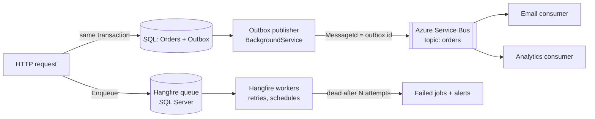

# Background Jobs & Messaging — Overview
[← Topic](../README.md)

**TECH:** `BackgroundService` + `System.Threading.Channels` for in-process work, Hangfire on SQL Server for durable jobs (fire-and-forget, delayed, recurring, continuations), the transactional outbox, and Azure Service Bus for messages between services
**LEVEL:** intermediate (mid-level, new to C# and .NET)

## Why this matters in production
- Anything slow, retryable, or scheduled (emails, payment reconciliation, exports, webhooks) must leave the request path or it causes timeouts and duplicate work.
- "Fire and forget" inside a request loses work on every deploy and every crash.
- Messaging is where distributed-systems problems show up first: duplicates, ordering, partial failure. Idempotency and the outbox are the core patterns.
- Licensing changed in 2025–2026: MassTransit 9 is commercial; this stack uses Hangfire (LGPL, free storage on SQL Server) and the plain Azure Service Bus SDK.

## Mental model

Use the right tool: Channels for in-process, losable work; Hangfire for durable jobs inside one app; Service Bus for messages between services or high-volume async processing.

## Prerequisites
- [01-language-runtime](../../01-language-runtime/README.md) lessons 04 and 06 (async, hosted services), [03-databases](../../03-databases/README.md) lesson 03 (transactions).

## Lesson map
| Lesson | Checklist items |
|:--|:--|
| [01 · Why background work, BackgroundService, Channels, and shutdown](01-why-builtin-shutdown.md) | 1, 2, 10 |
| [02 · Hangfire: jobs, retries, schedules, continuations](02-hangfire.md) | 3, 4, 6, 8 |
| [03 · Idempotent jobs, concurrency, priorities, and failures](03-idempotency-concurrency-failures.md) | 5, 7, 9 |
| [04 · The transactional outbox](04-outbox.md) | 11 |
| [05 · Azure Service Bus, messaging options, and monitoring queues](05-service-bus-messaging-monitoring.md) | 12, 13, 14, 15 |
| [Cheatsheet](cheatsheet.md) | all |

## Suggested order
1. 01 → 05.
2. Then [08-reliability](../../08-reliability/README.md) and [06-design/07-distributed-systems](../../../06-design/07-distributed-systems/README.md).
3. Ready to build: `/learn csharp/03-backend/07-background-jobs mode=tasks`.

## Version notes
- Hangfire 1.8 (latest Hangfire.SqlServer 1.8.25) uses Microsoft.Data.SqlClient, supports `CancellationToken` in job methods, and needs `SetDataCompatibilityLevel(Version_180)`. Hangfire Pro (batches, Redis storage) is commercial; the core is LGPL-3.0.
- Azure Service Bus has a local emulator (Docker) for development; the SDK is `Azure.Messaging.ServiceBus` with `DefaultAzureCredential`.
- MassTransit 9 is commercial (v8 stays open source with security fixes through 2026); open-source alternatives: Wolverine, Rebus, Brighter.

## Sources
- [Background tasks with hosted services](https://learn.microsoft.com/aspnet/core/fundamentals/host/hosted-services)
- [Hangfire documentation](https://docs.hangfire.io/)
- [Azure Service Bus messaging overview](https://learn.microsoft.com/azure/service-bus-messaging/service-bus-messaging-overview)
- [Transactional outbox pattern](https://learn.microsoft.com/azure/architecture/databases/guide/transactional-outbox-cosmos)
- [System.Threading.Channels](https://learn.microsoft.com/dotnet/core/extensions/channels)
