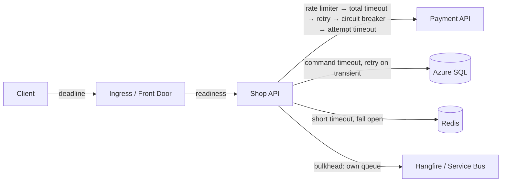

# Reliability & Resilience — Overview
[← Topic](../README.md)

**TECH:** Microsoft.Extensions.Http.Resilience (resilience pipelines on Polly 8) for outgoing HTTP, Polly pipelines for other dependencies, ASP.NET Core request timeouts and rate limiting, ASP.NET Core health checks, the generic host's graceful shutdown, Hangfire for retrying work, Azure Container Apps probes and revisions
**LEVEL:** intermediate (mid-level, new to C# and .NET)

## Why this matters in production
- Most outages aren't your code crashing. A dependency gets slow, requests pile up, threads and connections run out, and the whole API goes down with it.
- One missing timeout or one retry storm can turn a 2-minute partner blip into a 40-minute outage.
- Deploys are the most common cause of incidents; graceful shutdown and good health probes make them invisible to users.

## Mental model

For every dependency, answer four questions: how long do we wait (timeout), do we try again (retry), when do we stop trying (circuit breaker), and what do we return instead (fallback)?

## Prerequisites
- [01-language-runtime](../../01-language-runtime/README.md) (async and `CancellationToken`), [02-api-design](../../02-api-design/README.md), [06-caching](../../06-caching/README.md), [07-background-jobs](../../07-background-jobs/README.md).

## Lesson map
| Lesson | Checklist items |
|:--|:--|
| [01 · Failure modes, timeouts, and retries](01-failure-timeouts-retries.md) | 1, 2, 3 |
| [02 · Resilience pipelines, circuit breakers, and IHttpClientFactory](02-resilience-pipelines-httpclient.md) | 4, 5, 8 |
| [03 · Health checks and graceful shutdown](03-health-checks-shutdown.md) | 6, 7 |
| [04 · Bulkheads, load shedding, degradation, and outages](04-bulkheads-shedding-degradation.md) | 9, 10, 11, 13 |
| [05 · SLOs, error budgets, and testing failure](05-slos-testing-failure.md) | 12, 14 |
| [Cheatsheet](cheatsheet.md) | all |

## Suggested order
1. 01 → 05.
2. Then [09-scalability](../../09-scalability/README.md) and [10-observability](../../10-observability/README.md).
3. Ready to build: `/learn csharp/03-backend/08-reliability mode=tasks`.

## Version notes
- Microsoft.Extensions.Http.Resilience replaces Microsoft.Extensions.Http.Polly (Polly v7 style `AddTransientHttpErrorPolicy`). Treat the old package as `avoid` in new code.
- Polly 8 uses *resilience pipelines* built from *strategies*, and replaces v7 policies. Polly 8.3+ adds chaos strategies (`AddChaosLatency`, `AddChaosFault`, `AddChaosOutcome`, `AddChaosBehavior`).
- Request timeouts middleware (`AddRequestTimeouts`, .NET 8+) and rate limiting middleware (`AddRateLimiter`, .NET 7+) are built into ASP.NET Core.
- `HostOptions.ShutdownTimeout` defaults to 30 seconds. Container Apps waits for its termination grace period (commonly 30 s), then sends SIGKILL.

## Sources
- [Introduction to resilient app development (.NET)](https://learn.microsoft.com/dotnet/core/resilience/)
- [Build resilient HTTP apps](https://learn.microsoft.com/dotnet/core/resilience/http-resilience)
- [Polly documentation](https://www.pollydocs.org/)
- [Health checks in ASP.NET Core](https://learn.microsoft.com/aspnet/core/host-and-deploy/health-checks)
- [Google SRE book — Addressing cascading failures](https://sre.google/sre-book/addressing-cascading-failures/)
