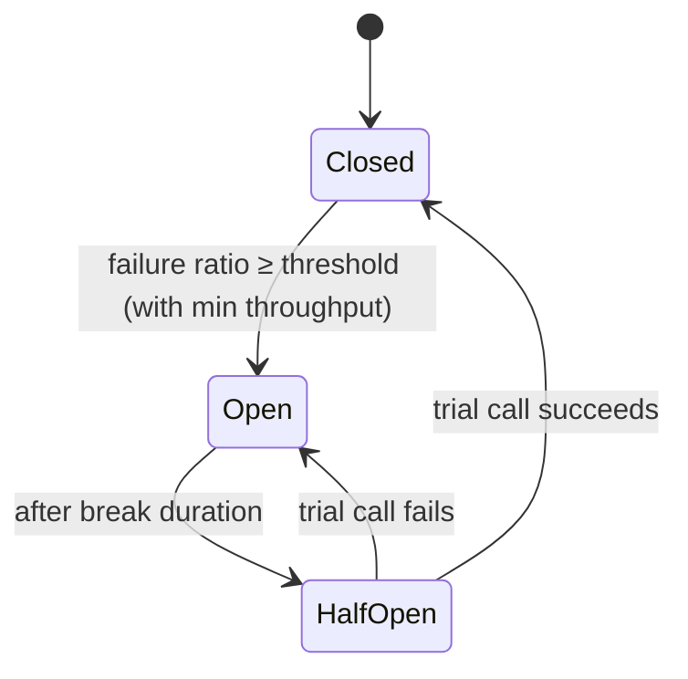

# Resilience pipelines, circuit breakers, and IHttpClientFactory
[← Overview](00-overview.md)

## Why it matters
- `new HttpClient()` per request works in development. Under load it leaves thousands of sockets in TIME_WAIT, and calls start failing with "address already in use" (socket exhaustion).
- A single static `HttpClient` never sees DNS changes, so after the partner fails over to a new IP, the shop keeps calling the old one.
- Without a circuit breaker, every request keeps hammering a dead partner for the full timeout, and users wait 10 s just to see an error.

## Concepts

### IHttpClientFactory
| Style | Registration | Use |
|:--|:--|:--|
| ⭐ typed client | `AddHttpClient<ShippingClient>(c => c.BaseAddress = ...)` | one class per external API (the adapter) |
| named client | `AddHttpClient("github", ...)` + `factory.CreateClient("github")` | quick, config-driven |
| defaults for all | `ConfigureHttpClientDefaults(b => b.AddStandardResilienceHandler())` | baseline resilience everywhere |

How it works: the factory pools `HttpMessageHandler`s and rotates them every `HandlerLifetime` (default 2 minutes). Pooling avoids socket exhaustion and rotation picks up DNS changes. Typed clients are registered as **transient**: don't capture one in a singleton, or it keeps one handler forever.
Without DI (console tools), use one static `HttpClient` with `SocketsHttpHandler { PooledConnectionLifetime = TimeSpan.FromMinutes(2) }`.

### Resilience pipelines
A pipeline is an ordered stack of strategies. The standard handler, outermost first:
| # | Strategy | Default | Purpose |
|:--|:--|:--|:--|
| 1 | rate limiter | 1,000 concurrent, queue 0 | cap concurrency to the dependency |
| 2 | ⭐ total timeout | 30 s | bound everything, retries included |
| 3 | ⭐ retry | 3 retries, exponential, jitter, 2 s base | ride out transient failures |
| 4 | ⭐ circuit breaker | 10% failures, min 100 requests in 30 s, break 5 s | fail fast when the dependency is sick |
| 5 | ⭐ attempt timeout | 10 s | bound each try |

Retry and circuit breaker handle 5xx, 408, 429, `HttpRequestException`, and Polly's `TimeoutRejectedException`. By default the standard handler retries **all** methods, so call `options.Retry.DisableForUnsafeHttpMethods()` (no retry for POST, PUT, PATCH, DELETE, CONNECT) or `DisableFor(HttpMethod.Post)` unless your calls are idempotent.

Add only **one** resilience handler per client. Use `AddResilienceHandler("name", b => ...)` for custom stacks, and `RemoveAllResilienceHandlers()` to replace defaults.

### Circuit breakers

While the circuit is open, calls fail at once with `BrokenCircuitException`. Catch it and fall back (lesson 04) instead of returning a 500.

### Hedging
`AddStandardHedgingHandler()` sends a second request in parallel when the first is slow (default delay 2 s, up to 10 attempts, optional endpoint groups). It cuts tail latency for **idempotent reads** at the cost of extra load. Never hedge payments.

### Non-HTTP pipelines
Polly.Extensions: `services.AddResiliencePipeline("redis-read", b => b.AddTimeout(TimeSpan.FromMilliseconds(300)))`, then inject `ResiliencePipelineProvider<string>` and call `pipeline.ExecuteAsync(...)`.

## Example
`src/Shop.Infrastructure/Shipping/ShippingClient.cs`
```csharp
using System.Net.Http.Json;

public sealed class ShippingClient(HttpClient http)
{
    public async Task<ShippingQuote[]> GetQuotesAsync(QuoteRequest req, CancellationToken ct)
    {
        using var resp = await http.PostAsJsonAsync("v2/quotes", req, ct);   // quotes are read-only on the partner side
        resp.EnsureSuccessStatusCode();
        return await resp.Content.ReadFromJsonAsync<ShippingQuote[]>(ct) ?? [];
    }
}
```
`src/Shop.Api/Program.cs`
```csharp
using Microsoft.Extensions.Http.Resilience;

builder.Services.AddHttpClient<ShippingClient>(c =>
    {
        c.BaseAddress = new Uri(builder.Configuration["Shipping:BaseUrl"]!);
        c.Timeout = Timeout.InfiniteTimeSpan;                 // let the pipeline's total timeout decide
    })
    .AddStandardResilienceHandler(o =>
    {
        o.TotalRequestTimeout.Timeout = TimeSpan.FromSeconds(5);
        o.AttemptTimeout.Timeout = TimeSpan.FromSeconds(2);
        o.Retry.MaxRetryAttempts = 2;
        o.CircuitBreaker.SamplingDuration = TimeSpan.FromSeconds(10);   // must be ≥ 2 × attempt timeout
        o.CircuitBreaker.MinimumThroughput = 20;
        o.CircuitBreaker.BreakDuration = TimeSpan.FromSeconds(15);
    });

builder.Services.AddHttpClient<PaymentsClient>(c => c.BaseAddress = new Uri(builder.Configuration["Payments:BaseUrl"]!))
    .AddStandardResilienceHandler(o => o.Retry.DisableForUnsafeHttpMethods());   // POST /charges: no blind retries
```
Options validation checks the combination at startup: for example, the attempt timeout must be shorter than the total timeout.

## Production patterns
- One typed client per external API, with its base address, auth handler, and resilience options from configuration (named options make tuning possible without a redeploy).
- Tune per dependency: payments get short timeouts and no retries on POST; catalog reads get hedging or retries.
- Telemetry: the resilience packages emit metrics (`resilience.polly.strategy.events`) and logs. Alert when circuits open (10-observability).
- `ConfigureHttpClientDefaults` for a baseline, overridden where needed.

## Mistakes
Wrong:
```csharp
using var http = new HttpClient();                         // per call: socket exhaustion
var quotes = await http.GetFromJsonAsync<Quote[]>(url);
```
Right: a typed client from `AddHttpClient<T>()`.

Wrong: stacking `AddStandardResilienceHandler()` and `AddResilienceHandler(...)` on one client.
Right: one handler per client; customise the standard one, or replace it.

Wrong: `services.AddSingleton<CheckoutService>()` that takes a typed `ShippingClient` in its constructor.
Right: make the consumer scoped or transient, or inject `IHttpClientFactory` and create clients per use.

## Check yourself
1. Which two problems does `IHttpClientFactory` solve?
2. What does the circuit breaker do while open, and what should your code do?
3. Why disable retries for unsafe methods on the payments client?

<details><summary>Answers</summary>

1. Socket exhaustion (from creating and disposing clients per request) and stale DNS (from one handler living forever). It pools handlers and rotates them.
2. It rejects calls straight away with `BrokenCircuitException`, without calling the dependency. Catch it and degrade: a fallback, a cached value, or a clear 503 with `Retry-After`.
3. A POST that timed out may have succeeded. Retrying could charge the customer twice unless the call carries an idempotency key.
</details>

## Sources
- [Build resilient HTTP apps (Microsoft.Extensions.Http.Resilience)](https://learn.microsoft.com/dotnet/core/resilience/http-resilience)
- [IHttpClientFactory with .NET](https://learn.microsoft.com/dotnet/core/extensions/httpclient-factory)
- [HttpClient guidelines for .NET](https://learn.microsoft.com/dotnet/fundamentals/networking/http/httpclient-guidelines)
- [Polly — Circuit breaker](https://www.pollydocs.org/strategies/circuit-breaker)
- [Polly — Hedging](https://www.pollydocs.org/strategies/hedging)
- [Circuit Breaker pattern (Azure Architecture Center)](https://learn.microsoft.com/azure/architecture/patterns/circuit-breaker)
