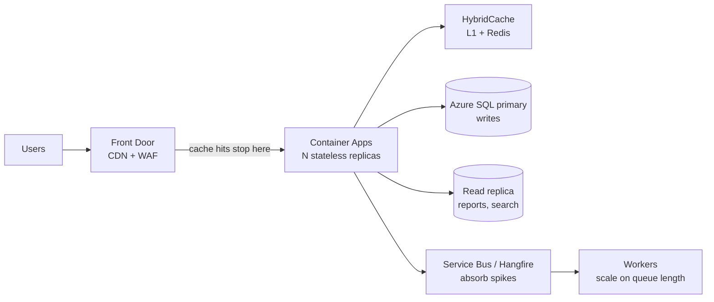

# Scalability & Performance — Overview
[← Topic](../README.md)

**TECH:** k6 for load tests, BenchmarkDotNet for micro-benchmarks, `dotnet-counters` / `dotnet-trace` for runtime analysis, Azure Container Apps scale rules for horizontal scaling, YARP and Azure Front Door for traffic, Azure SQL (with read replicas) and Redis for data scaling, SignalR with Azure SignalR Service for real time
**LEVEL:** intermediate (mid-level, new to C# and .NET)

## Why this matters in production
- Performance problems show up as lost revenue first: slower checkouts convert worse, and timeouts look like outages.
- Most slowness is in a few places: one missing index, an N+1 query, a chatty external call. You find them by measuring, not guessing.
- Scaling out only works if the app is stateless and the database can take the extra connections. Otherwise more replicas make things worse.

## Mental model

Measure → find the bottleneck → fix the biggest one → measure again. Scale out only after the per-replica cost is reasonable.

## Prerequisites
- [03-databases](../../03-databases/README.md) (indexes, query plans), [06-caching](../../06-caching/README.md), [07-background-jobs](../../07-background-jobs/README.md), [08-reliability](../../08-reliability/README.md).

## Lesson map
| Lesson | Checklist items |
|:--|:--|
| [01 · Measuring and load testing with k6](01-measure-load-testing.md) | 1, 2, 14 |
| [02 · BenchmarkDotNet and .NET runtime performance](02-benchmarks-dotnet-performance.md) | 3, 8 |
| [03 · Stateless scaling, load balancing, and real-time connections](03-horizontal-scaling-load-balancing.md) | 4, 5, 13 |
| [04 · Scaling the database and offloading reads](04-database-scaling-reads.md) | 6, 7, 9 |
| [05 · Queues, capacity planning, payloads, and batching](05-queues-capacity-payloads.md) | 10, 11, 12 |
| [Cheatsheet](cheatsheet.md) | all |

## Suggested order
1. 01 → 05.
2. Then [10-observability](../../10-observability/README.md) to see these numbers in production.
3. Ready to build: `/learn csharp/03-backend/09-scalability mode=tasks`.

## Version notes
- k6 1.0 (2025) is the first stable major. It runs TypeScript test files directly and keeps the `k6/http`, scenarios, and thresholds APIs.
- BenchmarkDotNet 0.15.x supports .NET 10. Always run benchmarks in Release, outside the debugger.
- .NET 9+ turns on DATAS (Dynamic Adaptation To Application Sizes) for Server GC by default, which shrinks the heap for small containers. Check memory limits after upgrading.
- Azure Container Apps scale rules are KEDA-based: HTTP concurrency (default 10 concurrent requests per replica), CPU/memory, and event sources such as Service Bus queue length.

## Sources
- [ASP.NET Core performance best practices](https://learn.microsoft.com/aspnet/core/fundamentals/best-practices)
- [Grafana k6 documentation](https://grafana.com/docs/k6/latest/)
- [BenchmarkDotNet](https://benchmarkdotnet.org/)
- [Scaling in Azure Container Apps](https://learn.microsoft.com/azure/container-apps/scale-app)
- [YARP documentation](https://learn.microsoft.com/aspnet/core/fundamentals/servers/yarp/yarp-overview)
