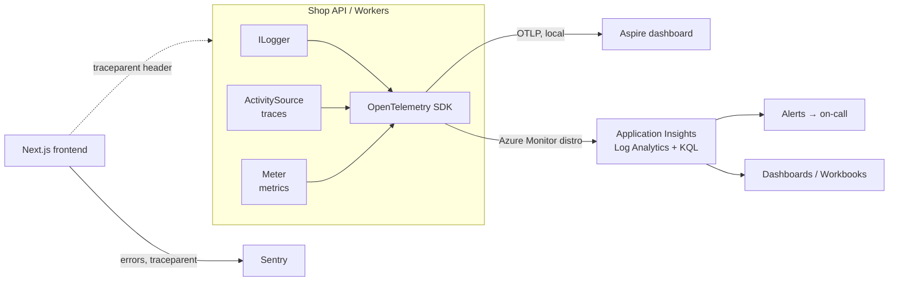

# Observability — Overview
[← Topic](../README.md)

**TECH:** `ILogger` with `[LoggerMessage]` source generation for logs; OpenTelemetry .NET for traces, metrics, and log export; the Aspire dashboard locally (OTLP); the Azure Monitor OpenTelemetry Distro sending to Application Insights and Log Analytics (KQL) in the cloud; Sentry for frontend errors; Serilog as a known alternative
**LEVEL:** intermediate (mid-level, new to C# and .NET)

## Why this matters in production
- When checkout fails at 02:00, you can only fix what you can see. Telemetry turns "it's slow" into "the payment call's p99 went from 300 ms to 8 s at 01:52".
- Without trace IDs in logs, debugging across the frontend, API, workers, and Service Bus is guesswork.
- Telemetry costs money and can leak personal data. Sampling, cardinality, and redaction are part of the design, not an afterthought.

## Mental model

Instrument once with OpenTelemetry, then choose the destination per environment. The code doesn't change when you switch from the Aspire dashboard to Application Insights.

## Prerequisites
- [08-reliability](../../08-reliability/README.md) (SLOs), [09-scalability](../../09-scalability/README.md) (latency percentiles), [07-background-jobs](../../07-background-jobs/README.md) (queues to monitor).

## Lesson map
| Lesson | Checklist items |
|:--|:--|
| [01 · Signals, structured logging with ILogger, and Serilog](01-signals-structured-logging.md) | 1, 2, 15 |
| [02 · Traces and metrics with OpenTelemetry](02-opentelemetry-traces-metrics.md) | 3, 4, 5, 6 |
| [03 · Aspire dashboard, Application Insights, and error tracking](03-aspire-app-insights-errors.md) | 7, 8, 9 |
| [04 · Dashboards, alerts, and business metrics](04-dashboards-alerts-business.md) | 10, 11, 13 |
| [05 · Sampling, cost, and privacy in telemetry](05-sampling-cost-privacy.md) | 12, 14 |
| [Cheatsheet](cheatsheet.md) | all |

## Suggested order
1. 01 → 05.
2. Then [04-shipping/06-incident-response](../../../04-shipping/06-incident-response/README.md), where alerts and dashboards get used.
3. Ready to build: `/learn csharp/03-backend/10-observability mode=tasks`.

## Version notes
- The **classic Application Insights SDK** (`Microsoft.ApplicationInsights.AspNetCore`, `TelemetryClient`) is in maintenance. New apps use the Azure Monitor OpenTelemetry Distro (`Azure.Monitor.OpenTelemetry.AspNetCore`, `UseAzureMonitor()`).
- Distro 1.5.0 (April 2026) changed the default sampling from 100% to rate-limited (5 traces per second). Set `TracesPerSecond` or `SamplingRatio` on purpose.
- The Aspire dashboard runs standalone in Docker and accepts any OTLP data; you don't need an Aspire AppHost to use it. "Aspire" dropped the ".NET" prefix with version 13.
- ASP.NET Core 8+ emits built-in metrics (`http.server.request.duration`, `kestrel.*`) that follow OpenTelemetry semantic conventions.

## Sources
- [.NET observability with OpenTelemetry](https://learn.microsoft.com/dotnet/core/diagnostics/observability-with-otel)
- [OpenTelemetry .NET](https://opentelemetry.io/docs/languages/dotnet/)
- [Enable Azure Monitor OpenTelemetry for .NET](https://learn.microsoft.com/azure/azure-monitor/app/opentelemetry-enable)
- [Standalone Aspire dashboard](https://learn.microsoft.com/dotnet/aspire/fundamentals/dashboard/standalone)
- [ASP.NET Core built-in metrics](https://learn.microsoft.com/aspnet/core/log-mon/metrics/built-in)
