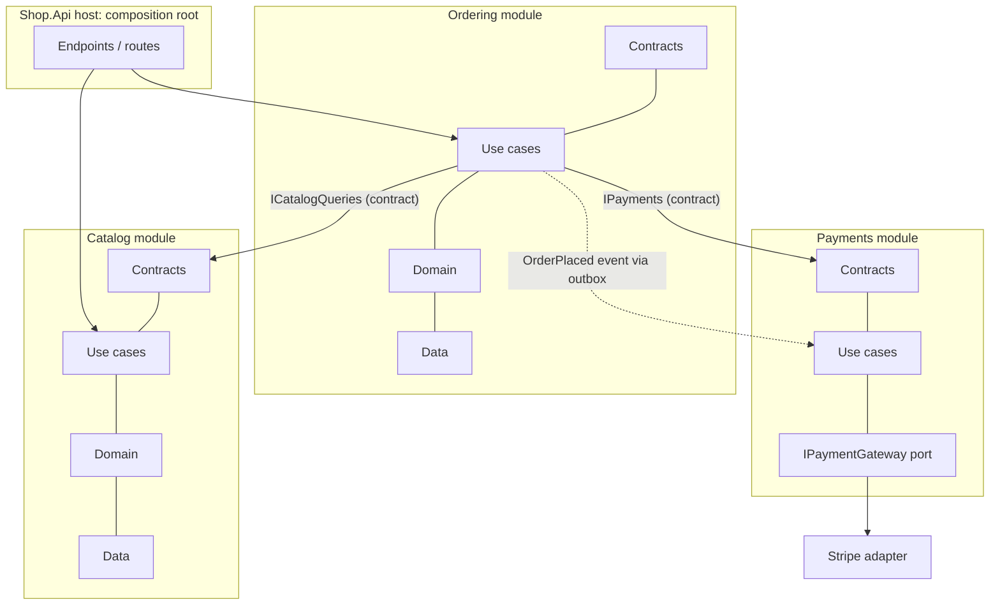

# Architecture — Overview
[← Topic](../README.md)

**TECH:** a modular monolith in ASP.NET Core 10: feature modules with public contracts, the built-in DI container with one registration method per module, plain C# domain types (records, value objects, results), ports and adapters for external services, domain events with the EF Core outbox, Mapperly or hand-written mapping, NetArchTest for architecture tests, ADRs in the repo
**LEVEL:** intermediate (mid-level, new to C# and .NET)

## Why this matters in production
- Architecture decides how expensive the next change is. In a tangled codebase, a "small" discount feature touches 30 files in 8 folders and breaks checkout.
- .NET teams often copy heavy templates (four projects, MediatR, AutoMapper, repositories over EF Core) for a CRUD app. The ceremony slows every change, and two of those libraries are now commercial.
- Splitting into microservices too early creates a distributed monolith: all the costs of a network, none of the independence.

## Mental model

Modules talk only through contracts or events. Inside a module, dependencies point inward: routes → use cases → domain; data access and adapters plug into ports.

## Prerequisites
- [02-api-design](../../02-api-design/README.md), [03-databases](../../03-databases/README.md), [07-background-jobs](../../07-background-jobs/README.md) (outbox). Concept background: [06-design](../../../06-design/README.md).

## Lesson map
| Lesson | Checklist items |
|:--|:--|
| [01 · Modular monolith, layers, and feature modules](01-modular-monolith-layers-modules.md) | 1, 2, 3 |
| [02 · Dependency injection and the composition root](02-dependency-injection.md) | 4 |
| [03 · Domain logic, error architecture, and ports and adapters](03-domain-errors-ports.md) | 5, 6, 7 |
| [04 · Events between modules and consistency boundaries](04-events-transactions.md) | 8, 13 |
| [05 · Mediators, mappers, and Clean Architecture templates](05-mediators-mappers-templates.md) | 9, 10 |
| [06 · Microservices, decisions, and enforcing boundaries](06-microservices-adrs-boundaries.md) | 11, 12, 14 |
| [Cheatsheet](cheatsheet.md) | all |

## Suggested order
1. 01 → 06.
2. Then the concept topics in [06-design](../../../06-design/README.md) (SOLID, patterns, DDD, architecture styles).
3. Ready to build: `/learn csharp/03-backend/11-architecture mode=tasks`.

## Version notes
- MediatR 13+ and AutoMapper 15+ need a commercial licence for most companies (free community tier for small companies). Older versions stay MIT but get no new features. This stack uses plain services and Mapperly (MIT, source generator).
- Keyed services (`AddKeyedScoped`, `[FromKeyedServices]`) are built into Microsoft.Extensions.DependencyInjection since .NET 8.
- Earlier lessons use three projects (`Shop.Api`, `Shop.Application`, `Shop.Infrastructure`) to keep examples short. This topic shows how the same code is organised by module.

## Sources
- [Common web application architectures (.NET)](https://learn.microsoft.com/dotnet/architecture/modern-web-apps-azure/common-web-application-architectures)
- [Dependency injection in .NET](https://learn.microsoft.com/dotnet/core/extensions/dependency-injection)
- [Modular monolith with DDD (sample)](https://github.com/kgrzybek/modular-monolith-with-ddd)
- [Martin Fowler — MonolithFirst](https://martinfowler.com/bliki/MonolithFirst.html)
- [Mapperly documentation](https://mapperly.riok.app/)
