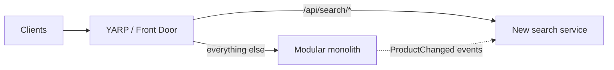

# Microservices, decisions, and enforcing boundaries
[← Overview](00-overview.md)

## Why it matters
- The shop split into eight services. Placing an order needed five synchronous calls; one slow service took down checkout, and every feature needed coordinated deploys: a distributed monolith.
- Nobody remembered why Hangfire was chosen over Service Bus for emails. A new lead replaced it, and the original reason (no extra Azure cost during the MVP) came back as a surprise bill.
- The module boundaries existed only in a diagram. Six months later, Ordering referenced 40 Catalog internals and the boundaries were fiction.

## Concepts

### Monolith vs microservices
| Factor | Modular monolith | Microservices |
|:--|:--|:--|
| deploys | one | many, independent |
| calls between parts | in-process (fast, reliable) | network (latency, failures, retries, versioning) |
| data | one database, schemas per module | a database per service; no shared tables |
| consistency | local transactions possible | eventual consistency, sagas |
| operations | one app to monitor | tracing, service discovery, many pipelines |
| team scaling | good up to several teams with module ownership | many teams that must ship independently |

**Split a module out when** you have a concrete reason: very different scaling or resource needs, a separate team that is blocked by shared releases, a different security or compliance boundary, or a different technology need. Not because "microservices are modern".

**Distributed-monolith signs:** services that must deploy together, chains of synchronous calls per request, a shared database, shared libraries that force lockstep upgrades, and changes that touch several services every time.

### Recording and evolving decisions
| Tool | Use |
|:--|:--|
| ⭐ ADR (Architecture Decision Record) | one short Markdown file per significant decision: context, decision, consequences, status |
| location | `docs/adr/0007-hangfire-for-background-jobs.md`, numbered, never deleted |
| status | Proposed → Accepted → Superseded by ADR-0012 |
| when | choices that are costly to reverse: databases, messaging, auth, module boundaries, major libraries |
| STACK.md decision log | this repo's lightweight equivalent for stack choices |

**Strangler fig:** replace or extract a part gradually. Put a routing layer (YARP or Front Door) in front, send one route at a time to the new implementation, and remove the old code when no traffic reaches it.


### Enforcing boundaries
| Mechanism | Enforces |
|:--|:--|
| ⭐ one project per module (+ a Contracts project) | other modules can only reference what the project graph allows |
| ⭐ `internal` by default | only contracts and the module's registration class are public |
| `InternalsVisibleTo` | the module's own test project can see internals |
| ⭐ architecture tests (NetArchTest, ArchUnitNET) | rules the compiler can't check: domain has no EF Core dependency, handlers are internal, naming |
| separate schemas / DbContexts | no cross-module SQL |
| ⭐ CODEOWNERS | changes to a module need its owners' review |
| `Directory.Build.props` / analyzers | shared rules across all projects |

## Example
`src/Modules/Ordering/Shop.Ordering/Shop.Ordering.csproj` (excerpt)
```xml
<ItemGroup>
  <ProjectReference Include="..\Shop.Ordering.Contracts\Shop.Ordering.Contracts.csproj" />
  <ProjectReference Include="..\..\Catalog\Shop.Catalog.Contracts\Shop.Catalog.Contracts.csproj" />  <!-- contracts only -->
  <ProjectReference Include="..\..\..\Shared\Shop.SharedKernel\Shop.SharedKernel.csproj" />
  <InternalsVisibleTo Include="Shop.Ordering.Tests" />
</ItemGroup>
```
`tests/Shop.ArchitectureTests/OrderingArchitectureTests.cs`
```csharp
using NetArchTest.Rules;

public sealed class OrderingArchitectureTests
{
    private static readonly System.Reflection.Assembly Ordering = typeof(OrderingModule).Assembly;

    [Fact]
    public void Domain_has_no_framework_dependencies()
    {
        var result = Types.InAssembly(Ordering)
            .That().ResideInNamespace("Shop.Ordering.Domain")
            .ShouldNot().HaveDependencyOnAny("Microsoft.EntityFrameworkCore", "Microsoft.AspNetCore", "Stripe")
            .GetResult();

        result.IsSuccessful.ShouldBeTrue(string.Join(", ", result.FailingTypeNames ?? []));
    }

    [Fact]
    public void Only_the_module_entry_point_is_public()
    {
        var result = Types.InAssembly(Ordering)
            .That().DoNotHaveName(nameof(OrderingModule))
            .Should().NotBePublic()
            .GetResult();

        result.IsSuccessful.ShouldBeTrue(string.Join(", ", result.FailingTypeNames ?? []));
    }
}
```
`docs/adr/0007-hangfire-for-background-jobs.md`
```markdown
# 7. Hangfire for background jobs

Status: Accepted (2026-03-02)

## Context
We need retries, schedules, and a dashboard for emails, exports, and reconciliation. Traffic is low; Azure SQL already exists.

## Decision
Use Hangfire 1.8 with SQL Server storage in the same database. Use Service Bus only for integration events between services, when we have any.

## Consequences
- No extra Azure resource or cost; jobs share SQL capacity (monitor it).
- Dashboard must be secured behind the admin policy.
- Revisit if job volume exceeds ~50/s or a second service needs the jobs (ADR to supersede).
```
`.github/CODEOWNERS`
```text
/src/Modules/Ordering/   @your-org/ordering-team
/src/Modules/Payments/   @your-org/payments-team
/docs/adr/               @your-org/architects
```

## Production patterns
- A modular monolith by default; extraction is a decision with an ADR, a reason from the list above, and a strangler-fig plan.
- Boundaries enforced by the compiler (projects, `internal`), by tests (architecture tests in CI), and by people (CODEOWNERS).
- ADRs are short (one page), written when deciding, reviewed in PRs, and superseded rather than edited when things change.

## Mistakes
Wrong: "Let's do microservices so teams can work independently", with one team of four.
Right: modules with owners inside one deployable; split when a real constraint appears.

Wrong: decisions recorded only in chat threads.
Right: an ADR per costly-to-reverse decision, linked from the code it affects.

## Check yourself
1. Name three signs of a distributed monolith.
2. What goes into an ADR?
3. Which three mechanisms enforce module boundaries in .NET, and which needs tests?

<details><summary>Answers</summary>

1. Any three of: services that must deploy together, synchronous call chains for one user request, a shared database, shared libraries that force lockstep upgrades, and features that always touch several services.
2. A title and number, status, context (forces and constraints), the decision, and consequences (good and bad), plus a date and links to superseding decisions.
3. Project references (only Contracts are referenced), `internal` visibility, and rules beyond visibility (such as "the domain has no EF Core dependency" or naming rules), which need architecture tests such as NetArchTest. CODEOWNERS adds a human check.
</details>

## Sources
- [Martin Fowler — Microservice prerequisites](https://martinfowler.com/bliki/MicroservicePrerequisites.html)
- [Michael Nygard — Documenting architecture decisions](https://cognitect.com/blog/2011/11/15/documenting-architecture-decisions)
- [Strangler fig pattern (Azure Architecture Center)](https://learn.microsoft.com/azure/architecture/patterns/strangler-fig)
- [NetArchTest](https://github.com/BenMorris/NetArchTest)
- [About code owners (GitHub)](https://docs.github.com/repositories/managing-your-repositorys-settings-and-features/customizing-your-repository/about-code-owners)
- [ADR GitHub organisation](https://adr.github.io/)
