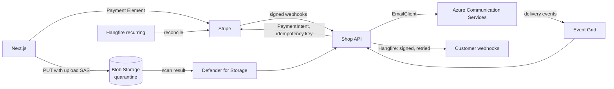

# Common Integrations — Overview
[← Topic](../README.md)

**TECH:** Stripe (Stripe.net on the server, Stripe.js and the Payment Element in Next.js) for payments; Azure Communication Services Email for transactional email with Event Grid delivery events; Azure Blob Storage with user delegation SAS for uploads and downloads, and Defender for Storage malware scanning; Hangfire for retries and reconciliation; Stripe CLI, Azurite, and WireMock.Net for tests
**LEVEL:** intermediate (mid-level, new to C# and .NET)

## Why this matters in production
- Integrations are where money and trust leak: double charges, lost payments, emails in spam, public files that should be private.
- Partners fail in their own ways: slow responses, rate limits, webhooks out of order, sandbox behaviour that differs from production.
- Each integration needs the same skeleton: an adapter behind a port, timeouts and retries, idempotency, secrets in Key Vault, tests against a sandbox, and reconciliation.

## Mental model

The rule for every partner: **don't trust, verify, and keep your own record.** Your database is the source of truth for what you intended; the partner is the source of truth for what happened; reconciliation keeps them in step.

## Prerequisites
- [08-reliability](../../08-reliability/README.md) (resilience handlers), [07-background-jobs](../../07-background-jobs/README.md) (Hangfire, idempotency), [11-architecture](../../11-architecture/README.md) (ports and adapters), [04-auth](../../04-auth/README.md).

## Lesson map
| Lesson | Checklist items |
|:--|:--|
| [01 · Integration principles and Stripe payments](01-principles-stripe-payments.md) | 1, 2 |
| [02 · Stripe webhooks](02-stripe-webhooks.md) | 3 |
| [03 · Transactional email with Azure Communication Services](03-email-acs-deliverability.md) | 4, 5 |
| [04 · Uploads and file serving with Blob Storage](04-blob-uploads-serving-security.md) | 6, 7, 8 |
| [05 · Outgoing webhooks and third-party API clients](05-outgoing-webhooks-api-clients.md) | 9, 10 |
| [06 · Testing integrations and reconciliation](06-testing-reconciliation.md) | 11, 12 |
| [Cheatsheet](cheatsheet.md) | all |

## Suggested order
1. 01 → 06.
2. Then [04-shipping/05-data-safety](../../../04-shipping/05-data-safety/README.md) for backups of the files and records these integrations create.
3. Ready to build: `/learn csharp/03-backend/12-integrations mode=tasks`.

## Version notes
- Each Stripe.net major version pins one Stripe API version. Upgrade the package on purpose, read the changelog, and match the webhook endpoint's API version.
- Azure Communication Services Email: custom domains start with low default sending quotas (raise them through a support request after building a sending reputation). Azure-managed domains are for testing only.
- Prefer **user delegation SAS** (signed with Entra ID) over account-key SAS; disable shared key access on the storage account where possible.

## Sources
- [Stripe docs](https://docs.stripe.com/)
- [Stripe.net on GitHub](https://github.com/stripe/stripe-dotnet)
- [Azure Communication Services Email overview](https://learn.microsoft.com/azure/communication-services/concepts/email/email-overview)
- [Azure Blob Storage SAS overview](https://learn.microsoft.com/azure/storage/common/storage-sas-overview)
- [Defender for Storage malware scanning](https://learn.microsoft.com/azure/defender-for-cloud/introduction-malware-scanning)
