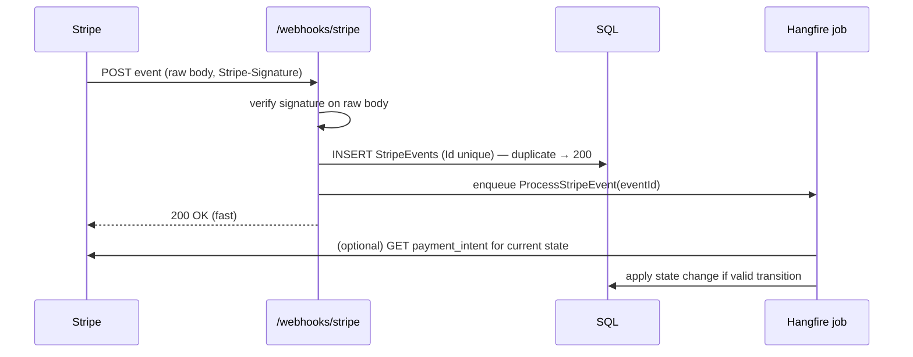

# Stripe webhooks
[← Overview](00-overview.md)

## Why it matters
- The webhook endpoint didn't verify signatures. Someone posted a fake `payment_intent.succeeded` and received goods without paying.
- The handler took 25 seconds (it generated a PDF and sent emails). Stripe timed out, retried, and the customer got four confirmation emails.
- `charge.refunded` arrived before `payment_intent.succeeded` after an outage. The handler marked a refunded order as paid and shipped it.

## Concepts

### How Stripe webhooks work
| Fact | Consequence |
|:--|:--|
| ⭐ signed with your endpoint secret (`Stripe-Signature` header, timestamp + HMAC) | verify against the **raw body**, before parsing |
| ⭐ at-least-once delivery | duplicates happen: dedupe on `event.id` |
| ⭐ no ordering guarantee | don't assume order; check current state, or fetch the object from the API |
| retries for up to 3 days (live mode) with backoff | your endpoint can catch up after downtime |
| expects a quick 2xx | acknowledge fast, process in the background |
| event has an `api_version` | Stripe.net checks it matches the library by default |

### A robust handler

| Rule | Why |
|:--|:--|
| ⭐ verify on raw body | any re-serialisation changes bytes and breaks the HMAC |
| ⭐ store event ID with a unique constraint | dedupe |
| ⭐ return 2xx quickly | no Stripe timeouts and retries |
| ⭐ state transitions, not blind updates | `Pending → Paid` only; ignore `succeeded` for a refunded or cancelled order |
| subscribe only to events you handle | less noise |
| return 400 for bad signatures | 4xx and 5xx both cause retries; signature failures should alert |
| one endpoint secret per environment | test and live are separate |
| rotate secrets | Stripe supports a rolling secret during rotation |

## Example
`src/Modules/Payments/Shop.Payments/Webhooks/StripeWebhookEndpoint.cs`
```csharp
using Stripe;

internal static class StripeWebhookEndpoint
{
    public static void MapStripeWebhook(this IEndpointRouteBuilder app) =>
        app.MapPost("/webhooks/stripe", async (HttpRequest request, IOptions<StripeOptions> options, PaymentsDb db,
                                               IBackgroundJobClient jobs, ILogger<StripeEventProcessor> log, CancellationToken ct) =>
        {
            using var reader = new StreamReader(request.Body);
            var json = await reader.ReadToEndAsync(ct);                     // raw body, untouched

            Event stripeEvent;
            try
            {
                stripeEvent = EventUtility.ConstructEvent(json, request.Headers["Stripe-Signature"], options.Value.WebhookSecret);
            }
            catch (StripeException ex)
            {
                log.LogWarning(ex, "Invalid Stripe webhook signature");
                return Results.BadRequest();
            }

            db.StripeEvents.Add(new StripeEventRecord(stripeEvent.Id, stripeEvent.Type, json, DateTimeOffset.UtcNow));
            try { await db.SaveChangesAsync(ct); }
            catch (DbUpdateException ex) when (ex.IsUniqueViolation()) { return Results.Ok(); }   // duplicate delivery

            jobs.Enqueue<StripeEventProcessor>(p => p.ProcessAsync(stripeEvent.Id, CancellationToken.None));
            return Results.Ok();
        })
        .AllowAnonymous()                       // authenticated by signature, not by user
        .DisableAntiforgery()
        .ExcludeFromDescription();
}
```
`IsUniqueViolation()` is a small extension that checks `SqlException.Number` 2627 or 2601. In production, enqueue through the outbox (07-background-jobs) so the event record and the job commit together.

`src/Modules/Payments/Shop.Payments/Webhooks/StripeEventProcessor.cs`
```csharp
internal sealed class StripeEventProcessor(PaymentsDb db, IPaymentsEvents events, TimeProvider time)
{
    [AutomaticRetry(Attempts = 10)]
    public async Task ProcessAsync(string eventId, CancellationToken ct)
    {
        var record = await db.StripeEvents.SingleAsync(e => e.Id == eventId, ct);
        if (record.ProcessedAt is not null) return;
        var evt = EventUtility.ParseEvent(record.Json);

        switch (evt.Type)
        {
            case EventTypes.PaymentIntentSucceeded:
                var intent = (PaymentIntent)evt.Data.Object;
                var payment = await db.Payments.SingleAsync(p => p.ProviderId == intent.Id, ct);
                if (payment.TryMarkSucceeded(intent.AmountReceived, time.GetUtcNow()))   // false if refunded/cancelled already
                    events.Raise(new PaymentSucceeded(payment.OrderId, payment.Id));      // outbox → Ordering marks paid
                break;
            case EventTypes.PaymentIntentPaymentFailed:
                (await db.Payments.SingleAsync(p => p.ProviderId == ((PaymentIntent)evt.Data.Object).Id, ct))
                    .MarkFailed(((PaymentIntent)evt.Data.Object).LastPaymentError?.Code);
                break;
            case EventTypes.ChargeRefunded:
                // ... mark refunded; transitions decide what's allowed
                break;
        }
        record.ProcessedAt = time.GetUtcNow();
        await db.SaveChangesAsync(ct);
    }
}
```
`TryMarkSucceeded` also checks that `AmountReceived` equals the expected amount, and records a mismatch for review instead of shipping.

Local testing with the Stripe CLI:
```bash
stripe listen --forward-to localhost:5080/webhooks/stripe   # prints a whsec_... secret for local config
stripe trigger payment_intent.succeeded
```

## Production patterns
- One webhook endpoint per environment, signature verified on the raw body, events stored with a unique ID, processed by idempotent background jobs.
- State changes follow allowed transitions and compare amounts; out-of-order or duplicate events are harmless.
- A recurring job re-enqueues stored events still unprocessed after a few minutes, so a crash between saving and enqueueing can't strand an event.
- Alerts on signature failures, processing failures, and the age of unprocessed events; the Stripe dashboard's failed-delivery list is checked in reconciliation.
- Package upgrades change the API version deliberately, together with the webhook endpoint's version.

## Mistakes
Wrong:
```csharp
app.MapPost("/webhooks/stripe", async (Event evt) => { ... });   // model binding re-parses the body: no signature check possible
```
Right: read the raw body, verify with `EventUtility.ConstructEvent`, then parse.

Wrong: doing the slow work (emails, PDFs) before returning 200.
Right: store, enqueue, return 200; process in the background.

## Check yourself
1. Why must the signature be checked against the raw body?
2. How do you make webhook processing idempotent?
3. What should the handler do if `payment_intent.succeeded` arrives for an order that was already cancelled?

<details><summary>Answers</summary>

1. The signature is an HMAC over the exact bytes Stripe sent. Parsing and re-serialising can change whitespace or ordering, so the check would fail (or you'd be checking something other than what was signed).
2. Store each `event.id` with a unique constraint and skip duplicates, mark events processed, and make every state change a guarded transition, so repeating it has no effect.
3. Not mark it paid. The transition from Cancelled to Paid isn't allowed, so it records the mismatch and triggers a refund or a review, depending on business rules.
</details>

## Sources
- [Stripe — Receive webhook events](https://docs.stripe.com/webhooks)
- [Stripe — Verify webhook signatures](https://docs.stripe.com/webhooks/signature)
- [Stripe — Webhook best practices](https://docs.stripe.com/webhooks#best-practices)
- [Stripe CLI — listen and trigger](https://docs.stripe.com/stripe-cli)
- [Stripe.net webhooks example](https://github.com/stripe/stripe-dotnet#webhooks)
