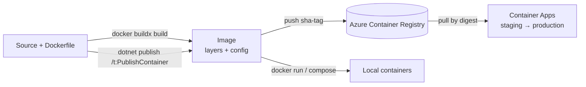

# Containers — Overview
[← Topic](../README.md)

**TECH:** Docker with BuildKit (`docker buildx`) for images, multi-stage Dockerfiles or `dotnet publish /t:PublishContainer` for the .NET API, chiseled .NET runtime images, Docker Compose for local dependencies, Aspire 13 as the C# alternative for local orchestration, Azure Container Registry for storing images
**LEVEL:** intermediate (mid-level, new to C# and .NET)

## Why this matters in production
- The container image is the thing you ship. Its size, contents, and user decide how fast you deploy, how many vulnerabilities you carry, and what an attacker gets if they break in.
- "Works on my machine" mostly disappears when the same image runs in CI, staging, and production.
- Slow image builds slow every PR. Caching layers properly can take a 6-minute build down to 40 seconds.

## Mental model

An image is a read-only stack of layers plus metadata (entrypoint, user, ports, env). A container is a running process with that filesystem and its own namespaces and limits. Build once, then run the same image everywhere.

## Prerequisites
- [01-foundations/07-config-environments](../../../01-foundations/07-config-environments/README.md) lesson 04 (Compose basics), [02-frontend/04-framework](../../../02-frontend/04-framework/README.md) (Next.js), Docker Desktop or Docker Engine with BuildKit.

## Lesson map
| Lesson | Checklist items |
|:--|:--|
| [01 · Images, Dockerfiles for .NET, and SDK container builds](01-images-dockerfiles-sdk.md) | 1, 2, 3 |
| [02 · Build speed and image security](02-build-speed-security.md) | 4, 5 |
| [03 · Runtime configuration, multi-arch, tags, and registries](03-runtime-multiarch-registries.md) | 6, 11, 12 |
| [04 · Local orchestration: Compose, SQL Server, and Aspire](04-compose-sql-aspire.md) | 7, 8, 9 |
| [05 · Next.js in containers and debugging containers](05-nextjs-debugging.md) | 10, 13 |
| [Cheatsheet](cheatsheet.md) | all |

## Suggested order
1. 01 → 05.
2. Then [02-cloud](../../02-cloud/README.md) and [04-deployments](../../04-deployments/README.md).
3. Ready to build: `/learn csharp/04-shipping/01-containers mode=tasks`.

## Version notes
- From .NET 10, default image tags (`mcr.microsoft.com/dotnet/aspnet:10.0`) are Ubuntu 24.04 "noble"; Debian images are no longer published. Ubuntu chiseled (`10.0-noble-chiseled`) and Azure Linux distroless (`10.0-azurelinux3.0-distroless`) are the minimal options.
- .NET 8+ images listen on port **8080** by default and include a non-root `app` user (`$APP_UID`).
- `dotnet publish /t:PublishContainer` is built into the .NET SDK (no extra package) and can push straight to a registry.
- Aspire 13 dropped ".NET" from its name, added the `aspire` CLI, and replaced `AddNpmApp` with `AddJavaScriptApp` (package `Aspire.Hosting.JavaScript`).

## Sources
- [Containerize a .NET app](https://learn.microsoft.com/dotnet/core/docker/build-container)
- [Containerize a .NET app with dotnet publish](https://learn.microsoft.com/dotnet/core/containers/sdk-publish)
- [.NET container images](https://learn.microsoft.com/dotnet/core/docker/container-images)
- [Docker build best practices](https://docs.docker.com/build/building/best-practices/)
- [Aspire 13 announcement](https://devblogs.microsoft.com/aspire/aspire13/)
