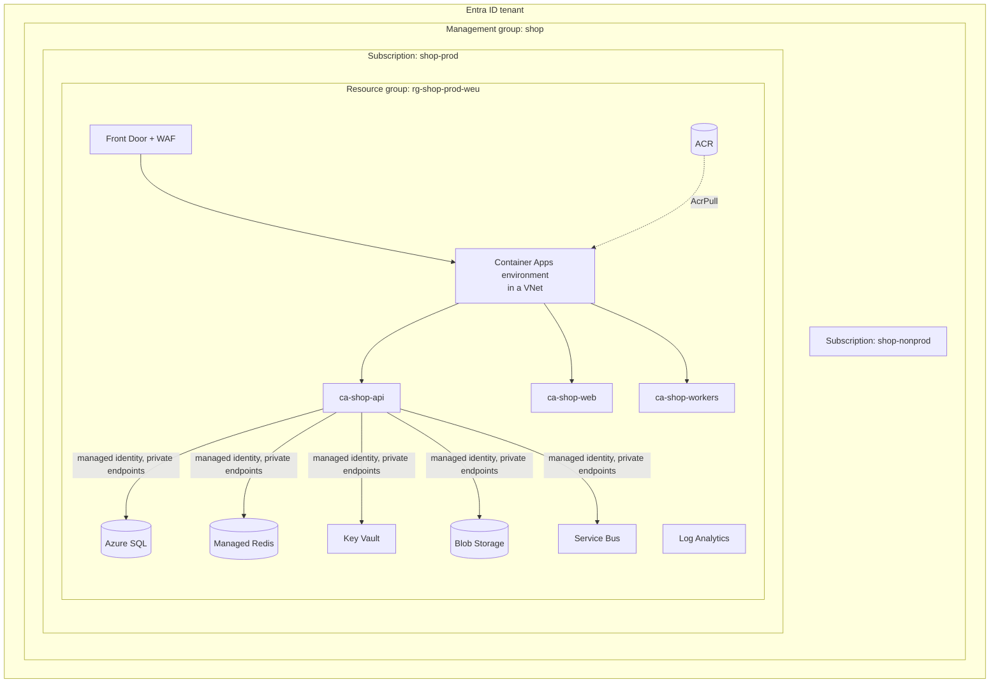

# Cloud — Overview
[← Topic](../README.md)

**TECH:** Microsoft Azure: Entra ID and managed identities, Azure Container Apps for the API, workers, and Next.js frontend, Azure Container Registry, Azure SQL Database, Azure Managed Redis, Key Vault and App Configuration, Blob Storage behind Azure Front Door, Service Bus, Log Analytics; App Service as the alternative host
**LEVEL:** intermediate (mid-level, new to C# and .NET)

## Why this matters in production
- Most cloud incidents and breaches come from configuration, not code: a public storage account, a connection string with an admin password, a database open to the internet.
- Identity is the new perimeter. Managed identities and RBAC remove most secrets from the app entirely.
- Cloud bills grow quietly. Knowing what costs money, and setting budgets on day one, avoids month-end surprises.

## Mental model

Every resource belongs to one resource group, in one subscription, governed by the management group above it. Access is granted to identities (people, pipelines, apps) through RBAC roles at a scope.

## Prerequisites
- [01-containers](../../01-containers/README.md), [03-backend/08-reliability](../../../03-backend/08-reliability/README.md), an Azure subscription (free account or Visual Studio subscription), Azure CLI.

## Lesson map
| Lesson | Checklist items |
|:--|:--|
| [01 · Azure foundations and identity](01-foundations-identity.md) | 1, 2 |
| [02 · Networking and Azure Container Apps](02-networking-container-apps.md) | 3, 4 |
| [03 · App Service, Azure SQL, and Azure Managed Redis](03-app-service-sql-redis.md) | 5, 6, 7 |
| [04 · Storage and Front Door, secrets, DNS, and TLS](04-storage-secrets-dns.md) | 8, 9, 10 |
| [05 · Cost awareness and platform logs](05-cost-logs.md) | 11, 12 |
| [Cheatsheet](cheatsheet.md) | all |

## Suggested order
1. 01 → 05.
2. Then [03-iac](../../03-iac/README.md) to create all of this from Bicep instead of the portal.
3. Ready to build: `/learn csharp/04-shipping/02-cloud mode=tasks`.

## Version notes
- **Azure Cache for Redis is retiring.** Basic/Standard/Premium retire on 30 September 2028 and Enterprise tiers in March 2027; creating new caches is already blocked for new customers. New work uses **Azure Managed Redis**.
- Container Apps **workload profiles** environments are the default and support smaller VNet subnets (/27), dedicated hardware, and NAT gateway egress. Consumption-only environments are the older model.
- Azure SQL supports **Entra-only authentication** (no SQL logins at all). Use it for new servers.
- Free allowances worth knowing: Container Apps monthly grant (180,000 vCPU-seconds, 360,000 GiB-seconds, 2 million requests per subscription) and the Azure SQL Database free offer (serverless, limited vCore-seconds and storage per month).

## Sources
- [Azure Container Apps overview](https://learn.microsoft.com/azure/container-apps/overview)
- [Azure landing zones (Cloud Adoption Framework)](https://learn.microsoft.com/azure/cloud-adoption-framework/ready/landing-zone/)
- [Managed identities for Azure resources](https://learn.microsoft.com/entra/identity/managed-identities-azure-resources/overview)
- [Azure Managed Redis overview](https://learn.microsoft.com/azure/redis/overview)
- [Azure Well-Architected Framework](https://learn.microsoft.com/azure/well-architected/)
