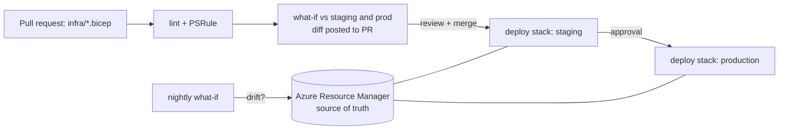

# Infrastructure as Code — Overview
[← Topic](../README.md)

**TECH:** Bicep for all Azure resources (modules, `.bicepparam` files per environment, Azure Verified Modules), deployment stacks for lifecycle and deny settings, what-if in pull requests, GitHub Actions with OIDC to deploy, the Azure Developer CLI (`azd`) for the developer workflow, PSRule for Azure and the Bicep linter for checks
**LEVEL:** intermediate (mid-level, new to C# and .NET)

## Why this matters in production
- Infrastructure clicked together in the portal can't be reviewed, can't be recreated after a disaster, and drifts between environments until staging no longer predicts production.
- With IaC, every change is a pull request with a diff (what-if) that someone approves, and rebuilding an environment is a command.
- Most security settings from 02-cloud (private endpoints, Entra-only SQL, no public blobs) are only reliable when they're code that can't be forgotten.

## Mental model

Bicep describes the **desired state**. Azure Resource Manager compares it with what exists and makes the changes. There's no state file: Azure itself is the state.

## Prerequisites
- [02-cloud](../../02-cloud/README.md) (what the resources are), [01-foundations/04-ci-cd](../../../01-foundations/04-ci-cd/README.md) (GitHub Actions basics), Azure CLI with Bicep (`az bicep install`), VS Code Bicep extension.

## Lesson map
| Lesson | Checklist items |
|:--|:--|
| [01 · Why IaC and Bicep basics](01-why-bicep-basics.md) | 1, 2 |
| [02 · State, what-if, deployment stacks, and safe refactoring](02-state-whatif-stacks.md) | 3, 4, 8 |
| [03 · Modules, environments, and secrets](03-modules-environments-secrets.md) | 5, 6, 7 |
| [04 · CI with OIDC, guardrails, and testing](04-ci-guardrails-testing.md) | 9, 10, 12 |
| [05 · The Azure Developer CLI and Bicep vs Terraform](05-azd-terraform.md) | 11, 13 |
| [Cheatsheet](cheatsheet.md) | all |

## Suggested order
1. 01 → 05.
2. Then [04-deployments](../../04-deployments/README.md), which deploys the apps onto this infrastructure.
3. Ready to build: `/learn csharp/04-shipping/03-iac mode=tasks`.

## Version notes
- Bicep evolves monthly. Recent features used here: user-defined types with `@export()`/`import`, `.bicepparam` files, secure outputs (`@secure()` on outputs), `readEnvironmentVariable()` and `az.getSecret()` in parameter files.
- **Deployment stacks** are GA and are the recommended way to manage a set of resources as a unit (with deletion of unmanaged resources and deny settings), replacing complete-mode deployments and Blueprints.
- Azure Verified Modules (AVM) are Microsoft's supported module library, published to the public Bicep registry (`br/public:avm/...`).
- In `azd`, `azd infra synth` was renamed `azd infra gen` (ejects Bicep for Aspire apps).

## Sources
- [What is Bicep?](https://learn.microsoft.com/azure/azure-resource-manager/bicep/overview)
- [Deployment stacks](https://learn.microsoft.com/azure/azure-resource-manager/bicep/deployment-stacks)
- [Azure Verified Modules](https://azure.github.io/Azure-Verified-Modules/)
- [Azure Developer CLI](https://learn.microsoft.com/azure/developer/azure-developer-cli/overview)
- [Bicep best practices](https://learn.microsoft.com/azure/azure-resource-manager/bicep/best-practices)
