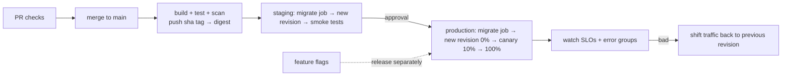

# Deployments — Overview
[← Topic](../README.md)

**TECH:** GitHub Actions pipelines that build each image once, push it to Azure Container Registry with immutable tags, and promote the same digest through staging and production on Azure Container Apps; OIDC to Azure; EF Core migration bundles run as Container Apps jobs; revisions for rolling, blue/green, and canary releases; feature flags with Azure App Configuration; `azd` for developer environments
**LEVEL:** intermediate (mid-level, new to C# and .NET)

## Why this matters in production
- Deploys cause most incidents. A safe pipeline makes them small, frequent, observable, and reversible in a minute.
- Teams that deploy often with low failure rates (the DORA research) ship more features *and* have fewer outages.
- Separating deploy from release (feature flags) lets you ship code on Tuesday and turn it on for 5% of users on Thursday.

## Mental model

Build once, deploy the same digest everywhere, change one thing at a time, and always know how to go back.

## Prerequisites
- [01-containers](../../01-containers/README.md), [02-cloud](../../02-cloud/README.md), [03-iac](../../03-iac/README.md), [01-foundations/04-ci-cd](../../../01-foundations/04-ci-cd/README.md), [03-backend/08-reliability](../../../03-backend/08-reliability/README.md) (probes, graceful shutdown).

## Lesson map
| Lesson | Checklist items |
|:--|:--|
| [01 · The pipeline: build once, OIDC, and ACR](01-pipeline-oidc-acr.md) | 1, 2, 3 |
| [02 · Deploying to Container Apps, rolling updates, and rollbacks](02-container-apps-rollouts-rollbacks.md) | 4, 5, 10 |
| [03 · Blue/green, canary, and feature flags](03-bluegreen-canary-flags.md) | 6, 9 |
| [04 · Database migrations, environments, and approvals](04-migrations-environments.md) | 7, 8 |
| [05 · Frontend deploys, scripts, and release hygiene](05-frontend-scripts-release.md) | 11, 12, 13 |
| [Cheatsheet](cheatsheet.md) | all |

## Suggested order
1. 01 → 05.
2. Then [05-data-safety](../../05-data-safety/README.md) (safe migrations, backups) and [06-incident-response](../../06-incident-response/README.md).
3. Ready to build: `/learn csharp/04-shipping/04-deployments mode=tasks`.

## Version notes
- Use `azure/login@v2` with OIDC; the old `AZURE_CREDENTIALS` JSON with a client secret is not needed anymore.
- Container Apps supports single and multiple revision modes, revision labels (stable URLs per revision), and traffic weights per revision or label; a newer "labels" revision mode also exists for label-based blue/green.
- EF Core 10 migration bundles (`dotnet ef migrations bundle`) produce one executable that applies pending migrations; ship it as an image and run it as a job.
- DORA's key metrics: deployment frequency, lead time for changes, change failure rate, failed deployment recovery time (recent reports add deployment rework rate).

## Sources
- [GitHub Actions for Azure Container Apps](https://learn.microsoft.com/azure/container-apps/github-actions)
- [Blue-green deployment in Container Apps](https://learn.microsoft.com/azure/container-apps/blue-green-deployment)
- [Traffic splitting in Container Apps](https://learn.microsoft.com/azure/container-apps/traffic-splitting)
- [EF Core migration bundles](https://learn.microsoft.com/ef/core/managing-schemas/migrations/applying#bundles)
- [DORA research](https://dora.dev/research/)
