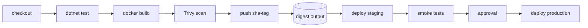

# The pipeline: build once, OIDC, and ACR
[← Overview](00-overview.md)

## Why it matters
- Staging and production each ran `docker build`. A base image update landed between the two builds, so production ran an image nobody had tested.
- The deploy credential was a service principal secret copied into three repositories. When it leaked through a forked PR's logs, an attacker could push images to the registry.
- Images were tagged `v1`, `v2`... by hand. Two branches both pushed `v7`, and production rolled back to the wrong code.

## Concepts

### Build once, promote the same artefact
| Rule | Why |
|:--|:--|
| ⭐ build each image once, on merge to `main` | what you test is what you ship |
| ⭐ promote by digest | staging and production run `shop-api@sha256:...`, byte-for-byte identical |
| configuration from the environment | the image has no environment-specific values (01-containers) |
| fail fast | build → unit tests → integration tests → scan → push; deploy only after all pass |
| one pipeline per deployable | API, workers, web, migrations; or one workflow with jobs per image |



### OIDC from GitHub Actions to Azure
| Piece | Practice |
|:--|:--|
| ⭐ federated identity per environment | `id-gh-shop-staging`, `id-gh-shop-prod` (user-assigned managed identities) |
| ⭐ subject pinned to the GitHub environment | `repo:my-org/shop:environment:production` |
| ⭐ `permissions: id-token: write` | only in jobs that log in to Azure |
| roles | `AcrPush` on the registry (build job); Container Apps Contributor-level rights on the environment's resource group (deploy jobs) |
| no secrets | IDs (client, tenant, subscription) are GitHub variables, not secrets |
| forks | PRs from forks get no OIDC token for your environments |

### Images in ACR
| Practice | How |
|:--|:--|
| ⭐ tag with the git SHA | `crshop.azurecr.io/shop-api:sha-${GITHUB_SHA}`; optional `1.8.2` on release |
| ⭐ record the digest | `docker/build-push-action` output `digest`; pass it to deploy jobs |
| ⭐ deploy by digest | `image@sha256:...` |
| one registry for all environments | promote by digest; or import between registries (`az acr import`) if prod must be separate |
| retention | purge old `sha-*` tags (01-containers lesson 03) |
| provenance and SBOM | attached at build (01-containers lesson 02) |

## Example
`.github/workflows/api.yml` (build once, then deploy jobs reuse the digest)
```yaml
name: api
on:
  push: { branches: [main], paths: ["src/**", "tests/**", "Directory.*.props", ".github/workflows/api.yml"] }

permissions:
  contents: read

env:
  REGISTRY: crshop.azurecr.io
  IMAGE: shop-api

jobs:
  build:
    runs-on: ubuntu-latest
    environment: build                             # federated identity with AcrPush only
    permissions: { contents: read, id-token: write }
    outputs:
      digest: ${{ steps.push.outputs.digest }}
    steps:
      - uses: actions/checkout@v5
      - uses: actions/setup-dotnet@v5
        with: { global-json-file: global.json }
      - run: dotnet test --configuration Release
      - uses: azure/login@v2
        with:
          client-id: ${{ vars.AZURE_CLIENT_ID }}
          tenant-id: ${{ vars.AZURE_TENANT_ID }}
          subscription-id: ${{ vars.AZURE_SUBSCRIPTION_ID }}
      - run: az acr login --name crshop
      - uses: docker/setup-buildx-action@v3
      - id: push
        uses: docker/build-push-action@v6
        with:
          context: .
          file: src/Shop.Api/Dockerfile
          push: true
          tags: ${{ env.REGISTRY }}/${{ env.IMAGE }}:sha-${{ github.sha }}
          cache-from: type=gha
          cache-to: type=gha,mode=max
          sbom: true
          provenance: mode=max

  deploy-staging:
    needs: build
    permissions: { contents: read, id-token: write }   # the called workflow can't get more than this
    uses: ./.github/workflows/deploy-api.yml
    with:
      environment: staging
      image: crshop.azurecr.io/shop-api@${{ needs.build.outputs.digest }}

  deploy-production:
    needs: [build, deploy-staging]
    permissions: { contents: read, id-token: write }
    uses: ./.github/workflows/deploy-api.yml
    with:
      environment: production
      image: crshop.azurecr.io/shop-api@${{ needs.build.outputs.digest }}
```
A reusable deploy workflow (`deploy-api.yml`) logs in with the environment's identity and updates the Container App (lesson 02). The calling jobs grant `id-token: write`, because a called workflow can't have more permissions than its caller.

Federated credentials (one-time, per environment):
```bash
for env in build staging production; do
  az identity federated-credential create -g rg-shop-identities --identity-name "id-gh-shop-$env" --name "gh-$env" \
    --issuer https://token.actions.githubusercontent.com \
    --subject "repo:my-org/shop:environment:$env" --audiences api://AzureADTokenExchange
done
az role assignment create --assignee "$BUILD_PRINCIPAL_ID" --role AcrPush --scope "$ACR_ID"
```

## Production patterns
- One image per deployable, built once on `main`, tested, scanned, signed with provenance, pushed with a SHA tag; deploy jobs receive the digest.
- OIDC with a separate identity per stage (build, staging, production), each with the smallest role; no long-lived secrets anywhere.
- Every running revision can be traced to a commit (SHA tag, `service.version`, deploy marker in lesson 05).
- Pipelines are code, reviewed like code; third-party actions pinned to versions or SHAs.

## Mistakes
Wrong: `docker build` in each environment's deploy job.
Right: build once; deploy `image@digest` everywhere.

Wrong: `creds: ${{ secrets.AZURE_CREDENTIALS }}` with a client secret shared across repos.
Right: OIDC with federated credentials scoped to environments.

## Check yourself
1. Why deploy by digest instead of rebuilding per environment?
2. What stops a workflow in a forked PR from deploying to production?
3. Which roles do the build and deploy identities need?

<details><summary>Answers</summary>

1. A rebuild can pick up different base images, packages, or tool versions, so production would run something never tested. The digest is the exact tested image.
2. The federated credential trusts only a specific subject (`environment:production` in your repo), the production environment requires approval, and GitHub doesn't issue OIDC tokens for your environments to fork PRs.
3. Build: `AcrPush` on the registry. Deploy: rights to update the Container Apps (and start jobs) in that environment's resource group, plus `AcrPull` for the apps' own identity, not for the pipeline.
</details>

## Sources
- [Configure OIDC for azure/login](https://learn.microsoft.com/azure/developer/github/connect-from-azure-openid-connect)
- [GitHub — about security hardening with OIDC](https://docs.github.com/actions/security-for-github-actions/security-hardening-your-deployments/about-security-hardening-with-openid-connect)
- [docker/build-push-action](https://github.com/docker/build-push-action)
- [ACR authentication options](https://learn.microsoft.com/azure/container-registry/container-registry-authentication)
- [Reusable workflows](https://docs.github.com/actions/sharing-automations/reusing-workflows)
