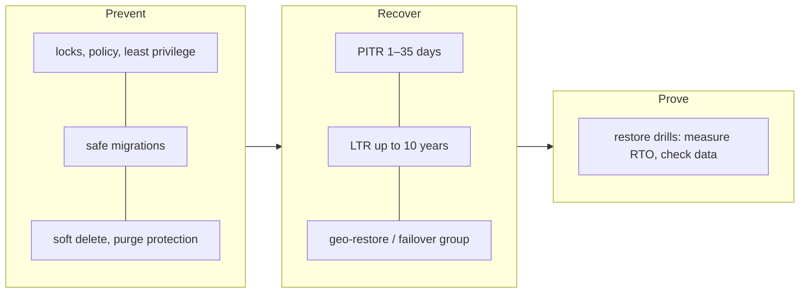

# Data Safety — Overview
[← Topic](../README.md)

**TECH:** Azure SQL automated backups (point-in-time restore, long-term retention, backup storage redundancy, geo-restore), failover groups, SQL Server 2025 native backups for self-hosted cases, SqlPackage BACPAC exports, EF Core migrations written for production, Blob Storage soft delete and versioning, Key Vault purge protection, TDE and TLS
**LEVEL:** intermediate (mid-level, new to C# and .NET)

## Why this matters in production
- Code can be redeployed in minutes; lost data is gone. Most "data loss" incidents are human: a bad migration, a wrong `DELETE`, a deleted resource.
- Backups you've never restored are a hope, not a plan. Restore drills turn RPO and RTO from numbers on a slide into numbers you've measured.
- Privacy law (GDPR) cares about how long you keep data and how you delete it, including in backups and test environments.

## Mental model

Prevent what you can, recover from what you can't, and prove recovery works by doing it regularly.

## Prerequisites
- [03-backend/03-databases](../../../03-backend/03-databases/README.md), [02-cloud](../../02-cloud/README.md) lesson 03 (Azure SQL), [04-deployments](../../04-deployments/README.md) lesson 04 (migrations in the pipeline).

## Lesson map
| Lesson | Checklist items |
|:--|:--|
| [01 · RPO, RTO, Azure SQL backups, and restore drills](01-rpo-rto-backups-drills.md) | 1, 2, 3 |
| [02 · Safe migrations in production](02-safe-migrations.md) | 4 |
| [03 · Exports, redundancy, and disaster recovery strategies](03-exports-redundancy-dr.md) | 5, 6, 9 |
| [04 · Human error, retention, encryption, and non-production data](04-human-error-retention-encryption.md) | 7, 8, 10, 11 |
| [Cheatsheet](cheatsheet.md) | all |

## Suggested order
1. 01 → 04.
2. Then [06-incident-response](../../06-incident-response/README.md): restore drills are one of its practice formats.
3. Ready to build: `/learn csharp/04-shipping/05-data-safety mode=tasks`.

## Version notes
- Azure SQL keeps automated backups with 1–35 days of point-in-time restore (default 7; Basic tier up to 7) and optional long-term retention up to 10 years. Backup storage redundancy (LRS/ZRS/GRS) decides whether geo-restore is possible.
- Azure SQL Database doesn't support native `.bak` backups; use PITR, copies, or BACPAC. SQL Server 2025 (and Azure SQL Managed Instance) support `BACKUP ... TO URL` to Blob Storage.
- SQL Server 2025 and Azure SQL have **optimized locking**, which reduces lock memory and blocking during large updates, but doesn't replace batching.
- Microsoft.Data.SqlClient defaults to `Encrypt=True` (mandatory) since version 4; production connection strings should never need `TrustServerCertificate=True`.

## Sources
- [Automated backups in Azure SQL Database](https://learn.microsoft.com/azure/azure-sql/database/automated-backups-overview)
- [Recover using backups](https://learn.microsoft.com/azure/azure-sql/database/recovery-using-backups)
- [Business continuity in Azure SQL Database](https://learn.microsoft.com/azure/azure-sql/database/business-continuity-high-availability-disaster-recover-hadr-overview)
- [Azure Well-Architected — disaster recovery](https://learn.microsoft.com/azure/well-architected/reliability/disaster-recovery)
- [GDPR Article 17 — right to erasure](https://gdpr-info.eu/art-17-gdpr/)
