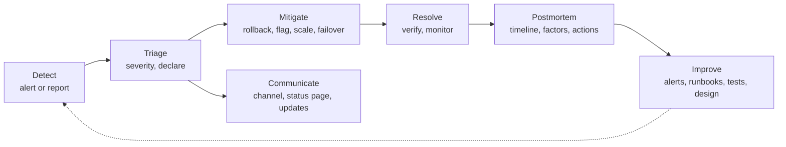

# Incident Response — Overview
[← Topic](../README.md)

**TECH:** Azure Monitor alerts and action groups for paging, Application Insights and Log Analytics (KQL) for diagnosis, Sentry for frontend errors, Azure Service Health and Resource Health for platform status, Container Apps revisions and feature flags for mitigation, a paging tool (PagerDuty, incident.io, or similar), and a status page hosted outside your own infrastructure
**LEVEL:** intermediate (mid-level, new to C# and .NET)

## Why this matters in production
- Every system fails eventually. What separates good teams is how fast they notice, how calmly they restore service, and whether the same failure happens again.
- Most extra downtime comes from confusion: nobody in charge, ten people debugging in parallel, customers not told, rollback delayed while someone hunts for the root cause.
- Blameless postmortems turn incidents into improvements instead of fear, which makes people report problems early.

## Mental model

Stop the bleeding first, understand later. The incident ends when users are fine, not when the bug is fixed.

## Prerequisites
- [03-backend/10-observability](../../../03-backend/10-observability/README.md) (telemetry, alerts), [03-backend/08-reliability](../../../03-backend/08-reliability/README.md) (SLOs), [04-deployments](../../04-deployments/README.md) (rollbacks, flags), [05-data-safety](../../05-data-safety/README.md) (restores).

## Lesson map
| Lesson | Checklist items |
|:--|:--|
| [01 · Incidents, severity, roles, and mitigation first](01-severity-roles-mitigation.md) | 1, 2, 3 |
| [02 · Debugging in production, and is it us or Azure?](02-debugging-production-azure-health.md) | 4, 13 |
| [03 · Communication, on-call, and runbooks](03-communication-oncall-runbooks.md) | 5, 6, 7 |
| [04 · Postmortems, common patterns, and practice](04-postmortems-patterns-practice.md) | 8, 9, 10 |
| [05 · Security incidents and measuring improvement](05-security-measuring.md) | 11, 12 |
| [Cheatsheet](cheatsheet.md) | all |

## Suggested order
1. 01 → 05.
2. Then [05-practice](../../../05-practice/README.md) and the [07-capstone](../../../07-capstone/README.md) pre-launch checklist, which includes an incident drill.
3. Ready to build: `/learn csharp/04-shipping/06-incident-response mode=tasks`.

## Version notes
- Atlassian stopped selling Opsgenie in 2025 and ends support in 2027 (moving customers to Jira Service Management / Compass); choose another paging tool for new setups.
- Azure Service Health alerts are activity-log alerts on the `ServiceHealth` category; Resource Health shows per-resource availability and history.
- GDPR requires notifying the supervisory authority of personal data breaches within 72 hours of becoming aware; NIS2 adds a 24-hour early warning for covered entities.

## Sources
- [Google SRE book — Managing incidents](https://sre.google/sre-book/managing-incidents/)
- [Google SRE book — Postmortem culture](https://sre.google/sre-book/postmortem-culture/)
- [PagerDuty incident response documentation](https://response.pagerduty.com/)
- [Azure Service Health](https://learn.microsoft.com/azure/service-health/overview)
- [Incident management (Azure Well-Architected)](https://learn.microsoft.com/azure/well-architected/design-guides/incident-management)
