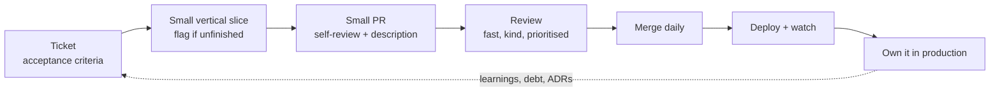

# Engineering Practice — Overview
[← Topic](../README.md)

**TECH:** Git and GitHub (pull requests, reviews, CODEOWNERS, rulesets, issues, Projects, the `gh` CLI), GitHub Copilot in VS Code and Visual Studio (chat, agent mode, code review, coding agent, custom instructions), applied to the C#/.NET shop and its Next.js frontend
**LEVEL:** intermediate (mid-level moving toward senior)

## Why this matters in production
- Most of a senior engineer's impact isn't typing code: it's slicing work so it ships safely, reviewing so others ship better, writing so decisions stick, and owning outcomes in production.
- Teams with small batches, fast reviews, and clear tickets deliver more with fewer incidents (the same DORA findings as 04-shipping).
- AI assistants make producing code cheap; judging, verifying, and integrating it is now the scarce skill.

## Mental model

Every habit in this topic shortens that loop or makes it safer.

## Prerequisites
- [01-foundations/01-git](../../../01-foundations/01-git/README.md), [01-foundations/04-ci-cd](../../../01-foundations/04-ci-cd/README.md); some backend and shipping experience to apply it to.

## Lesson map
| Lesson | Checklist items |
|:--|:--|
| [01 · Small batches, tickets, and estimation](01-small-batches-tickets-estimation.md) | 1, 4, 5 |
| [02 · Code review as reviewer and author](02-code-review.md) | 2, 3 |
| [03 · Technical debt, design docs, and communication](03-debt-design-docs-communication.md) | 6, 7, 8 |
| [04 · Debugging methodically and AI coding assistants](04-debugging-ai-assistants.md) | 9, 10 |
| [05 · Ownership and growing to senior](05-ownership-growth.md) | 11, 12 |
| [Cheatsheet](cheatsheet.md) | all |

## Suggested order
1. Read 01 and 02 early and apply them to every module's tasks.
2. Return to 03–05 as you take on bigger work (06-design, 07-capstone).
3. Ready to practise: `/learn csharp/05-practice/01-engineering-practice mode=tasks`.

## Version notes
- GitHub Copilot now includes agent mode in VS Code and Visual Studio, a coding agent that works on assigned issues and opens PRs, Copilot code review, and repository custom instructions (`.github/copilot-instructions.md`, path-scoped `.github/instructions/*.instructions.md`; `AGENTS.md` is also read).
- GitHub rulesets supersede classic branch protection for new setups; merge queues keep `main` green with many small PRs.
- Conventional Comments (`nitpick:`, `issue:`, `suggestion:`...) and Conventional Commits are widely used conventions, not GitHub features.

## Sources
- [Google engineering practices — code review](https://google.github.io/eng-practices/review/)
- [DORA capabilities — working in small batches](https://dora.dev/capabilities/working-in-small-batches/)
- [GitHub Copilot documentation](https://docs.github.com/copilot)
- [The Staff Engineer's Path (Tanya Reilly)](https://www.oreilly.com/library/view/the-staff-engineers/9781098118723/)
- [Conventional Comments](https://conventionalcomments.org/)
