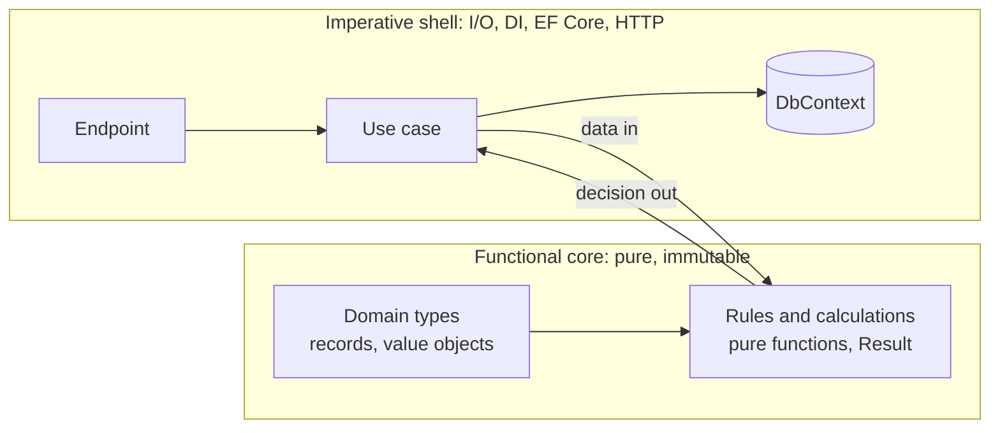

# Paradigms & OOP — Overview
[← Topic](../README.md)

**TECH:** C# 14 on .NET 10: classes, records, interfaces, generics, delegates and lambdas, LINQ, pattern matching, and switch expressions, used to write object-oriented and functional code side by side
**LEVEL:** intermediate (mid-level, new to C# and .NET)

## Why this matters in production
- C# is multi-paradigm. Teams that only know "classes with services" write 3,000-line service classes; teams that only know functional tricks write clever code nobody can debug. Knowing both lets you pick the clearest tool per problem.
- Most production bugs in business code come from shared mutable state and illegal states that the types allow. Immutability and well-designed types remove whole classes of bugs.
- The paradigm choices made here show up everywhere else: in the domain model (05-domain-driven-design), in patterns (03-design-patterns), and in tests.

## Mental model

Objects organise code around data and behaviour with boundaries; functions transform data without side effects. In the shop, the core (prices, discounts, order rules) leans functional and immutable; the shell (endpoints, EF Core, partners) is object-oriented and imperative.

## Prerequisites
- [03-backend/01-language-runtime](../../../03-backend/01-language-runtime/README.md) (C# syntax, records, LINQ, pattern matching).

## Lesson map
| Lesson | Checklist items |
|:--|:--|
| [01 · Paradigms and the four OOP pillars](01-paradigms-pillars.md) | 1, 2 |
| [02 · Classes, composition, interfaces, and polymorphism](02-classes-composition-polymorphism.md) | 3, 4, 7 |
| [03 · Functional C#: pure functions, ADTs, and results](03-functional-adts-results.md) | 5, 6, 9 |
| [04 · Entities, value objects, DTOs, and choosing a style](04-entities-values-choosing.md) | 8, 10 |
| [Cheatsheet](cheatsheet.md) | all |

## Suggested order
1. 01 → 04, alongside the backend module.
2. Then [02-principles](../../02-principles/README.md) and [08-data-structures-algorithms](../../08-data-structures-algorithms/README.md).
3. Ready to practise: `/learn csharp/06-design/01-paradigms-oop mode=tasks`.

## Version notes
- C# 14 (.NET 10): extension members (`extension` blocks), the `field` keyword in properties, null-conditional assignment, first-class `Span` conversions.
- C# 15 ships with .NET 11 (November 2026) and adds **union types** (`public union Pet(Cat, Dog);`) with exhaustive pattern matching. This stack targets C# 14 on .NET 10 LTS, so lessons model unions with sealed record hierarchies and show the C# 15 form as a preview.
- Default interface methods (C# 8+) exist but are mostly for evolving library interfaces, not for everyday design.

## Sources
- [C# language documentation](https://learn.microsoft.com/dotnet/csharp/)
- [Object-oriented programming (C#)](https://learn.microsoft.com/dotnet/csharp/fundamentals/tutorials/oop)
- [Functional programming techniques in C#](https://learn.microsoft.com/dotnet/csharp/fundamentals/functional/pattern-matching)
- [What's new in C# 14](https://learn.microsoft.com/dotnet/csharp/whats-new/csharp-14)
- [C# 15 union types (.NET blog)](https://devblogs.microsoft.com/dotnet/csharp-15-union-types/)
