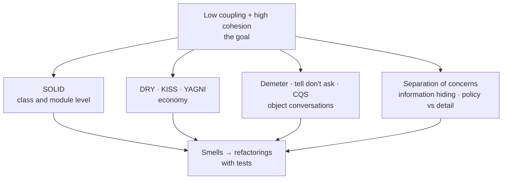

# Design Principles — Overview
[← Topic](../README.md)

**TECH:** C# 14 on .NET 10, with the shop's backend as the running example; IDE refactorings in Visual Studio / VS Code C# Dev Kit; .NET code analyzers for some smells
**LEVEL:** intermediate (mid-level, new to C# and .NET)

## Why this matters in production
- The cost of software is mostly the cost of changing it. Principles are compressed experience about what makes change cheap or expensive.
- Applied blindly, principles cause the opposite problem: interfaces everywhere, five layers for a CRUD screen, abstractions nobody needs.
- In code review, principles give you shared words ("this class has two reasons to change") that make feedback concrete instead of personal.

## Mental model

Almost every principle is a way to lower coupling (fewer, weaker dependencies) or raise cohesion (things that change together live together).

## Prerequisites
- [01-paradigms-oop](../../01-paradigms-oop/README.md); some backend code to apply it to ([03-backend](../../../03-backend/README.md)).

## Lesson map
| Lesson | Checklist items |
|:--|:--|
| [01 · Coupling, cohesion, SRP, and OCP](01-coupling-cohesion-srp-ocp.md) | 1, 2, 3 |
| [02 · LSP, ISP, and DIP](02-lsp-isp-dip.md) | 4, 5, 6 |
| [03 · DRY, KISS, YAGNI, and object conversations](03-dry-kiss-yagni-demeter.md) | 7, 8, 9 |
| [04 · Code smells, safe refactoring, and principles in review](04-smells-refactoring-review.md) | 10, 11 |
| [Cheatsheet](cheatsheet.md) | all |

## Suggested order
1. 01 → 04.
2. Then [03-design-patterns](../../03-design-patterns/README.md): many patterns are these principles applied.
3. Ready to practise (refactoring katas): `/learn csharp/06-design/02-principles mode=tasks`.

## Version notes
- Principles don't change with versions, but C# makes some easier: records for value objects, primary constructors for DI, `internal` + projects for information hiding, analyzers (CA1502 complexity, CA1506 class coupling) for some smells.
- Visual Studio and C# Dev Kit provide safe automated refactorings (rename, extract method/interface, introduce parameter, move type to file).

## Sources
- [Robert C. Martin — Clean Architecture (SOLID chapters)](https://www.oreilly.com/library/view/clean-architecture-a/9780134494272/)
- [Martin Fowler — Refactoring (2nd ed.)](https://refactoring.com/)
- [Code metrics in Visual Studio](https://learn.microsoft.com/visualstudio/code-quality/code-metrics-values)
- [Kent Beck — Tidy First?](https://www.oreilly.com/library/view/tidy-first/9781098151232/)
- [Sandi Metz — The wrong abstraction](https://sandimetz.com/blog/2016/1/20/the-wrong-abstraction)
