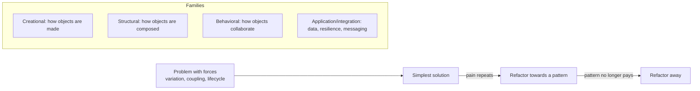

# Design Patterns — Overview
[← Topic](../README.md)

**TECH:** C# 14 and ASP.NET Core 10 for the classic and application patterns (with the built-in DI container, middleware, options, `IEnumerable<T>`/`yield`), React 19.2 with TypeScript for the frontend patterns
**LEVEL:** intermediate (mid-level, new to C# and .NET)

## Why this matters in production
- Patterns are a shared vocabulary: "put a decorator around the client" says in five words what would otherwise take a paragraph.
- Most patterns already live inside .NET (middleware is a chain of responsibility, `HttpClient` handlers are decorators, `IOptions<T>` is a configuration pattern). Recognising them helps you use the framework instead of fighting it.
- Pattern-itis is as costly as no design at all: `OrderStrategyFactoryProvider` classes make simple code hard to read.

## Mental model

Start from the problem, not the catalogue. A pattern is worth it when its forces are present in your code.

## Prerequisites
- [01-paradigms-oop](../../01-paradigms-oop/README.md), [02-principles](../../02-principles/README.md), [03-backend/11-architecture](../../../03-backend/11-architecture/README.md).

## Lesson map
| Lesson | Checklist items |
|:--|:--|
| [01 · What patterns are for, creational patterns, and DI](01-purpose-creational-di.md) | 1, 2, 3 |
| [02 · Structural patterns](02-structural.md) | 4, 5 |
| [03 · Behavioral patterns](03-behavioral.md) | 6, 7 |
| [04 · Application, resilience, and integration patterns](04-application-integration.md) | 8, 9 |
| [05 · Frontend patterns, anti-patterns, choosing, and .NET's built-in patterns](05-frontend-antipatterns-choosing-dotnet.md) | 10, 11, 12, 13 |
| [Cheatsheet](cheatsheet.md) | all |

## Suggested order
1. 01 → 05.
2. Then [04-architecture-styles](../../04-architecture-styles/README.md).
3. Ready to practise (pattern katas): `/learn csharp/06-design/03-design-patterns mode=tasks`.

## Version notes
- Modern C# changes how some patterns look: lambdas and `Func<>` replace many one-method strategy/command classes; records make builders less necessary (`with` expressions, required members); pattern matching replaces many visitors.
- The built-in DI container (.NET 8+ keyed services) covers most factory and singleton needs; Scrutor adds decoration and scanning (also seen).
- Keep MediatR's licence change in mind when choosing a mediator implementation (03-backend/11-architecture lesson 05).

## Sources
- [Design Patterns: Elements of Reusable Object-Oriented Software (GoF)](https://www.oreilly.com/library/view/design-patterns-elements/0201633612/)
- [Refactoring.Guru — design patterns in C#](https://refactoring.guru/design-patterns/csharp)
- [Martin Fowler — Patterns of Enterprise Application Architecture](https://martinfowler.com/eaaCatalog/)
- [Cloud design patterns (Azure Architecture Center)](https://learn.microsoft.com/azure/architecture/patterns/)
- [patterns.dev (frontend patterns)](https://www.patterns.dev/)
