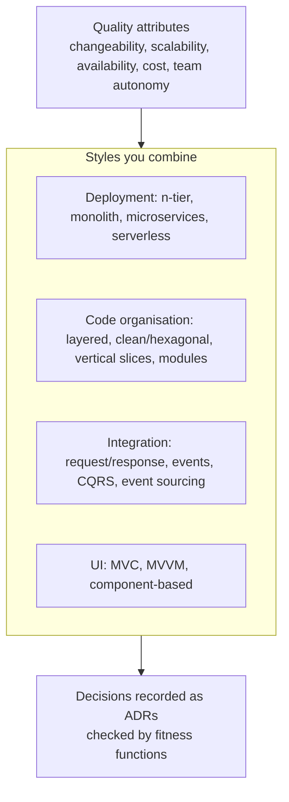

# Architecture Styles — Overview
[← Topic](../README.md)

**TECH:** C# and ASP.NET Core 10 for backend styles (layered, clean/hexagonal, vertical slices, modular monolith, event-driven, CQRS), Next.js 16 and React 19.2 for UI patterns, Azure services (Container Apps, Service Bus, Functions, API Management) for deployment styles
**LEVEL:** intermediate (mid-level, new to C# and .NET)

## Why this matters in production
- Architecture styles are bundles of trade-offs. Picking microservices for a team of four, or a single layered app for twelve teams, makes every later change expensive.
- Most real systems combine styles: the shop is an n-tier deployment, a modular monolith inside, clean architecture per module, event-driven between modules, and DDD in the core.
- Knowing the names and forces lets you read other systems quickly and explain your own decisions in ADRs.

## Mental model

Start from the quality attributes that matter most, choose the simplest combination that meets them, write it down, and check it automatically.

## Prerequisites
- [03-backend/11-architecture](../../../03-backend/11-architecture/README.md), [02-principles](../../02-principles/README.md), [03-design-patterns](../../03-design-patterns/README.md).

## Lesson map
| Lesson | Checklist items |
|:--|:--|
| [01 · Forces, layered and n-tier, and UI patterns](01-forces-layered-ui.md) | 1, 2, 3 |
| [02 · Clean and hexagonal architecture, vertical slices, and the modular monolith](02-clean-slices-modular-monolith.md) | 4, 5, 6 |
| [03 · Microservices, event-driven architecture, CQRS, and event sourcing](03-microservices-events-cqrs.md) | 7, 8, 9 |
| [04 · Serverless, BFF and gateways, fitness functions, and combining styles](04-serverless-bff-fitness-combining.md) | 10, 11, 12 |
| [Cheatsheet](cheatsheet.md) | all |

## Suggested order
1. 01 → 04.
2. Then [05-domain-driven-design](../../05-domain-driven-design/README.md) and [06-system-design](../../06-system-design/README.md).
3. Ready to practise (design docs): `/learn csharp/06-design/04-architecture-styles mode=tasks`.

## Version notes
- Next.js 16's App Router with Server Components blurs the classic client/server tiers: some UI code runs on the server, close to data, which affects BFF decisions.
- Azure Functions (isolated worker model on .NET 10) and Container Apps jobs are the serverless options in this stack; Azure API Management and YARP are the gateway options.
- Aspire 13 makes multi-service local development easier, which lowers the cost of trying a split, but not the cost of operating one in production.

## Sources
- [Azure Architecture Center — architecture styles](https://learn.microsoft.com/azure/architecture/guide/architecture-styles/)
- [Mark Richards & Neal Ford — Fundamentals of Software Architecture](https://www.oreilly.com/library/view/fundamentals-of-software/9781098175504/)
- [Martin Fowler — Microservices](https://martinfowler.com/articles/microservices.html)
- [Building Evolutionary Architectures (fitness functions)](https://www.oreilly.com/library/view/building-evolutionary-architectures/9781492097532/)
- [Common web application architectures (.NET)](https://learn.microsoft.com/dotnet/architecture/modern-web-apps-azure/common-web-application-architectures)
