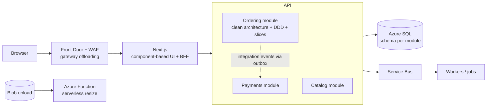

# Serverless, BFF and gateways, fitness functions, and combining styles
[← Overview](00-overview.md)

## Why it matters
- Image resizing ran inside the API. Product uploads on a busy day made the API slow for shoppers. A serverless function triggered by blob uploads would have isolated that load.
- The mobile app and web app shared one API shaped for the web. Mobile screens made 9 calls each over slow networks; a backend for frontend (BFF) would have made one.
- The architecture said "the domain never references EF Core", but nothing checked it. A year later, 40 domain classes did.

## Concepts

### Serverless
| Option (Azure) | Model | Shop use |
|:--|:--|:--|
| ⭐ Azure Functions (isolated worker, .NET 10) | event-triggered functions (HTTP, Blob, Service Bus, Timer), scale to zero, pay per execution (Flex Consumption) | image resizing on blob upload, webhook fan-out |
| ⭐ Container Apps jobs | containers that run to completion: manual, scheduled, or event-driven | migrations, nightly reconciliation, batch exports |
| Container Apps with scale to zero | HTTP/event apps that sleep when idle | low-traffic internal tools |
| Logic Apps | low-code workflows | partner integrations owned by ops |

| Serverless pros | Cons |
|:--|:--|
| no idle cost, automatic scaling | cold starts, execution time limits |
| event-driven isolation from the main app | harder local testing and debugging; more moving parts |
| | vendor-specific triggers and bindings |

### Backend for frontend and API gateways
| Pattern | Purpose | In this stack |
|:--|:--|:--|
| ⭐ BFF | a backend shaped for one frontend: aggregates calls, holds the session/cookies, hides tokens from the browser | Next.js server (Server Components, route handlers, Server Actions) acts as the web BFF |
| ⭐ API gateway | single entry for many services: routing, auth, rate limits, TLS, caching | Azure Front Door (edge), Azure API Management (partners/public API), YARP (in-app) |
| gateway aggregation | combine several backend calls into one | BFF or gateway |
| gateway offloading | auth, TLS, rate limits at the edge | Front Door WAF, APIM policies |

Keep gateways thin: routing and cross-cutting concerns, not business rules.

### Quality attributes, fitness functions, and ADRs
| Tool | Means | Example |
|:--|:--|:--|
| ⭐ fitness function | an automated check that the architecture still has a desired property | architecture tests, performance budgets, SLO alerts, dependency rules |
| ⭐ ADR | a record of a decision and its trade-offs | `docs/adr/0001-modular-monolith.md` |
| quality attribute scenario | measurable statement of a quality | "checkout p95 < 500 ms at 300 req/s" |

| Fitness function | Checks | Runs |
|:--|:--|:--|
| architecture tests (NetArchTest) | dependency rule, module boundaries | every PR |
| k6 thresholds | latency/throughput budgets | nightly, smoke per PR |
| SLO burn-rate alerts | availability | continuously |
| dependency/licence scans | allowed packages, no commercial-licence libraries | every PR |
| Bicep linter + PSRule | infrastructure rules | every infra PR |

### Combining styles
The shop in one picture:

| Level | Style |
|:--|:--|
| deployment | n-tier (browser, Next.js, API, DB) + serverless for isolated event work |
| backend code | modular monolith; clean architecture and vertical slices per module |
| core domain | DDD (aggregates, value objects, domain events) |
| integration | event-driven (outbox, Service Bus) between modules and to workers |
| reads | CQRS-lite (projections, read replica) |
| edge | gateway (Front Door) + BFF (Next.js) |

## In our stack
- Container Apps jobs and scale rules: [04-shipping/02-cloud lesson 02](../../../04-shipping/02-cloud/docs/02-networking-container-apps.md).
- Next.js server as BFF, YARP as gateway: [02-frontend/04-framework](../../../02-frontend/04-framework/README.md), [03-backend/09-scalability lesson 03](../../../03-backend/09-scalability/docs/03-horizontal-scaling-load-balancing.md).
- Architecture tests and ADRs: [03-backend/11-architecture lesson 06](../../../03-backend/11-architecture/docs/06-microservices-adrs-boundaries.md).
- k6 thresholds and SLO alerts as fitness functions: [03-backend/09-scalability](../../../03-backend/09-scalability/README.md), [03-backend/08-reliability](../../../03-backend/08-reliability/README.md).

## When not to
- Don't move core request handling to functions just to avoid paying for idle; cold starts and fragmentation can cost more than they save.
- Don't put business rules in the gateway or BFF; they become a second backend.
- Don't add an API gateway product in front of a single API with one client.

## Example
Serverless image resize (Azure Functions isolated worker, .NET 10):
```csharp
public sealed class ResizeProductImage(BlobServiceClient blobs, ILogger<ResizeProductImage> log)
{
    [Function(nameof(ResizeProductImage))]
    public async Task RunAsync([BlobTrigger("products-original/{name}", Connection = "Storage")] Stream image, string name, CancellationToken ct)
    {
        using var img = await Image.LoadAsync(image, ct);                         // SixLabors.ImageSharp (check its licence)
        foreach (var width in new[] { 320, 640, 1280 })
        {
            using var copy = img.Clone(x => x.Resize(width, 0));
            await using var output = new MemoryStream();
            await copy.SaveAsWebpAsync(output, ct);
            output.Position = 0;
            await blobs.GetBlobContainerClient("products").GetBlobClient($"{Path.GetFileNameWithoutExtension(name)}/{width}.webp")
                       .UploadAsync(output, overwrite: true, ct);
        }
        log.LogInformation("Resized {Name}", name);
    }
}
```
BFF route handler in Next.js aggregating backend calls for one screen:
```typescript
// app/api/account/summary/route.ts
import { cookies } from "next/headers";

export async function GET() {
  const token = (await cookies()).get("__Host-shop")?.value;      // session stays server-side
  const headers = { Cookie: `__Host-shop=${token}` };
  const [profile, orders, points] = await Promise.all([
    fetch(`${process.env.API_URL}/me`, { headers }).then(r => r.json()),
    fetch(`${process.env.API_URL}/me/orders?pageSize=3`, { headers }).then(r => r.json()),
    fetch(`${process.env.API_URL}/me/loyalty`, { headers }).then(r => r.json()),
  ]);
  return Response.json({ name: profile.name, recentOrders: orders.items, points: points.balance });
}
```
A licence fitness function (CI step):
```bash
dotnet list package --include-transitive --format json > packages.json
# fail if these appear at all; using an old MIT-licensed version needs an explicit, reviewed exception
jq -e '[.projects[].frameworks[]?.topLevelPackages[]?, .projects[].frameworks[]?.transitivePackages[]?
        | select((.id == "MediatR" or .id == "AutoMapper" or .id == "FluentAssertions" or .id == "MassTransit"))] | length == 0' packages.json
```

## Production patterns
- Serverless (Functions, Container Apps jobs) for isolated, event-driven or scheduled work; the core API stays a long-running service.
- Next.js as the web BFF; Front Door and (when needed) API Management as gateways; gateways stay free of business rules.
- Architecture decisions recorded as ADRs and protected by fitness functions in CI and monitoring.
- Styles combined deliberately and documented in one diagram the whole team understands.

## Mistakes
Wrong: a BFF that re-implements discount rules "to save a call".
Right: the BFF aggregates and shapes; the API decides.

Wrong: "the domain must not reference EF Core" in a wiki page only.
Right: an architecture test that fails the build.

## Check yourself
1. When is a serverless function a better fit than code in the API?
2. What's the difference between a BFF and an API gateway?
3. Give three examples of fitness functions in this stack.

<details><summary>Answers</summary>

1. For isolated, event-triggered or scheduled work with spiky or low volume (image resizing on upload, webhook fan-out, nightly jobs) that shouldn't compete with user requests and benefits from scale-to-zero.
2. A BFF is a backend built for one specific frontend's needs (aggregation, session, shaping data). An API gateway is a shared entry point for many clients and services, handling routing and cross-cutting concerns like auth, TLS, and rate limits.
3. Architecture tests for the dependency rule and module boundaries, k6 performance thresholds, SLO burn-rate alerts, licence/dependency checks, and Bicep linter/PSRule rules.
</details>

## Sources
- [Azure Functions isolated worker guide](https://learn.microsoft.com/azure/azure-functions/dotnet-isolated-process-guide)
- [Container Apps jobs](https://learn.microsoft.com/azure/container-apps/jobs)
- [Backends for Frontends pattern](https://learn.microsoft.com/azure/architecture/patterns/backends-for-frontends)
- [Gateway aggregation / offloading / routing patterns](https://learn.microsoft.com/azure/architecture/patterns/gateway-aggregation)
- [Fitness functions (Thoughtworks)](https://www.thoughtworks.com/radar/techniques/architectural-fitness-function)
- [Azure API Management](https://learn.microsoft.com/azure/api-management/api-management-key-concepts)
