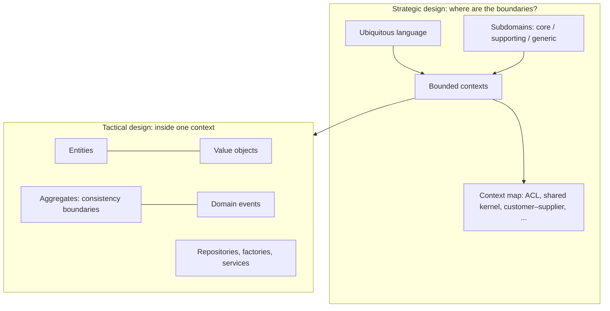

# Domain-Driven Design — Overview
[← Topic](../README.md)

**TECH:** C# 14 for the model (records as value objects, strongly typed IDs, factory methods, sum types), EF Core 10 for persisting aggregates (complex types, owned types, backing fields, value converters, `rowversion`, the outbox), SQL Server 2025 / Azure SQL
**LEVEL:** intermediate (mid-level, new to C# and .NET)

## Why this matters in production
- In complex domains, most bugs aren't technical: they're misunderstandings. "Order", "shipment", and "return" meant different things to support, finance, and developers, and the code encoded a fourth meaning.
- DDD gives you a language shared with domain experts, boundaries where meanings change, and building blocks (aggregates, value objects) that keep rules consistent.
- DDD is expensive if applied everywhere. Knowing where it pays (the core domain) and where it doesn't (CRUD, generic subdomains) is half the skill.

## Mental model

Strategic design (language, boundaries) matters more than tactical patterns. Get the boundaries right; then use the building blocks inside them.

## Prerequisites
- [01-paradigms-oop](../../01-paradigms-oop/README.md), [04-architecture-styles](../../04-architecture-styles/README.md), [03-backend/11-architecture](../../../03-backend/11-architecture/README.md), [03-backend/03-databases](../../../03-backend/03-databases/README.md).

## Lesson map
| Lesson | Checklist items |
|:--|:--|
| [01 · Why DDD, ubiquitous language, and subdomains](01-why-language-subdomains.md) | 1, 2, 3 |
| [02 · Bounded contexts and context maps](02-bounded-contexts-maps.md) | 4 |
| [03 · Entities, value objects, aggregates, and domain events](03-building-blocks-aggregates.md) | 5, 6, 7 |
| [04 · Services, modelling in C#, and persisting with EF Core](04-services-modelling-ef-core.md) | 8, 9, 10 |
| [05 · DDD with clean architecture, and when not to use DDD](05-clean-architecture-when-not.md) | 11, 12 |
| [Cheatsheet](cheatsheet.md) | all |

## Suggested order
1. 01 → 05.
2. Then [07-distributed-systems](../../07-distributed-systems/README.md) (events across contexts) and the [07-capstone](../../../07-capstone/README.md) domain document.
3. Ready to practise (event storming and modelling katas): `/learn csharp/06-design/05-domain-driven-design mode=tasks`.

## Version notes
- EF Core 8+ complex types (`ComplexProperty`) map value objects without keys; EF Core 10 adds JSON mapping and optional complex types, making them the preferred mapping for value objects over owned types in many cases.
- EF Core backing fields and `PropertyAccessMode.Field` let aggregates keep private collections and setters.
- C# records give value equality for free; C# 15 unions (.NET 11) will make "illegal states unrepresentable" easier for state types.

## Sources
- [Eric Evans — Domain-Driven Design (2003)](https://www.domainlanguage.com/ddd/)
- [Vaughn Vernon — Implementing Domain-Driven Design / DDD Distilled](https://www.informit.com/store/domain-driven-design-distilled-9780134434421)
- [Domain-driven design for microservices (Azure)](https://learn.microsoft.com/azure/architecture/microservices/model/domain-analysis)
- [DDD-oriented microservice (.NET guide)](https://learn.microsoft.com/dotnet/architecture/microservices/microservice-ddd-cqrs-patterns/ddd-oriented-microservice)
- [DDD Crew (context mapping, event storming)](https://github.com/ddd-crew)
