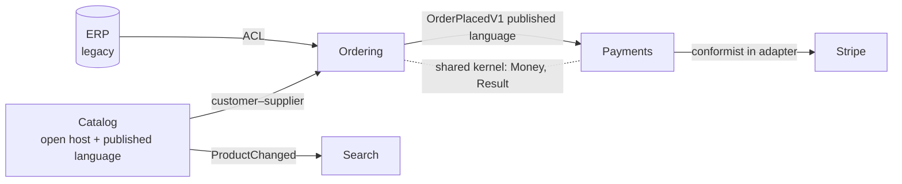

# Bounded contexts and context maps
[← Overview](00-overview.md)

## Why it matters
- One `Product` class served Catalog (descriptions, images), Inventory (stock, bins), Pricing (cost, margins), and Shipping (weight, dimensions). It had 70 properties, and every team's change risked the others.
- The shop's model of "customer" was copied from the ERP. When the ERP changed a field, the shop's checkout broke.
- Two modules shared a "common" `Order` library. Neither team could change it without the other, so neither did, and both worked around it.

## Concepts

### Bounded contexts
A **bounded context** is a boundary within which a model and its language are consistent. The same word can mean different things in different contexts, and that's fine.
| Context | "Product" means | Key data |
|:--|:--|:--|
| Catalog | something we sell and describe | name, description, images, categories, roast profile |
| Inventory | stock we hold | SKU, quantity on hand, bin, batch, roast date |
| Pricing | something with a price and margin | list price, cost, discounts |
| Shipping | a parcel item | weight, dimensions, hazardous flag |

Each context has its own model, its own data, and often its own team. They share **IDs** (SKU) and communicate through contracts and events. In the shop, contexts map to **modules** (03-backend/11-architecture).

### Context maps
| Relationship | Meaning | Shop example |
|:--|:--|:--|
| ⭐ anti-corruption layer (ACL) | downstream translates the upstream model into its own | Ordering ← ERP customers via an ACL |
| ⭐ customer–supplier | upstream (supplier) plans for downstream (customer) needs | Catalog (supplier) publishes `ProductChanged` for Search (customer) |
| ⭐ conformist | downstream adopts the upstream model as is | Payments conforms to Stripe's model inside its adapter |
| ⭐ open host service | upstream offers a well-defined protocol for many consumers | Catalog's public API / contracts |
| ⭐ published language | a shared, documented exchange format | versioned integration events (`OrderPlacedV1`), OpenAPI |
| shared kernel | two contexts share a small model and change it together | `Shop.SharedKernel` (`Money`, `Result`) — keep tiny |
| partnership | two teams succeed or fail together; coordinate closely | Ordering + Payments during checkout redesign |
| separate ways | no integration; duplicate if needed | newsletter tool vs shop |
| big ball of mud | a context without clear model | legacy system to protect against (with an ACL) |



## In our stack
- Contexts as modules with their own `DbContext` and schema: [03-backend/11-architecture lesson 01](../../../03-backend/11-architecture/docs/01-modular-monolith-layers-modules.md).
- Published language: integration events and OpenAPI contracts ([03-backend/02-api-design](../../../03-backend/02-api-design/README.md)).
- ACLs and adapters: [03-design-patterns lesson 04](../../03-design-patterns/docs/04-application-integration.md).
- Shared kernel kept tiny: `Shop.SharedKernel`.

## When not to
- Don't split a small domain into many contexts; boundaries have a cost (translation, events, duplication). Start with a few.
- Don't build ACLs against stable, well-modelled upstreams that match your language; conforming is cheaper.
- Don't grow the shared kernel into a "common" library of everything.

## Example
Each context has its own `Product`:
```csharp
// Catalog context
namespace Shop.Catalog.Domain;
public sealed class Product
{
    public Sku Sku { get; private set; }
    public string Name { get; private set; } = "";
    public RoastProfile Roast { get; private set; }
    public IReadOnlyList<Uri> Images => _images;
    private readonly List<Uri> _images = [];
}

// Inventory context
namespace Shop.Inventory.Domain;
public sealed class StockItem
{
    public Sku Sku { get; private set; }
    public int OnHand { get; private set; }
    public DateOnly RoastedOn { get; private set; }
    public Result<StockItem> Reserve(int quantity) => /* rules about freshness and quantity */ this;
}
```
Customer–supplier with a published event:
```csharp
// Catalog (supplier) publishes; Search (customer) consumes
public sealed record ProductChangedV1(string Sku, string Name, string RoastLevel, IReadOnlyList<string> Tags, bool Active);

internal sealed class IndexProduct(ISearchIndex index) : IIntegrationEventHandler<ProductChangedV1>
{
    public Task HandleAsync(ProductChangedV1 e, Guid messageId, CancellationToken ct) =>
        e.Active ? index.UpsertAsync(new SearchDocument(e.Sku, e.Name, e.RoastLevel, e.Tags), ct) : index.DeleteAsync(e.Sku, ct);
}
```
A context map as a living document (`docs/domain/context-map.md`):
```markdown
| Upstream | Downstream | Relationship | Contract |
|:--|:--|:--|:--|
| Catalog | Ordering | customer–supplier | ICatalogQueries (prices, availability) |
| Catalog | Search | open host + published language | ProductChangedV1 |
| Ordering | Payments, Loyalty, Notifications | published language | OrderPlacedV1, OrderCancelledV1 |
| ERP | Ordering | ACL | ErpTranslation (customers) |
| Stripe | Payments | conformist (inside adapter) | Stripe.net |
```

## Production patterns
- Contexts drawn where the language changes; each owns its model and data; IDs cross boundaries, objects don't.
- A context map document kept current; every relationship names its contract.
- Upstream changes are absorbed by ACLs and versioned published languages; the shared kernel is minimal and changed jointly.

## Mistakes
Wrong: one `Product` with 70 properties shared by every module.
Right: a model per context, linked by `Sku`, synchronised by events.

Wrong: `Shop.Common` containing entities from every module.
Right: a tiny shared kernel (money, results, IDs) and contracts per module.

## Check yourself
1. What defines the edge of a bounded context?
2. When do you choose an ACL over being conformist?
3. What belongs in a shared kernel?

<details><summary>Answers</summary>

1. The boundary within which a model and its language stay consistent; where a term starts meaning something different (or a different team owns the model), a new context begins.
2. When the upstream model is messy, legacy, unstable, or conflicts with your language, so translating protects your model. Conform when the upstream model is good, stable, and close to what you need.
3. Only a small set of concepts both contexts genuinely share and agree to change together, such as `Money`, `Result`, and common identifiers, never module-specific entities.
</details>

## Sources
- [Martin Fowler — Bounded context](https://martinfowler.com/bliki/BoundedContext.html)
- [DDD Crew — Context mapping](https://github.com/ddd-crew/context-mapping)
- [Azure — Identify microservice boundaries](https://learn.microsoft.com/azure/architecture/microservices/model/microservice-boundaries)
- [Anti-corruption layer pattern](https://learn.microsoft.com/azure/architecture/patterns/anti-corruption-layer)
- [Vaughn Vernon — DDD Distilled (context mapping chapter)](https://www.informit.com/store/domain-driven-design-distilled-9780134434421)
