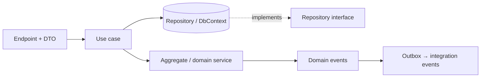

# DDD with clean architecture, and when not to use DDD
[← Overview](00-overview.md)

## Why it matters
- Repositories, specifications, domain services, and value objects were added to the product-review feature, which only stores text and a star rating. It took three times longer than the CRUD version, and nobody could explain the benefit.
- In another module, domain logic leaked into EF Core configurations and API filters, because nobody knew where each building block should live.
- A prototype for a new B2B channel was built with full DDD. The business changed direction after two months; most of the model was thrown away.

## Concepts

### Where each building block lives
| Building block | Clean/hexagonal ring | Shop location (module) |
|:--|:--|:--|
| ⭐ entities, aggregates, value objects | domain | `Shop.Ordering/Domain/` |
| ⭐ domain events | domain | `Shop.Ordering/Domain/Events/` |
| domain services | domain | `Shop.Ordering/Domain/Services/` |
| ⭐ repository interfaces (if any) | domain or application | `Shop.Ordering/Domain/IOrderRepository.cs` |
| ⭐ application services / use cases | application | `Shop.Ordering/PlaceOrder/PlaceOrderHandler.cs` (slices) |
| ports for external services | application | `IPaymentGateway` in Payments |
| ⭐ integration events | contracts | `Shop.Ordering.Contracts/OrderPlacedV1.cs` |
| repository implementations, EF Core configurations, `DbContext` | infrastructure (adapters) | `Shop.Ordering/Data/` |
| endpoints, DTOs | presentation (adapters) | `Shop.Ordering/PlaceOrder/PlaceOrderEndpoint.cs` |
| outbox, dispatchers | infrastructure (shared) | `Shop.Infrastructure/Outbox/` |


The domain folder has no references to EF Core, ASP.NET Core, or SDKs (checked by an architecture test).

### When not to use DDD
| Situation | Better approach |
|:--|:--|
| ⭐ CRUD (product reviews, settings, admin lists) | records + `DbContext` + validation; maybe a transaction script |
| ⭐ generic subdomains (payments, email, auth, tax) | buy/integrate behind ports; conform to the vendor inside the adapter |
| ⭐ prototypes and experiments | simplest code; DDD after the model stabilises |
| reporting and analytics | read models, SQL, BI tools |
| simple domain, small team, short-lived app | plain layered or vertical-slice code |
| ⭐ most of the shop outside the core | DDD-lite: ubiquitous language + bounded contexts + value objects, without the full tactical patterns |

| Signs DDD is paying off | Signs it isn't |
|:--|:--|
| business rules change often and are easy to find | lots of mapping code for simple data |
| domain experts recognise the code's terms | repositories/specs with one caller |
| bugs are rarely "two places disagree" | ceremony slows small changes |

## In our stack
- Module layout with domain, slices, data: [03-backend/11-architecture lesson 01](../../../03-backend/11-architecture/docs/01-modular-monolith-layers-modules.md).
- Architecture tests enforcing the domain's purity: [04-architecture-styles lesson 02](../../04-architecture-styles/docs/02-clean-slices-modular-monolith.md).
- Core vs supporting vs generic subdomains: [lesson 01](01-why-language-subdomains.md).
- Capstone domain decisions: [07-capstone/01-design-build](../../../07-capstone/01-design-build/README.md).

## When not to
This whole lesson is about it: reserve full tactical DDD for the core subdomain; use DDD-lite or plain code elsewhere, and revisit when complexity grows.

## Example
Same module, two styles side by side.

Core: subscriptions (full DDD)
```csharp
// Domain/Subscription.cs: aggregate with rules and events
public sealed class Subscription : IHasDomainEvents
{
    public SubscriptionId Id { get; private set; }
    public CustomerId CustomerId { get; private set; }
    public SubscriptionState State { get; private set; } = new SubscriptionState.Paused(DateOnly.MinValue);
    private readonly List<IDomainEvent> _events = [];

    public Result<Subscription> Activate(DateOnly firstRoast, int everyWeeks, DateOnly today)
    {
        if (everyWeeks is < 1 or > 8) return new Error("subscription.invalid_frequency", "1–8 weeks", ErrorType.Validation);
        if (firstRoast < today.AddDays(2)) return new Error("subscription.too_soon", "First roast at least 2 days ahead", ErrorType.Validation);
        State = new SubscriptionState.Active(firstRoast, everyWeeks);
        _events.Add(new SubscriptionActivated(Id, firstRoast, everyWeeks));
        return this;
    }
    public IReadOnlyList<IDomainEvent> DequeueEvents() { var e = _events.ToList(); _events.Clear(); return e; }
}
```
Supporting/CRUD: product reviews (plain slice, no aggregate ceremony)
```csharp
// Reviews/AddReviewEndpoint.cs
public sealed record AddReviewRequest([Range(1, 5)] int Stars, [MaxLength(2000)] string? Text);

app.MapPost("/products/{sku}/reviews", async (string sku, AddReviewRequest req, CatalogDb db, ClaimsPrincipal user, CancellationToken ct) =>
{
    db.Reviews.Add(new Review { Sku = sku, CustomerId = user.GetUserId(), Stars = req.Stars, Text = req.Text?.Trim(), CreatedAt = DateTimeOffset.UtcNow });
    await db.SaveChangesAsync(ct);
    return TypedResults.Created($"/products/{sku}/reviews");
}).RequireAuthorization().AddEndpointFilter<ValidationFilter>();
```
Both live happily in the same modular monolith; the architecture tests check boundaries, not that every feature uses every pattern.

## Production patterns
- Domain building blocks live in the domain folder (no framework references); use cases in slices; persistence and HTTP in adapters; integration events in contracts.
- Full tactical DDD in the core subdomain; DDD-lite (language, boundaries, value objects) in supporting areas; integration behind ports for generic ones.
- The choice is revisited when a CRUD area grows real rules (refactor towards a model) or a modelled area turns out simple (simplify).

## Mistakes
Wrong: aggregates, repositories, and domain events for storing a star rating.
Right: a straightforward slice; promote to a model only when rules appear.

Wrong: `[Required]` and `[Column]` attributes on domain entities so the API and EF Core "share" the model.
Right: DTOs with validation attributes at the edge; EF Core fluent configuration in the data folder; a clean domain.

## Check yourself
1. Where do integration events live, and why not in the domain folder?
2. Name three situations where full DDD is the wrong choice.
3. What is DDD-lite?

<details><summary>Answers</summary>

1. In the module's Contracts project: they're a published language other modules depend on, versioned and stable, while domain events are internal and free to change.
2. Any three of: CRUD features, generic subdomains (payments, email, auth, tax), prototypes and experiments, reporting, and simple short-lived apps.
3. Using DDD's strategic ideas (ubiquitous language, bounded contexts) and some tactical ones (value objects, clear entities) without the full set of aggregates, repositories, domain services, and events where they don't pay.
</details>

## Sources
- [DDD-oriented microservice layers (.NET guide)](https://learn.microsoft.com/dotnet/architecture/microservices/microservice-ddd-cqrs-patterns/ddd-oriented-microservice)
- [Robert C. Martin — The Clean Architecture](https://blog.cleancoder.com/uncle-bob/2012/08/13/the-clean-architecture.html)
- [Vladimir Khorikov — When to use DDD](https://enterprisecraftsmanship.com/posts/when-to-use-domain-driven-design/)
- [Martin Fowler — Transaction script](https://martinfowler.com/eaaCatalog/transactionScript.html)
- [Azure — Using tactical DDD to design microservices](https://learn.microsoft.com/azure/architecture/microservices/model/tactical-ddd)
