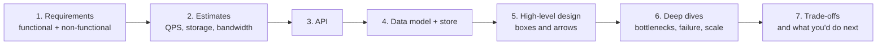

# System Design — Overview
[← Topic](../README.md)

**TECH:** designs expressed with this stack's building blocks: Azure Front Door (CDN, WAF), Container Apps (stateless services), Azure SQL / SQL Server 2025 (relational), Azure Managed Redis (cache, counters, rate limits), Service Bus (queues, topics), Blob Storage (objects), Azure AI Search (search), plus C# 14 for small algorithmic pieces (IDs, hashing, rate limiters)
**LEVEL:** intermediate (mid-level, new to C# and .NET)

## Why this matters in production
- Before writing code for a feature like "notifications" or "search", someone has to decide what boxes exist, where data lives, and what happens at 10× traffic. Getting that wrong is expensive to undo.
- System design interviews test exactly this; more importantly, so does every design doc you'll write as a senior engineer.
- A repeatable method (requirements → estimates → API → data → design → deep dives → trade-offs) turns a blank whiteboard into a reviewable plan.

## Mental model

Design for the requirements you have (with headroom), name the trade-offs, and keep the simplest design that works.

## Prerequisites
- [03-backend/09-scalability](../../../03-backend/09-scalability/README.md), [03-backend/06-caching](../../../03-backend/06-caching/README.md), [03-backend/07-background-jobs](../../../03-backend/07-background-jobs/README.md), [04-architecture-styles](../../04-architecture-styles/README.md).

## Lesson map
| Lesson | Checklist items |
|:--|:--|
| [01 · The method, estimation, and communicating designs](01-method-estimation-communication.md) | 1, 2, 12 |
| [02 · Building blocks and data storage choices](02-building-blocks-storage.md) | 3, 4 |
| [03 · Scaling data, caching, and asynchronous processing](03-scaling-data-caching-async.md) | 5, 6, 7 |
| [04 · Rate limits, idempotency, availability, security, and cost](04-limits-availability-security-cost.md) | 8, 9, 11 |
| [05 · Classic designs](05-classic-designs.md) | 10 |
| [Cheatsheet](cheatsheet.md) | all |

## Suggested order
1. 01 → 05.
2. Then [07-distributed-systems](../../07-distributed-systems/README.md) for what happens inside the boxes.
3. Ready to practise (design exercises, also with `/design`): `/learn csharp/06-design/06-system-design mode=tasks`.

## Version notes
- Numbers change: hardware and cloud limits grow every year. Treat latency figures and service limits as orders of magnitude, and check current Azure limits (Service Bus message size, Redis throughput per tier, SQL tier limits) for a real design.
- Azure Managed Redis replaces Azure Cache for Redis for new designs; Azure AI Search is the managed search building block; Azure Front Door Standard/Premium is the CDN + WAF.

## Sources
- [Azure Architecture Center](https://learn.microsoft.com/azure/architecture/)
- [Alex Xu — System Design Interview (vol. 1 and 2)](https://bytebytego.com/)
- [Martin Kleppmann — Designing Data-Intensive Applications](https://dataintensive.net/)
- [The C4 model](https://c4model.com/)
- [Azure Well-Architected Framework](https://learn.microsoft.com/azure/well-architected/)
