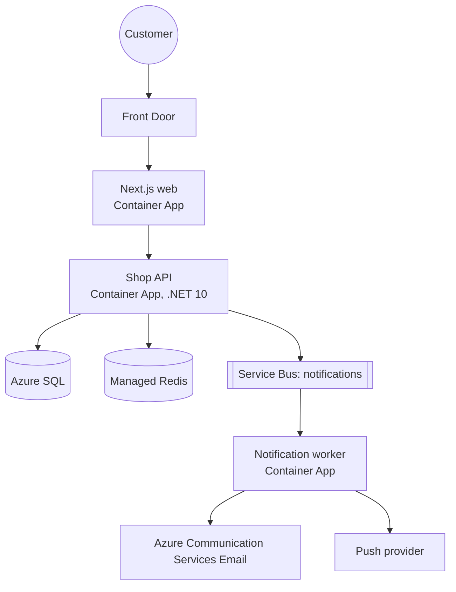

# The method, estimation, and communicating designs
[← Overview](00-overview.md)

## Why it matters
- A team designed product reviews for "millions of reviews per second". The real need was 2,000 reviews per day; the extra components cost months and money.
- A design review went in circles for an hour because there was no shared diagram; everyone pictured a different system.
- An interview candidate jumped straight into Kafka partitions without asking how many users there were; the interviewer's question was about a 50-user internal tool.

## Concepts

### The system design method
| Step | Output | Time (interview) |
|:--|:--|:--|
| ⭐ 1. requirements | functional (what it does), non-functional (scale, latency, availability, consistency, cost), out of scope | 5 min |
| ⭐ 2. estimates | users, QPS (avg/peak), read/write ratio, storage per year, bandwidth | 5 min |
| ⭐ 3. API | main endpoints or events with inputs/outputs | 5 min |
| ⭐ 4. data model | entities, keys, access patterns → store choice | 5 min |
| ⭐ 5. high-level design | boxes and arrows covering every requirement | 10 min |
| ⭐ 6. deep dives | bottlenecks, hot paths, failure modes, scaling the hard part | 10–15 min |
| ⭐ 7. trade-offs | what you chose and why; what you'd change at 10× | 5 min |

Ask before you draw: Who uses it? How many? Read-heavy or write-heavy? How fresh must data be? What can never be lost?

### Back-of-the-envelope estimation
| Rule of thumb | Value |
|:--|:--|
| seconds per day | ~86,400 ≈ 10^5 |
| ⭐ QPS from daily volume | requests/day ÷ 10^5; peak ≈ 2–5× average (10×+ for campaigns) |
| storage | items/day × size × 365 × years × replication factor |
| bandwidth | QPS × response size |

| Latency (orders of magnitude) | Value |
|:--|:--|
| main memory reference | ~100 ns |
| read 1 MB sequentially from memory | ~10 µs |
| SSD random read | ~100 µs |
| ⭐ round trip within a data centre / Azure region | ~0.5–1 ms |
| read 1 MB sequentially from SSD | ~1 ms |
| ⭐ Redis GET (same region) | ~1 ms |
| ⭐ indexed SQL query (same region) | ~1–5 ms |
| ⭐ cross-continent round trip | ~100–150 ms |

| Capacity anchors (order of magnitude, check current limits) | |
|:--|:--|
| one ASP.NET Core replica (simple JSON API) | thousands of req/s |
| one Azure SQL General Purpose 2-vCore DB | hundreds to a few thousand simple queries/s |
| one Redis node | ~100k ops/s |
| Service Bus standard queue message size | up to 256 KB (Premium: up to 100 MB) |

### Communicating designs
| Tool | Use |
|:--|:--|
| ⭐ C4 model | four zoom levels: **Context** (system and users), **Container** (deployable units and stores), **Component** (inside a container), **Code** (rarely drawn) |
| Mermaid / diagrams as code | diagrams in Markdown, versioned with the design doc |
| ⭐ design doc | context, requirements, estimates, design, alternatives, risks (05-practice lesson 03) |
| ADR | the decision and trade-offs (03-backend/11-architecture lesson 06) |
| interviews | think aloud, state assumptions, check in with the interviewer, manage time |

## In our stack
- Capacity numbers from load tests: [03-backend/09-scalability](../../../03-backend/09-scalability/README.md).
- Design docs and ADRs: [05-practice lesson 03](../../../05-practice/01-engineering-practice/docs/03-debt-design-docs-communication.md).
- The capstone system design document follows this method: [07-capstone/01-design-build](../../../07-capstone/01-design-build/README.md).

## When not to
- Don't produce a 30-page design for a feature one person builds in a week; a half-page with a diagram is enough.
- Don't over-precise estimates; orders of magnitude decide the design.
- Don't draw Component- or Code-level C4 diagrams for everything; they go stale fast.

## Example
Estimate for "order notifications" (email + push when order status changes):
```text
Requirements: notify on placed, shipped, delivered; within 1 minute; never lose a shipped notice; 1 language per user.
Users: 200k customers, 20k orders/day, ~3 notifications per order → 60k notifications/day.
Average: 60,000 / 100,000 s ≈ 0.6/s. Peak (campaign, 10×): ~6/s. Tiny.
Storage: 60k/day × 1 KB (log row) × 365 ≈ 22 GB/year. Fine for SQL.
Conclusion: one queue + one worker; no sharding, no streaming platform. Spend effort on idempotency and templates.
```
The same as a small C# helper used in design docs and tests:
```csharp
public static class Estimate
{
    public const double SecondsPerDay = 86_400;
    public static double Qps(double perDay, double peakFactor = 1) => perDay / SecondsPerDay * peakFactor;
    public static double GigabytesPerYear(double itemsPerDay, double bytesPerItem, int replicas = 1) =>
        itemsPerDay * bytesPerItem * 365 * replicas / 1e9;
}

Console.WriteLine($"peak {Estimate.Qps(60_000, peakFactor: 10):0.0}/s, {Estimate.GigabytesPerYear(60_000, 1_000):0} GB/yr");
```
C4 container diagram (Mermaid):


## Production patterns
- Every significant design starts from written requirements and rough estimates; the numbers justify (or rule out) each component.
- Designs are communicated with a C4 context and container diagram plus a short doc; decisions go into ADRs.
- Estimates are revisited with real measurements after launch.

## Mistakes
Wrong: "We'll need Kafka and sharding" before knowing the volume.
Right: estimate first; 6 messages per second needs a queue, not a streaming platform.

Wrong: a whiteboard full of boxes with no data flow or labels.
Right: labelled arrows (protocol, sync/async), named stores, and a legend.

## Check yourself
1. How do you turn "2 million requests per day" into QPS?
2. What are the first two C4 levels, and what do they show?
3. Which questions do you ask before drawing anything?

<details><summary>Answers</summary>

1. Divide by ~10^5 seconds per day: about 20 requests per second on average; multiply by a peak factor (2–10×) for capacity planning.
2. Context (the system as one box, its users, and external systems) and Container (the deployable units and data stores inside the system and how they communicate).
3. Who the users are and how many, the key features, read/write ratio, latency and freshness needs, availability and durability needs (what can't be lost), constraints, and what's out of scope.
</details>

## Sources
- [Jeff Dean — Latency numbers every programmer should know](https://gist.github.com/jboner/2841832)
- [The C4 model](https://c4model.com/)
- [Mermaid flowcharts](https://mermaid.js.org/syntax/flowchart.html)
- [Azure subscription and service limits](https://learn.microsoft.com/azure/azure-resource-manager/management/azure-subscription-service-limits)
- [Service Bus quotas](https://learn.microsoft.com/azure/service-bus-messaging/service-bus-quotas)
