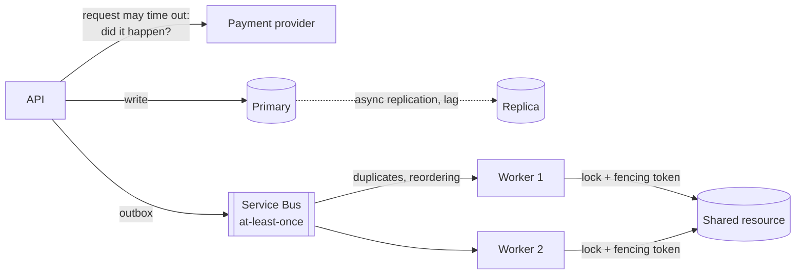

# Distributed Systems — Overview
[← Topic](../README.md)

**TECH:** the stack's distributed pieces as examples: Azure SQL (replication, failover groups, `rowversion`), Redis (locks, counters), Azure Service Bus (delivery guarantees, sessions, duplicate detection, dead-lettering), the outbox/inbox from 03-backend, and C# 14 for small implementations (clocks, idempotent consumers, sagas, event-sourced aggregates)
**LEVEL:** intermediate (mid-level, new to C# and .NET), with advanced notes

## Why this matters in production
- As soon as the shop has an API, a database, a cache, a queue, and Stripe, it's a distributed system: messages get lost or duplicated, clocks disagree, and "did the payment succeed?" can have no answer for a while.
- Most hard bugs (double charges, lost events, stale reads, two workers doing the same job) come from assuming one machine's guarantees across many.
- The theory (CAP, consistency models, consensus) explains why the patterns from earlier modules (idempotency, outbox, sagas, fencing) exist.

## Mental model

Assume the network fails, messages repeat, clocks drift, and partial failure is normal; design every interaction so that retries, duplicates, and delays are harmless.

## Prerequisites
- [03-backend/07-background-jobs](../../../03-backend/07-background-jobs/README.md) (outbox, idempotency), [03-backend/08-reliability](../../../03-backend/08-reliability/README.md), [06-system-design](../../06-system-design/README.md).

## Lesson map
| Lesson | Checklist items |
|:--|:--|
| [01 · Fallacies, partial failure, CAP, PACELC, and consistency models](01-fallacies-cap-consistency.md) | 1, 2, 3 |
| [02 · Replication, partitioning, and time and ordering](02-replication-partitioning-time.md) | 4, 5, 6 |
| [03 · Consensus, locks, fencing, and delivery guarantees](03-consensus-locks-delivery.md) | 7, 8 |
| [04 · Distributed transactions, sagas, CQRS, and event sourcing](04-sagas-cqrs-event-sourcing.md) | 9, 10 |
| [05 · Testing distributed behaviour](05-testing-distributed.md) | 11 |
| [Cheatsheet](cheatsheet.md) | all |

## Suggested order
1. 01 → 05.
2. Then the [07-capstone](../../../07-capstone/README.md) system design document, which applies these ideas.
3. Ready to practise: `/learn csharp/06-design/07-distributed-systems mode=tasks`.

## Version notes
- Azure SQL active geo-replication and failover groups are asynchronous (RPO of seconds); within a region, Business Critical/Premium replicas are synchronous (Always On availability groups).
- Service Bus guarantees at-least-once delivery in peek-lock mode, ordered delivery per session, and duplicate detection by `MessageId` within a configurable window.
- Redis single-instance locks (`SET key value NX PX`) are fine for efficiency; for correctness, combine them with fencing tokens (Redlock's safety is debated).

## Sources
- [Martin Kleppmann — Designing Data-Intensive Applications](https://dataintensive.net/)
- [Fallacies of distributed computing](https://en.wikipedia.org/wiki/Fallacies_of_distributed_computing)
- [Jepsen — consistency models](https://jepsen.io/consistency)
- [Service Bus message sequencing and sessions](https://learn.microsoft.com/azure/service-bus-messaging/message-sessions)
- [Azure SQL high availability](https://learn.microsoft.com/azure/azure-sql/database/high-availability-sla)
