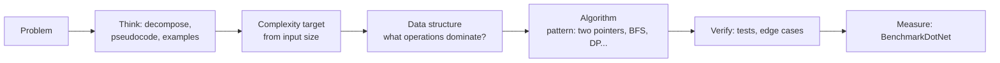

# Data Structures & Algorithms — Overview
[← Topic](../README.md)

**TECH:** C# 14 on .NET 10: arrays, `Span<T>`, `List<T>`, `LinkedList<T>`, `Stack<T>`, `Queue<T>`, `Dictionary<TKey,TValue>`, `HashSet<T>`, `PriorityQueue<TElement,TPriority>`, `SortedDictionary`/`SortedSet`, `FrozenDictionary`, immutable collections, LINQ, plus your own implementations for learning; xUnit v3 for tests and BenchmarkDotNet for measuring
**LEVEL:** beginner to intermediate (this topic covers the Microsoft certificate's DSA course)

## Why this matters in production
- Choosing the right collection is a daily decision: a `List<T>.Contains` inside a loop over 100,000 orders is O(n²) and turns a 50 ms job into a 10-minute one; a `HashSet<T>` makes it O(n).
- Most production performance bugs aren't exotic algorithms; they're the wrong data structure, accidental quadratic loops, or missing indexes (which are B-trees).
- Interviews test this directly, and the problem-solving method (clarify, examples, brute force, optimise, test) is useful far beyond interviews.

## Mental model

Pick the data structure by the operations you do most (lookup, insert, ordered iteration, min/max), then the algorithm by the problem's shape.

## Prerequisites
- [03-backend/01-language-runtime](../../../03-backend/01-language-runtime/README.md) (C#, generics, LINQ), [01-paradigms-oop](../../01-paradigms-oop/README.md).

## Lesson map
| Lesson | Checklist items |
|:--|:--|
| [01 · Computational thinking and complexity](01-thinking-complexity.md) | 1, 2 |
| [02 · Arrays, lists, linked lists, stacks, and queues](02-arrays-lists-stacks-queues.md) | 3, 4, 6 |
| [03 · Hash tables and sorted and read-optimised collections](03-hash-tables-sorted-collections.md) | 5, 9 |
| [04 · Trees, heaps, and tries](04-trees-heaps-tries.md) | 7, 8, 10 |
| [05 · Graphs and shortest paths](05-graphs-shortest-paths.md) | 11, 12 |
| [06 · Sorting and searching](06-sorting-searching.md) | 13, 14 |
| [07 · Recursion, backtracking, and dynamic programming](07-recursion-dp.md) | 15, 16 |
| [08 · Problem-solving patterns, measuring, and the interview method](08-patterns-measuring-interviews.md) | 17, 18, 19 |
| [Cheatsheet](cheatsheet.md) | all |

## Suggested order
1. 01 → 08, alongside the foundations and backend modules (one lesson per week works well, with katas).
2. Then [06-system-design](../../06-system-design/README.md), where these structures appear at system scale (B-trees, hash rings, tries).
3. Ready to practise (katas with tests): `/learn csharp/06-design/08-data-structures-algorithms mode=tasks`.

## Version notes
- `PriorityQueue<TElement,TPriority>` (.NET 6+) is a min-heap; `FrozenDictionary`/`FrozenSet` (.NET 8+) optimise read-only lookups; `SearchValues<T>` (.NET 8+) speeds up "any of" searches.
- `Array.Sort`/`List<T>.Sort` use introsort (unstable); LINQ `OrderBy` is a stable sort.
- C# 14 first-class `Span<T>` conversions make slicing arrays without copying more natural.

## Sources
- [Collections and data structures (.NET)](https://learn.microsoft.com/dotnet/standard/collections/)
- [Introduction to Algorithms (CLRS)](https://mitpress.mit.edu/9780262046305/introduction-to-algorithms/)
- [Big-O cheat sheet](https://www.bigocheatsheet.com/)
- [Microsoft Back-End Developer certificate (DSA course)](https://www.coursera.org/professional-certificates/microsoft-back-end-developer)
- [BenchmarkDotNet](https://benchmarkdotnet.org/)
