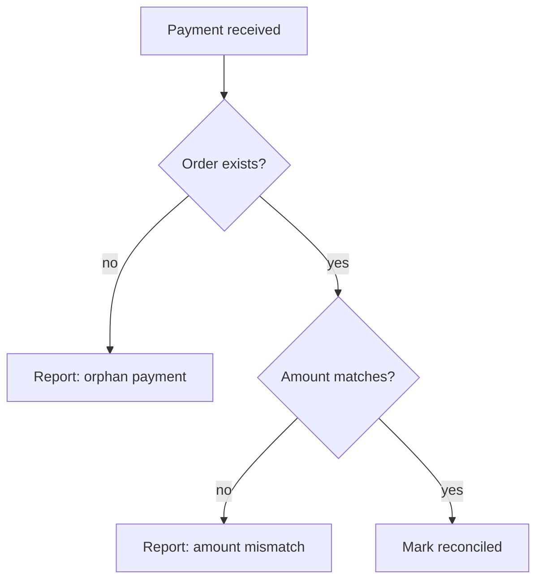

# Computational thinking and complexity
[← Overview](00-overview.md)

## Why it matters
- A nightly job matched 200,000 payments to orders with a nested loop. It worked in testing with 100 rows and took 6 hours in production: O(n²).
- A developer started coding a discount engine straight away, rewrote it three times, and still missed cases a 10-line pseudocode sketch would have shown.
- An "optimisation" made a function faster for 10 items and slower for 10,000, because nobody thought about how cost grows with input.

## Concepts

### Computational thinking
| Skill | Means | Example |
|:--|:--|:--|
| ⭐ decomposition | split a problem into smaller ones | "find reorder candidates" = load stock → compute daily sales → compare with lead time |
| pattern recognition | notice it looks like a known problem | "top 10 bestsellers" = top-k (heap) |
| abstraction | keep only what matters | products as (SKU, sales/day, stock) tuples |
| ⭐ algorithm design | steps that always work, including edge cases | pseudocode before C# |
| flowcharts | visualise branches and loops | Mermaid flowcharts in design docs |

### Complexity analysis
| Notation | Meaning |
|:--|:--|
| ⭐ Big-O | upper bound on growth as input size n grows (constants and lower terms dropped) |
| Ω (omega) / Θ (theta) | lower bound / tight bound (less used day to day) |
| ⭐ time vs space | operations vs extra memory |
| best / average / worst case | e.g. quicksort: O(n log n) average, O(n²) worst |
| ⭐ amortised | average per operation over a sequence: `List<T>.Add` is O(1) amortised although resizing is O(n) |

| Class | Name | n = 1,000,000 → roughly | Example |
|:--|:--|:--|:--|
| O(1) | constant | 1 | `Dictionary` lookup, array index |
| O(log n) | logarithmic | 20 | binary search, balanced tree lookup |
| ⭐ O(n) | linear | 10^6 | one pass, `List.Contains` |
| ⭐ O(n log n) | linearithmic | 2×10^7 | good sorting |
| ⭐ O(n²) | quadratic | 10^12 (too slow) | nested loops over the same data |
| O(2^n) | exponential | impossible | naive subsets |
| O(n!) | factorial | impossible | all permutations |

| Input size | Target complexity (≈ 10^8 simple ops/s) |
|:--|:--|
| n ≤ 20 | O(2^n) ok |
| n ≤ 10^3–10^4 | O(n²) ok |
| n ≤ 10^6 | O(n log n) |
| n ≥ 10^7 | O(n) or better |

Hidden costs in C#: `List.Contains`/`IndexOf`/`Remove` (O(n)), `string` concatenation in loops (O(n²)), LINQ `Count()` on non-collections (O(n)), multiple enumeration of `IEnumerable<T>` (CA1851), `ToList()` inside loops, EF Core N+1 queries.

## In our stack
- Measuring instead of guessing: [03-backend/09-scalability lesson 02](../../../03-backend/09-scalability/docs/02-benchmarks-dotnet-performance.md).
- Indexes turn O(n) table scans into O(log n) seeks: [03-backend/03-databases](../../../03-backend/03-databases/README.md).
- Estimation at system scale: [06-system-design lesson 01](../../06-system-design/docs/01-method-estimation-communication.md).

## When not to
- Don't optimise O(n²) code that runs on 20 items once a day; clarity wins.
- Don't trust Big-O alone for small inputs; constants and memory layout matter (lesson 08: measure).
- Don't over-plan simple tasks; pseudocode is for anything with branches, loops, or edge cases you're unsure about.

## Example
Pseudocode first (reconciliation: match payments to orders):
```text
input: orders (id, totalMinor), payments (orderId, amountMinor)
build map: orderId → order                       // O(n)
for each payment:                                // O(m)
    order = map[payment.orderId] (or missing)    // O(1)
    if missing or amount differs → report
output: mismatches
total: O(n + m) time, O(n) extra space
```
The quadratic version and the linear one:
```csharp
public sealed record OrderTotal(long OrderId, long TotalMinor);
public sealed record PaymentRow(long OrderId, long AmountMinor);

public static class Reconcile
{
    // O(n·m): fine for 100 rows, hours for 200,000
    public static List<PaymentRow> MismatchesSlow(List<OrderTotal> orders, List<PaymentRow> payments) =>
        payments.Where(p => !orders.Any(o => o.OrderId == p.OrderId && o.TotalMinor == p.AmountMinor)).ToList();

    // O(n + m)
    public static List<PaymentRow> Mismatches(IReadOnlyList<OrderTotal> orders, IReadOnlyList<PaymentRow> payments)
    {
        var byId = new Dictionary<long, long>(orders.Count);
        foreach (var o in orders) byId[o.OrderId] = o.TotalMinor;

        var result = new List<PaymentRow>();
        foreach (var p in payments)
            if (!byId.TryGetValue(p.OrderId, out var total) || total != p.AmountMinor)
                result.Add(p);
        return result;
    }
}
```
Amortised O(1) in action (and how to avoid resizes):
```csharp
var list = new List<int>(capacity: 1_000_000);     // pre-size when you know n: no resize copies
for (var i = 0; i < 1_000_000; i++) list.Add(i);
```
A decision as a flowchart:


## Production patterns
- Before coding anything non-trivial: decompose, write pseudocode or a flowchart, list edge cases (empty, one item, duplicates, huge input).
- Estimate complexity from the expected input size; aim for O(n log n) or better for anything that scales with data.
- Watch for hidden O(n) operations inside loops; replace list lookups with hash-based structures.

## Mistakes
Wrong: `foreach (var p in payments) if (orders.Any(o => o.Id == p.OrderId)) ...` over large lists.
Right: build a `Dictionary`/`HashSet` once, then O(1) lookups.

Wrong: `var s = ""; foreach (var line in lines) s += line;`
Right: `string.Join` or `StringBuilder` (O(n) instead of O(n²)).

## Check yourself
1. What does "amortised O(1)" mean for `List<T>.Add`?
2. Roughly how many operations is O(n²) for n = 100,000?
3. Name three hidden O(n) operations in everyday C#.

<details><summary>Answers</summary>

1. Most adds are O(1); occasionally the internal array doubles and copies (O(n)), but averaged over many adds the cost per add is constant.
2. 10^10, far too many for an interactive request (minutes to hours).
3. Any three of: `List.Contains`/`IndexOf`/`Remove`, `Enumerable.Count()` on a non-collection sequence, `string` concatenation in a loop, `ToList()` in a loop, `ElementAt` on sequences, repeated enumeration of a deferred LINQ query.
</details>

## Sources
- [Big-O notation (Wikipedia)](https://en.wikipedia.org/wiki/Big_O_notation)
- [Collections and performance (.NET)](https://learn.microsoft.com/dotnet/standard/collections/#algorithmic-complexity-of-collections)
- [CA1851: possible multiple enumerations](https://learn.microsoft.com/dotnet/fundamentals/code-analysis/quality-rules/ca1851)
- [Jeannette Wing — Computational thinking](https://www.cs.cmu.edu/~15110-s13/Wing06-ct.pdf)
- [Mermaid flowcharts](https://mermaid.js.org/syntax/flowchart.html)
