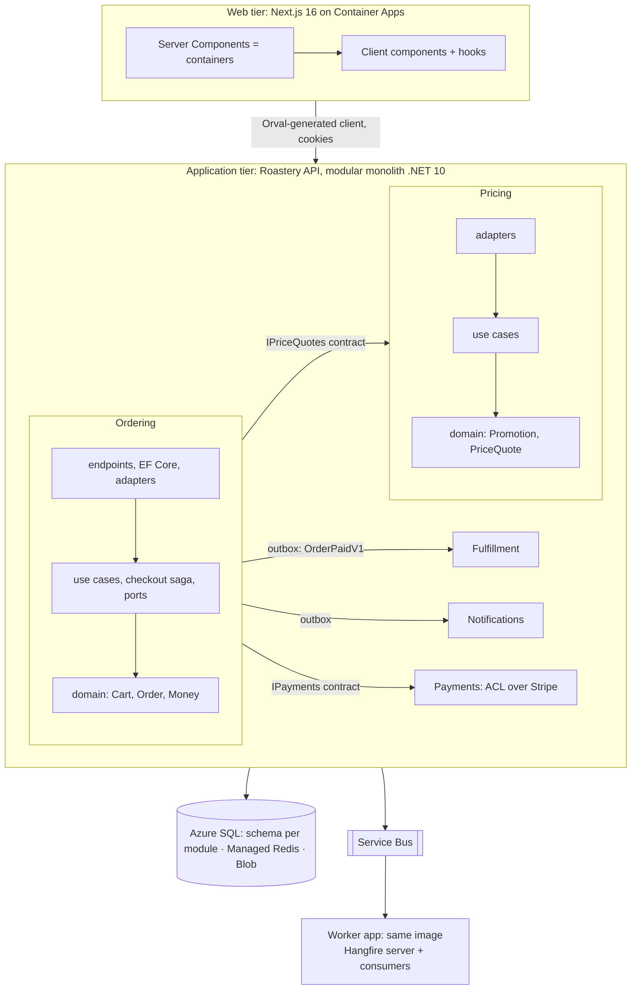

# Design & Build — Overview
[← Topic](../README.md)

**TECH:** the whole stack from STACK.md: a Next.js 16 web app; an ASP.NET Core 10 modular monolith (Minimal APIs, EF Core 10, Dapper for reports) with Hangfire and Service Bus workers from the same image; Azure SQL, Azure Managed Redis, Blob Storage, Stripe, Azure Communication Services Email; deployed to Azure Container Apps with Bicep, azd, and GitHub Actions
**LEVEL:** intermediate → senior (this is where the modules come together)
**KIND:** capstone: these documents are the project specification; tasks are milestones

## What you build
**Roastery**: the online shop of a specialty coffee roaster. Customers browse coffees and equipment, choose variants (size, grind), apply promotions, pay with Stripe, and receive their parcels; staff manage the catalog, stock, orders, and refunds. It's small enough to finish and rich enough to need every idea in the course: a real core domain (pricing and ordering), money, stock, asynchronous flows, and production operations.

## How the ideas fit together
DDD, clean architecture, and the modular monolith don't compete; each answers a different question.
| Question | Answer in Roastery | Taught in |
|:--|:--|:--|
| Where does code run? | **n-tier**: browser · Front Door · Next.js (web tier) · ASP.NET Core API (application tier) · Azure SQL / Redis / Blob (data tier) · workers | [06-design/04 lesson 01](../../../06-design/04-architecture-styles/docs/01-forces-layered-ui.md) |
| How many deployables? | **modular monolith**: one API image, run as `api` and `worker` Container Apps, plus a migration job | [06-design/04 lesson 02](../../../06-design/04-architecture-styles/docs/02-clean-slices-modular-monolith.md) |
| What are the modules and the model? | **DDD**: bounded contexts (Catalog, Pricing, Ordering, Payments, Fulfillment, Identity, Notifications), aggregates, ubiquitous language | [06-design/05](../../../06-design/05-domain-driven-design/README.md) |
| Which way do dependencies point inside a module? | **clean/hexagonal**: endpoints and adapters → use cases → domain | [03-backend/11-architecture lesson 01](../../../03-backend/11-architecture/docs/01-modular-monolith-layers-modules.md) |
| How do modules talk? | contracts for queries needed now; **outbox events** for consequences; an orchestrated **checkout saga** | [06-design/07 lesson 04](../../../06-design/07-distributed-systems/docs/04-sagas-cqrs-event-sourcing.md) |
| How are reads served? | **CQRS-lite**: projections, Dapper queries, read replica for reports | [06-design/04 lesson 03](../../../06-design/04-architecture-styles/docs/03-microservices-events-cqrs.md) |
| How is the UI organised? | React Server Components as containers, client components and hooks; Next.js as the **BFF** | [06-design/03 lesson 05](../../../06-design/03-design-patterns/docs/05-frontend-antipatterns-choosing-dotnet.md) |

**DDD shapes the boxes; clean architecture shapes the arrows inside each box.**

## Documents
| Document | Checklist items |
|:--|:--|
| [01 · Product and domain](01-product-and-domain.md) | 1, 2, 3, 4 |
| [02 · Architecture](02-architecture.md) | 5, 6, 7, 11 |
| [03 · System design, data, and cross-cutting concerns](03-system-design-and-data.md) | 8, 9, 10 |
| [04 · Milestones](04-milestones.md) | 12 |
| [Cheatsheet](cheatsheet.md) | all |

## Rules for the project
- Every major decision gets an ADR in `docs/adr/` before or while it's implemented (02-architecture lists the first ones).
- Business rules live in domain code with unit tests (xUnit v3 + Shouldly); adapters are tested against real SQL Server and Redis (Testcontainers), the Service Bus emulator, Azurite, and fakes/WireMock.Net for Stripe and email.
- Boundaries are enforced in CI: project references, `internal` types, NetArchTest architecture tests, CODEOWNERS.
- Each milestone ends deployed to staging (and production from M4), with dashboards and runbooks updated.

## Sources
- [STACK.md](../../../../STACK.md) (the decisions this project uses)
- [Azure Architecture Center — web app reference architectures](https://learn.microsoft.com/azure/architecture/web-apps/)
- [eShop reference application (.NET)](https://github.com/dotnet/eShop)
- [Modular monolith with DDD (sample)](https://github.com/kgrzybek/modular-monolith-with-ddd)
