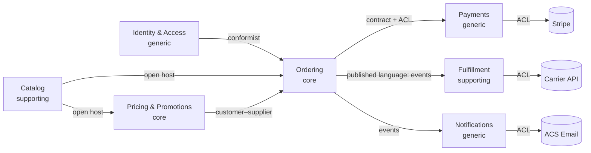
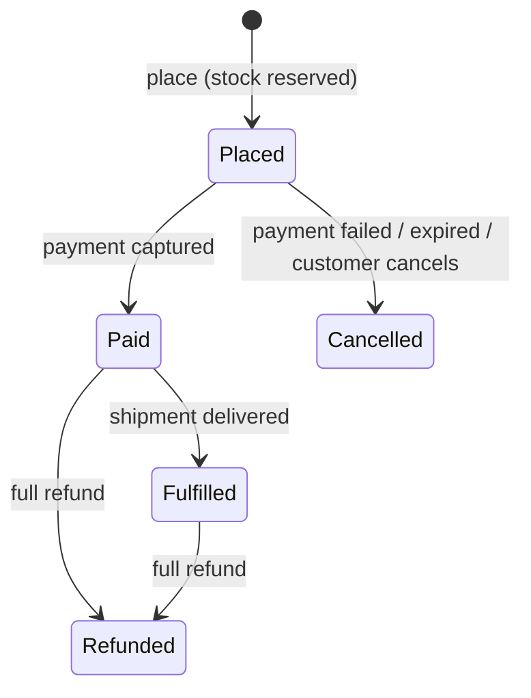

# Product and domain
[← Overview](00-overview.md)

## Why it matters
- Without written scope and numbers, the capstone grows forever or skips the hard parts.
- The domain work decides the module boundaries. Wrong bounded contexts mean every feature crosses every module.
- Aggregates and invariants written down first make the code obvious; discovered in code, they make it a mess.

## Product scope
| In scope (v1) | Out of scope (v1) |
|:--|:--|
| Catalog: coffees and equipment with variants (size, grind), images, categories | marketplace sellers |
| Accounts: sign-up, login, password reset, passkeys or TOTP MFA for staff (ASP.NET Core Identity) | social logins beyond one provider |
| Cart for guests and customers; merge on login | wish lists |
| Promotions: percentage and fixed coupons; automatic "free shipping over €40" | loyalty points, subscriptions (v2) |
| Checkout with Stripe Checkout (cards, wallets); EU VAT included in prices | multiple currencies |
| Orders: history, status, cancellation before payment, refunds by staff | self-service returns portal |
| Fulfillment: stock per variant, reservations, shipments with tracking from one carrier | multi-warehouse routing |
| Notifications: order confirmation, shipping, password reset (ACS Email) | SMS, push |
| Staff admin: products, stock, orders, refunds, promotions | custom report builder |

### Non-functional requirements (numbers)
| Requirement | Target |
|:--|:--|
| Traffic | 20k daily visitors; API peak 20 req/s; campaign peak 100 req/s |
| Orders | 300/day; peak 30/minute during campaigns |
| Latency | product page API p95 < 300 ms; checkout start p95 < 800 ms |
| Availability | 99.9% monthly for browse and checkout (SLOs in 03-backend/08-reliability) |
| Durability | no acknowledged order or payment lost; RPO 5 min; RTO 1 h |
| Consistency | stock reservation and payment status strongly consistent; catalog, search, dashboards eventually consistent |
| Security and privacy | OWASP Top 10:2025 reviewed; GDPR (access, erasure, breach process); no card data on our servers |
| Accessibility | WCAG 2.2 AA |
| Cost | production under a set monthly budget with alerts (04-shipping/02-cloud lesson 05) |

## Domain discovery
Event storming result for the main flow (events in time order):
| # | Domain event | Command | Actor / trigger | Policy (whenever…) |
|:--|:--|:--|:--|:--|
| 1 | Product published | Publish product | staff | → index for search |
| 2 | Item added to cart | Add to cart | customer | — |
| 3 | Promotion applied | Apply coupon | customer | — |
| 4 | Order placed | Place order | customer (checkout) | → reserve stock |
| 5 | Stock reserved | Reserve stock | policy | → create payment session |
| 6 | Payment session created | Create payment session | policy | — |
| 7 | Payment captured | (Stripe webhook) | Stripe | → mark order paid |
| 8 | Order paid | Mark paid | policy | → request shipment; send confirmation |
| 9 | Shipment created | Create shipment | policy / staff | → send shipping email |
| 10 | Parcel shipped | (carrier webhook or staff) | carrier | → update order status |
| — | Payment failed / session expired | (Stripe webhook / timer) | Stripe, scheduler | → release stock; cancel order |
| — | Refund issued | Refund order | staff | → restock or write off per case |

Hotspots resolved with "the business":
| Question | Decision |
|:--|:--|
| what happens to stock while the customer is on Stripe for 50 minutes? | the reservation expires with the Stripe Checkout session (60 minutes) |
| can promotions stack? | no: the best single promotion applies |
| partial refunds? | staff only, per line |
| price changes during checkout? | prices are frozen in the order at placement |

## Ubiquitous language (excerpt of `docs/domain/glossary.md`)
| Term | Context | Meaning |
|:--|:--|:--|
| Product | Catalog | what's sold under one name and description ("Ethiopia Guji") |
| Variant / SKU | Catalog, Fulfillment | one buyable option (250 g, whole bean), identified by a SKU |
| Listing price | Catalog | the price shown before promotions |
| Promotion | Pricing | a rule that reduces a price: coupon or automatic, with validity and limits |
| Price quote | Pricing | computed prices for a cart at a moment, with the applied promotion |
| Cart | Ordering | what a shopper intends to buy; no stock reserved |
| Order | Ordering | a committed purchase created at checkout, with a status lifecycle |
| Placed / Paid / Cancelled / Fulfilled / Refunded | Ordering | order states; *placed* = created and stock reserved, awaiting payment |
| Reservation | Fulfillment | stock held for a placed order until paid or expired |
| Shipment | Fulfillment | one parcel to one address with tracking |
| Payment | Payments | our record of a Stripe payment for an order |

## Subdomains and bounded contexts
| Context (module) | Subdomain | Owns | Integration |
|:--|:--|:--|:--|
| **Pricing & Promotions** | core | promotions, coupon redemptions, price quotes | `IPriceQuotes` contract for Ordering (customer–supplier) |
| **Ordering** | core | carts, orders, checkout saga | publishes `OrderPlacedV1`, `OrderPaidV1`, `OrderCancelledV1` |
| Catalog | supporting | products, variants, listings, images | open host (`ICatalogQueries`, product API); `ProductChangedV1` |
| Fulfillment | supporting | stock items, reservations, shipments | `IStock` contract; reacts to Ordering events; carrier ACL |
| Payments | generic (Stripe) | payments, refunds, Stripe events | `IPayments` contract; ACL over Stripe |
| Identity & Access | generic (ASP.NET Core Identity) | users, roles, sessions, passkeys | conformist to Identity |
| Notifications | generic (ACS Email) | emails, templates, suppressions | reacts to events; ACS ACL |

## Aggregates and invariants (core and key supporting contexts)
| Aggregate | Context | Invariants | References |
|:--|:--|:--|:--|
| Cart | Ordering | ≤ 50 lines; quantity 1–99; one line per variant; one owner (guest token or customer) | variant IDs, customer ID |
| Order | Ordering | total = sum of frozen line prices − discount; transitions only via the lifecycle; lines frozen after placement; cancel only before payment | customer ID, variant IDs, payment ID |
| Promotion | Pricing | valid window; usage limit not exceeded; no stacking; minimum basket respected | — |
| CouponRedemption | Pricing | one redemption per (coupon, customer) for single-use coupons (unique constraint) | promotion ID, order ID |
| StockItem | Fulfillment | `OnHand ≥ 0`; `Reserved ≤ OnHand` | SKU |
| Reservation | Fulfillment | expires after 60 min unless confirmed; released exactly once | order ID, SKU lines |
| Payment | Payments | one successful capture per order; refunds ≤ captured amount | order ID |

Order lifecycle:

Modelled in C# as transition methods with an allowed-transitions table ([06-design/03 lesson 03](../../../06-design/03-design-patterns/docs/03-behavioral.md)), strongly typed IDs, and `Money` as a value object ([06-design/05 lesson 04](../../../06-design/05-domain-driven-design/docs/04-services-modelling-ef-core.md)).

## Mistakes
Wrong: one `Product` entity shared by Catalog, Pricing, and Fulfillment.
Right: each context models what it needs; they share SKUs and IDs.

Wrong: stock as a property on the catalog product (`product.Stock -= 1` at checkout).
Right: Fulfillment owns stock and reservations; Ordering asks through `IStock`.

Wrong: promotions computed in the frontend.
Right: Pricing computes quotes on the server; the UI displays them.

## Check yourself
1. Why are Pricing and Ordering core subdomains, and Payments generic?
2. Which invariants force stock reservation to be strongly consistent?
3. Why does the Order aggregate reference variants by ID and freeze prices instead of embedding catalog products?

Answers

1. Pricing rules and the ordering experience differentiate the shop and change often with the business, so they deserve rich models; payments are a solved problem provided by Stripe, so they get a thin ACL.
2. `Reserved ≤ OnHand` and "no overselling": two concurrent checkouts for the last bag must not both succeed, so the reservation must be an atomic, consistent database operation (conditional update or row lock), not an eventually consistent one.
3. Products belong to Catalog and change independently (names, prices, images). The order stores variant IDs plus the names and prices it was sold with, so later catalog changes can't alter past orders, and the contexts stay decoupled.

## Sources
- [Alberto Brandolini — EventStorming](https://www.eventstorming.com/)
- [DDD Crew — Bounded context canvas](https://github.com/ddd-crew/bounded-context-canvas)
- [Martin Fowler — Ubiquitous language](https://martinfowler.com/bliki/UbiquitousLanguage.html)
- [Vaughn Vernon — Effective aggregate design](https://www.dddcommunity.org/library/vernon_2011/)
- [Stripe Checkout sessions (expiry)](https://docs.stripe.com/payments/checkout/managing-limited-inventory)
