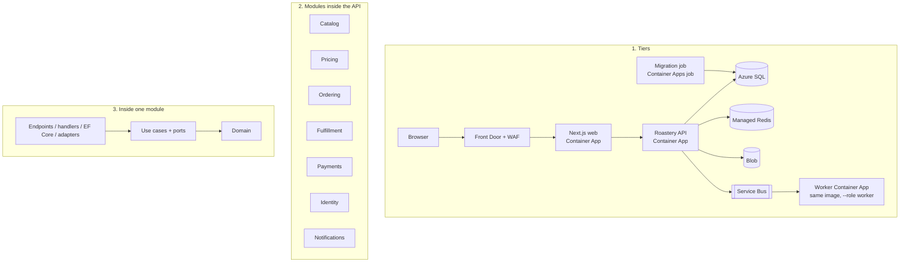

# Architecture
[← Overview](00-overview.md)

## Why it matters
- The architecture decides how expensive each milestone after M2 will be. A tangle created in week two costs weeks later.
- Boundaries that only exist in a diagram erode within months; boundaries the compiler and CI enforce survive.
- Patterns applied everywhere make a small app slow to change; applied where they pay, they make change cheap. A written map keeps the team honest.

## Architecture at three levels

| Level | Decision | ADR |
|:--|:--|:--|
| tiers | Next.js web + one API image (api/worker roles) + Azure SQL/Redis/Blob/Service Bus on Container Apps | ADR-0001 |
| modules | modular monolith; one module per bounded context; contracts + events between modules | ADR-0002 |
| inside a module | clean architecture with vertical slices; domain free of frameworks | ADR-0003 |

## Repository layout
```text
roastery/
  Roastery.slnx
  Directory.Build.props, Directory.Packages.props (Central Package Management), global.json
  src/
    Roastery.Api/                       # host: Program.cs, composition root, middleware, OpenAPI; --role api|worker
    Modules/
      Catalog/      Roastery.Catalog.Contracts/      Roastery.Catalog/
      Pricing/      Roastery.Pricing.Contracts/      Roastery.Pricing/
      Ordering/     Roastery.Ordering.Contracts/     Roastery.Ordering/
      Fulfillment/  Roastery.Fulfillment.Contracts/  Roastery.Fulfillment/
      Payments/     Roastery.Payments.Contracts/     Roastery.Payments/
      Identity/     Roastery.Identity/
      Notifications/Roastery.Notifications/
    Shared/Roastery.SharedKernel/       # Money, Result, Error, IDs base, IClock helpers (tiny)
    Shared/Roastery.Infrastructure/     # outbox, inbox, event dispatch, telemetry setup
  web/                                  # Next.js 16 (App Router), Orval-generated API client + Zod schemas
  tests/
    Roastery.<Module>.Tests/            # domain + use cases (unit)
    Roastery.Api.IntegrationTests/      # WebApplicationFactory + Testcontainers (SQL, Redis), Service Bus emulator, Azurite
    Roastery.ArchitectureTests/         # NetArchTest rules
  infra/                                # Bicep (main.bicep, modules/, env/*.bicepparam), azure.yaml
  perf/                                 # k6 scripts, BenchmarkDotNet project
  docs/                                 # adr/, domain/, runbooks/, design/
  .github/                              # workflows, CODEOWNERS, PR template, copilot-instructions.md
```
Each module project contains `Domain/`, use-case slices (`PlaceOrder/`, `ApplyCoupon/`...), `Data/` (its own `DbContext` and schema), and `XxxModule.cs` (`AddXxxModule`, `MapXxxEndpoints`) ([03-backend/11-architecture lesson 01](../../../03-backend/11-architecture/docs/01-modular-monolith-layers-modules.md)).

## Module boundaries and their enforcement
| Rule | Enforced by |
|:--|:--|
| ⭐ modules reference only other modules' `*.Contracts` | project references (review + architecture test) |
| ⭐ only contracts and the module entry point are `public` | `internal` + NetArchTest `Should().NotBePublic()` |
| ⭐ domain has no EF Core / ASP.NET Core / Stripe / Azure SDK dependencies | NetArchTest `ShouldNot().HaveDependencyOnAny(...)` |
| ⭐ each module owns its schema (`catalog.*`, `ordering.*`...) | one `DbContext` per module; migrations history table per schema |
| no cross-module SQL | code review + a test that scans `FromSql`/Dapper SQL for foreign schemas |
| owners review their modules | `.github/CODEOWNERS` |
| no commercial-licence libraries (MediatR 13+, AutoMapper 15+, FluentAssertions 8+, MassTransit 9) | CI package check ([06-design/04 lesson 04](../../../06-design/04-architecture-styles/docs/04-serverless-bff-fitness-combining.md)) |

## Patterns and principles map (where they pay off)
| Where | Pattern / principle | Why here |
|:--|:--|:--|
| Payments, Notifications, Fulfillment carrier | ⭐ ports and adapters (adapter, ACL) | vendors change; tests need fakes |
| Pricing promotions | ⭐ strategy (closed set: percentage, fixed, free shipping) as a sum type | variation is real and growing |
| Order, Reservation | ⭐ state machine on the aggregate | lifecycle rules in one place |
| checkout | ⭐ orchestrated saga (process manager) | multi-step with compensations |
| module communication | ⭐ outbox + domain/integration events (observer) | reliable consequences |
| Catalog reads | decorator (HybridCache around `ICatalogQueries`) | hot, cacheable |
| admin reports | query objects with Dapper on the read replica (CQRS-lite) | read-heavy, no domain rules |
| composition root | DI with keyed services (carriers, gateways) | swap implementations |
| everywhere | SRP by actor, DIP (core-owned ports), tell-don't-ask aggregates | cheap change |
| **not** used | MediatR, AutoMapper, generic repositories, a rules engine | YAGNI and licences (ADR-0006) |

## Architecture decision records
| ADR | Decision |
|:--|:--|
| 0001 | Overall: n-tier on Azure Container Apps; Next.js + one .NET 10 API image (api/worker roles) |
| 0002 | Modular monolith; contexts as modules; contracts + outbox events |
| 0003 | Clean architecture + vertical slices inside modules; NetArchTest in CI |
| 0004 | Azure SQL with schema per module; EF Core 10 for writes, Dapper for reports |
| 0005 | Hangfire (SQL storage) for jobs; Service Bus for integration events to workers |
| 0006 | No mediator/mapper libraries; plain handlers + Mapperly where mapping is large |
| 0007 | Stripe Checkout (hosted) for v1; Payment Element later if needed |
| 0008 | ASP.NET Core Identity with cookie auth for the web BFF; passkeys/TOTP for staff |
| 0009 | Bicep + azd; deployment stacks; GitHub Actions with OIDC |
| 0010 | Observability: OpenTelemetry → Aspire dashboard locally, Azure Monitor distro in Azure; Sentry for web |

Template and practice: [03-backend/11-architecture lesson 06](../../../03-backend/11-architecture/docs/06-microservices-adrs-boundaries.md).

## Example
`tests/Roastery.ArchitectureTests/ModuleRules.cs`
```csharp
using NetArchTest.Rules;

public sealed class ModuleRules
{
    public static TheoryData<Type> ModuleEntryPoints => new(
        typeof(CatalogModule), typeof(PricingModule), typeof(OrderingModule),
        typeof(FulfillmentModule), typeof(PaymentsModule), typeof(NotificationsModule));

    [Theory, MemberData(nameof(ModuleEntryPoints))]
    public void Domain_is_framework_free(Type entry)
    {
        var domainNamespace = $"{entry.Namespace}.Domain";
        var result = Types.InAssembly(entry.Assembly).That().ResideInNamespace(domainNamespace)
            .ShouldNot().HaveDependencyOnAny("Microsoft.EntityFrameworkCore", "Microsoft.AspNetCore", "Stripe", "Azure")
            .GetResult();
        result.IsSuccessful.ShouldBeTrue(string.Join(", ", result.FailingTypeNames ?? []));
    }

    [Theory, MemberData(nameof(ModuleEntryPoints))]
    public void Only_entry_point_is_public(Type entry)
    {
        var result = Types.InAssembly(entry.Assembly).That().DoNotHaveName(entry.Name).Should().NotBePublic().GetResult();
        result.IsSuccessful.ShouldBeTrue(string.Join(", ", result.FailingTypeNames ?? []));
    }
}
```

## Mistakes
Wrong: starting with seven microservices "to practise".
Right: one modular monolith; the module seams are the practice, and extraction stays possible.

Wrong: `Roastery.Common` that every module references and everyone adds to.
Right: a tiny shared kernel (Money, Result, IDs) and contracts per module.

Wrong: patterns everywhere "because it's the capstone".
Right: the map above; everything else stays plain.

## Check yourself
1. Which three levels of architecture does Roastery decide, and with which styles?
2. How are module boundaries enforced automatically?
3. Why is there no mediator library in Roastery?

<details><summary>Answers</summary>

1. Tiers (n-tier on Container Apps), modules (modular monolith along bounded contexts), and inside each module (clean architecture with vertical slices).
2. Project references to `*.Contracts` only, `internal` by default, NetArchTest rules in CI (domain dependencies, visibility), a schema per module with its own `DbContext`, CODEOWNERS, and a package check.
3. Endpoints call plain handlers directly, which is clearer and easier to debug; cross-cutting concerns live in middleware and filters; and MediatR 13+ needs a commercial licence (ADR-0006).
</details>

## Sources
- [03-backend/11-architecture](../../../03-backend/11-architecture/README.md)
- [06-design/04-architecture-styles](../../../06-design/04-architecture-styles/README.md)
- [NetArchTest](https://github.com/BenMorris/NetArchTest)
- [ADR templates](https://adr.github.io/)
- [Central Package Management](https://learn.microsoft.com/nuget/consume-packages/central-package-management)
