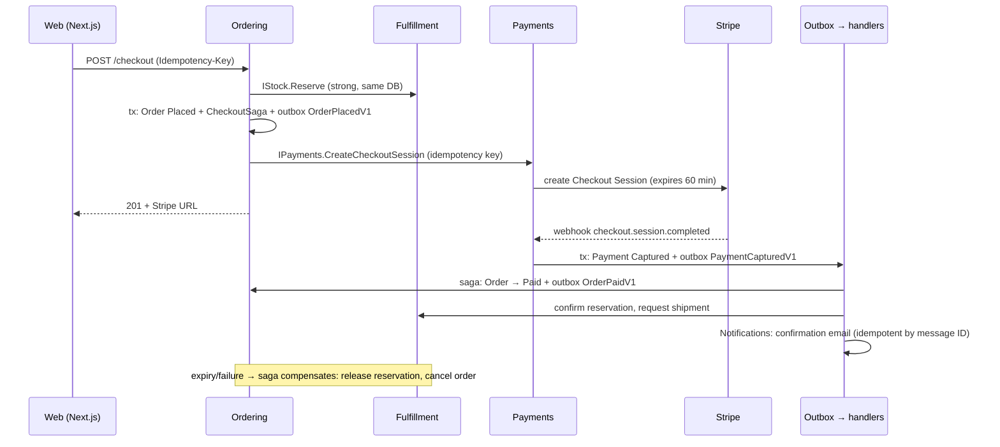

# System design, data, and cross-cutting concerns
[← Overview](00-overview.md)

## Why it matters
- Checkout touches four modules, a payment provider, and a timer. Without an explicit design for consistency and failure, it double-charges, oversells, or strands orders.
- Cross-cutting concerns (auth, validation, errors, telemetry, resilience) decided per endpoint become inconsistent; decided once, they're free for every new feature.

## Estimates (from 01-product-and-domain)
| Quantity | Estimate | Consequence |
|:--|:--|:--|
| API requests | ~20 req/s peak, 100 req/s campaigns | 2–4 API replicas; one Azure SQL GP 2 vCore DB is plenty |
| orders | 300/day, 30/min peak | checkout writes are tiny; correctness matters more than throughput |
| catalog | ~500 products, ~2,000 variants | cache catalog reads (HybridCache + Front Door) |
| data growth | orders ~1 GB/year incl. events and outbox | no partitioning; retention jobs for outbox/inbox |
| emails | ~1,000/day | ACS quotas raised before launch |

Method: [06-design/06 lesson 01](../../../06-design/06-system-design/docs/01-method-estimation-communication.md).

## API (main endpoints, OpenAPI → Orval in the web app)
| Endpoint | Module | Notes |
|:--|:--|:--|
| `GET /products`, `GET /products/{slug}` | Catalog | cursor pagination; cached; public |
| `GET /cart`, `POST /cart/items`, `PATCH /cart/items/{sku}`, `DELETE ...` | Ordering | guest token or user |
| `POST /cart/coupon` | Ordering → Pricing | returns a price quote |
| `POST /checkout` | Ordering | `Idempotency-Key` required; returns Stripe Checkout URL |
| `POST /webhooks/stripe` | Payments | raw body, signature check |
| `GET /me/orders`, `GET /me/orders/{number}` | Ordering (read model) | owner only |
| `POST /admin/orders/{number}/refunds` | Payments | staff policy; idempotency key |
| `/admin/products`, `/admin/stock`, `/admin/promotions` | Catalog, Fulfillment, Pricing | staff policies |
| `/health/live`, `/health/ready` | host | probes |

Conventions: Problem Details with `code` and `traceId`, `Idempotency-Key` on unsafe POSTs, keyset pagination, versioned events (03-backend/02-api-design).

## Data model per context (schemas in one Azure SQL database)
| Schema | Tables (main) | Notes |
|:--|:--|:--|
| `catalog` | Products, Variants, Images, Categories | `ProductChangedV1` from outbox |
| `pricing` | Promotions, CouponRedemptions | unique (PromotionId, CustomerId) for single-use |
| `ordering` | Carts, CartLines, Orders, OrderLines, CheckoutSagas | `rowversion` on Orders; frozen prices on lines |
| `fulfillment` | StockItems, Reservations, ReservationLines, Shipments | conditional updates for stock |
| `payments` | Payments, Refunds, StripeEvents | unique Stripe IDs and event IDs |
| `identity` | AspNetUsers... (Identity schema) | passkeys, roles |
| `notifications` | Emails, Suppressions | delivery status from Event Grid |
| `infra` | OutboxMessages, Inbox, HangFire.* | shared infrastructure |

## Consistency per operation
| Operation | Consistency | Mechanism |
|:--|:--|:--|
| ⭐ reserve stock | strong | `UPDATE fulfillment.StockItems SET Reserved += @q WHERE Sku = @sku AND OnHand - Reserved >= @q` (rows affected = success) |
| ⭐ place order | strong within Ordering | one transaction: order + saga + outbox |
| ⭐ payment status | strong within Payments | webhook → event store row (unique) → state transition |
| coupon redemption | strong | unique constraint |
| order confirmation email, shipment request | eventual | outbox → handlers |
| order history, admin dashboard | eventual | projections / replica |
| catalog pages, search | eventual (seconds–minutes) | cache TTL + invalidation by events |

## Asynchronous flows

| Flow element | Implementation | Taught in |
|:--|:--|:--|
| ⭐ outbox | EF Core interceptor → `infra.OutboxMessages` → publisher (in-process dispatch; Service Bus for workers) | [03-backend/07-background-jobs lesson 04](../../../03-backend/07-background-jobs/docs/04-outbox.md) |
| ⭐ checkout saga | `CheckoutSaga` state in `ordering`, handled per event, deadline via Hangfire scheduled job | [06-design/07 lesson 04](../../../06-design/07-distributed-systems/docs/04-sagas-cqrs-event-sourcing.md) |
| ⭐ idempotent consumers | `infra.Inbox` (MessageId, Handler) unique, same transaction | [06-design/07 lesson 03](../../../06-design/07-distributed-systems/docs/03-consensus-locks-delivery.md) |
| read models | `OrderHistory` projection; admin dashboard via Dapper on the replica | [03-backend/09-scalability lesson 04](../../../03-backend/09-scalability/docs/04-database-scaling-reads.md) |
| reconciliation | hourly Stripe ↔ payments job; stale reservations sweep | [03-backend/12-integrations lesson 06](../../../03-backend/12-integrations/docs/06-testing-reconciliation.md) |

## Cross-cutting concerns
| Concern | Decision | Taught in |
|:--|:--|:--|
| authentication | ASP.NET Core Identity, `__Host-` cookie via the Next.js BFF; passkeys/TOTP for staff | [03-backend/04-auth](../../../03-backend/04-auth/README.md) |
| authorization | policies (`Staff`, `Admin`), resource checks (order owner) | 03-backend/04-auth |
| validation | `AddValidation()` + FluentValidation for complex rules; Zod (Orval) in the UI | [03-backend/05-validation-abuse](../../../03-backend/05-validation-abuse/README.md) |
| abuse | rate limits on login, coupon, checkout; Front Door WAF | 03-backend/05-validation-abuse |
| errors | `Result<T>` + codes → Problem Details; `IExceptionHandler` for the unexpected | [03-backend/11-architecture lesson 03](../../../03-backend/11-architecture/docs/03-domain-errors-ports.md) |
| configuration | options pattern + validation on start; Key Vault references; App Configuration flags | [01-foundations/07-config-environments](../../../01-foundations/07-config-environments/README.md) |
| observability | OpenTelemetry (traces, metrics, logs), business metrics, SLOs | [03-backend/10-observability](../../../03-backend/10-observability/README.md) |
| resilience | standard resilience handler on Stripe/carrier clients, timeouts, health checks, graceful shutdown | [03-backend/08-reliability](../../../03-backend/08-reliability/README.md) |
| caching | HybridCache for catalog and quotes; output cache for anonymous product pages | [03-backend/06-caching](../../../03-backend/06-caching/README.md) |

## Example
Atomic stock reservation (Fulfillment):
```csharp
internal sealed class StockReservations(FulfillmentDb db, TimeProvider time) : IStock
{
    public async Task<Result<ReservationId>> ReserveAsync(OrderId order, IReadOnlyList<(Sku Sku, int Qty)> lines, CancellationToken ct)
    {
        var strategy = db.Database.CreateExecutionStrategy();
        return await strategy.ExecuteAsync(async () =>
        {
            await using var tx = await db.Database.BeginTransactionAsync(ct);
            foreach (var (sku, qty) in lines.OrderBy(l => l.Sku.Value))          // fixed order avoids deadlocks
            {
                var updated = await db.StockItems
                    .Where(s => s.Sku == sku && s.OnHand - s.Reserved >= qty)
                    .ExecuteUpdateAsync(s => s.SetProperty(x => x.Reserved, x => x.Reserved + qty), ct);
                if (updated == 0) return Result<ReservationId>.Fail(new Error("stock.insufficient", $"Not enough {sku.Value}", ErrorType.Conflict));
            }
            var reservation = Reservation.Create(order, lines, expiresAt: time.GetUtcNow().AddMinutes(60));
            db.Reservations.Add(reservation);
            await db.SaveChangesAsync(ct);
            await tx.CommitAsync(ct);
            return Result<ReservationId>.Ok(reservation.Id);
        });
    }
}
```
Returning early without commit rolls back the earlier lines' reservations (the transaction is disposed).

## Mistakes
Wrong: `if (stock.Available >= qty) { stock.Reserved += qty; SaveChanges(); }` (check-then-act race).
Right: a conditional `UPDATE` that checks and changes in one statement.

Wrong: marking the order paid on the Stripe success redirect.
Right: the webhook drives Payments; the saga moves the order to Paid.

## Check yourself
1. Which operations need strong consistency in Roastery, and how is each achieved?
2. What drives the checkout saga forward, and what compensates it?
3. Where does each cross-cutting concern live in the code?

<details><summary>Answers</summary>

1. Stock reservation (conditional update in a transaction), order placement (one transaction with saga state and outbox), payment status (unique Stripe event IDs and guarded transitions), and coupon redemption (unique constraint).
2. Events from the outbox (StockReserved, PaymentCaptured, PaymentFailed, session expiry) and a Hangfire deadline job; compensations release the reservation and cancel the order (and refund if a later step fails after payment).
3. In the host and middleware once: authentication/authorization policies, validation filters, exception handler and Problem Details, OpenTelemetry setup, rate limiting, options validation, resilience handlers on typed clients; modules only declare policies and contracts.
</details>

## Sources
- [06-design/06-system-design](../../../06-design/06-system-design/README.md)
- [06-design/07-distributed-systems](../../../06-design/07-distributed-systems/README.md)
- [Stripe Checkout — fulfil orders with webhooks](https://docs.stripe.com/checkout/fulfillment)
- [EF Core ExecuteUpdate](https://learn.microsoft.com/ef/core/saving/execute-insert-update-delete)
- [Saga pattern (Azure)](https://learn.microsoft.com/azure/architecture/reference-architectures/saga/saga)
