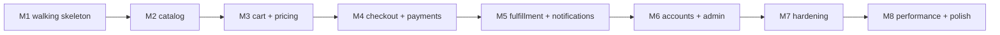

# Milestones
[← Overview](00-overview.md)

## Why it matters
- Capstones fail by building every layer of every module before anything runs end to end. A walking skeleton in week one exposes integration problems while they're cheap.
- Each milestone is deployed, tested, and reviewed, so "done" always means "works in an environment", never "works on my laptop".
- Milestones are the capstone's tasks: `T01 = M1 ... T08 = M8` (`/learn csharp/07-capstone/01-design-build mode=tasks`).

## How milestones work
| Rule | Practice |
|:--|:--|
| ⭐ walking skeleton first | the thinnest end-to-end path through every tier, deployed by the real pipeline |
| ⭐ vertical slices | each milestone adds working features across web, API, data, and infrastructure |
| ⭐ exit criteria | written, testable, checked in review (`/review csharp/07-capstone/01-design-build Txx`) |
| deployed every time | staging from M1, production from M4 (behind flags where needed) |
| ADRs and docs as you go | not at the end |
| small PRs, merged daily | [05-practice lesson 01](../../../05-practice/01-engineering-practice/docs/01-small-batches-tickets-estimation.md) |



## The milestones
| # | Goal | Exit criteria | Applies |
|:--|:--|:--|:--|
| ⭐ M1 | **Walking skeleton** | solution layout and modules as in 02-architecture; one endpoint `GET /products` (hard-coded data) through Next.js → API → Azure SQL; Compose + Aspire AppHost locally; Bicep + deployment stack for staging; GitHub Actions with OIDC builds once and deploys the digest; health probes; OpenTelemetry to the Aspire dashboard and App Insights; architecture tests green; ADR-0001…0003 | 01-foundations, 04-shipping/01–04, 03-backend/11 |
| M2 | **Catalog** | products, variants, images (Blob + Front Door), categories; cursor pagination; HybridCache + output caching; `ProductChangedV1` via outbox; admin create/edit behind a staff policy; Problem Details everywhere; Orval client and Zod schemas in the web app; product pages meet the latency target in a k6 smoke test | 03-backend/02, 03, 06, 07; 02-frontend |
| M3 | **Cart and pricing** | guest and customer carts (merge on login stub); Pricing module with percentage, fixed, and free-shipping promotions as a sum type; coupon endpoint returns a price quote; invariants covered by unit tests; rate limit on coupon attempts | 06-design/01, 05; 03-backend/05 |
| ⭐ M4 | **Checkout and payments** | stock reservation (conditional update), order placement with saga + outbox in one transaction; Stripe Checkout session with idempotency keys; webhook with signature check, event dedupe, guarded transitions; expiry and failure compensations; reconciliation job; first production deploy with the checkout flag for staff only | 03-backend/07, 12; 06-design/07; 04-shipping/04 |
| M5 | **Fulfillment and notifications** | shipments with a carrier adapter (fake + sandbox), tracking updates; ACS email with templates, custom domain records documented, suppression from delivery events; idempotent consumers tested with concurrent duplicates | 03-backend/12; 06-design/07 lesson 05 |
| M6 | **Accounts and admin** | Identity with cookie auth through the BFF, password reset, passkeys or TOTP for staff; order history read model; staff refunds (partial, per line) with idempotency; admin dashboard via Dapper on the read replica | 03-backend/04, 09 |
| M7 | **Hardening** | resilience handlers and timeouts on all outgoing calls; graceful shutdown verified in a deploy; SLOs and burn-rate alerts with runbooks; restore drill with measured RTO; security review items from 02-pre-launch fixed or ticketed | 03-backend/08, 10; 04-shipping/05, 06 |
| M8 | **Performance and polish** | k6 campaign-peak test passes thresholds; Core Web Vitals budgets in CI; WCAG 2.2 AA checks (automated + manual); SEO metadata; all ADRs current; the full 02-pre-launch checklist ready to run | 03-backend/09; 02-frontend/07, 08 |

## Example
M1 walking skeleton, the minimum code in the API:
```csharp
// src/Roastery.Api/Program.cs (M1)
var builder = WebApplication.CreateBuilder(args);
builder.AddServiceDefaults();                                    // OpenTelemetry, health checks, resilience (Aspire service defaults)
builder.Services.AddProblemDetails();
builder.Services.AddCatalogModule(builder.Configuration);
builder.Services.AddOpenApi();

var app = builder.Build();
app.UseExceptionHandler();
app.MapDefaultEndpoints();                                       // template maps /health and /alive; adapt to /health/ready and /health/live (03-backend/08-reliability)
app.MapOpenApi();
app.MapCatalogEndpoints();                                       // GET /products
app.Run();

public partial class Program;                                     // for WebApplicationFactory
```
M1 exit check as a script the reviewer runs:
```bash
curl --fail https://staging.roastery.example/api/health/ready
curl --fail "https://staging.roastery.example/api/products?pageSize=1"
gh run list --workflow api.yml --limit 1          # green, single build → staging digest
az containerapp revision list -g rg-roastery-staging-weu -n ca-roastery-api --query "[0].properties.template.containers[0].image"
```
A milestone task (generated later with `mode=tasks`) states the exit criteria above as checkboxes and links the lessons each criterion relies on.

## Mistakes
Wrong: M1 = "set up all seven modules with entities and repositories".
Right: M1 = one thin path through every tier, deployed by the real pipeline.

Wrong: leaving infrastructure, CI/CD, and observability for the last milestone.
Right: they're part of M1 and grow with every milestone.

Wrong: production deploy only at the end.
Right: production from M4, with flags limiting who sees unfinished features.

## Check yourself
1. What makes M1 a walking skeleton rather than a prototype?
2. Why does checkout (M4) come before accounts and admin (M6)?
3. What has to be true at the end of every milestone?

<details><summary>Answers</summary>

1. It runs end to end through every real tier (web, API, database, cloud, pipeline, telemetry) with production-grade structure, even though the feature is trivial; a prototype proves an idea and is often thrown away.
2. Checkout is the riskiest, most valuable flow (money, stock, a partner, async consistency); tackling it early surfaces the hardest problems while there's time, and guest checkout doesn't need accounts.
3. The exit criteria pass, the code is reviewed and merged, it's deployed (staging, and production from M4) by the pipeline, tests are green, and ADRs, dashboards, and runbooks are updated.
</details>

## Sources
- [Alistair Cockburn — Walking skeleton](https://wiki.c2.com/?WalkingSkeleton)
- [DORA — Working in small batches](https://dora.dev/capabilities/working-in-small-batches/)
- [Aspire service defaults](https://learn.microsoft.com/dotnet/aspire/fundamentals/service-defaults)
- [04-shipping/04-deployments](../../../04-shipping/04-deployments/README.md)
- [02-pre-launch](../../02-pre-launch/README.md)
