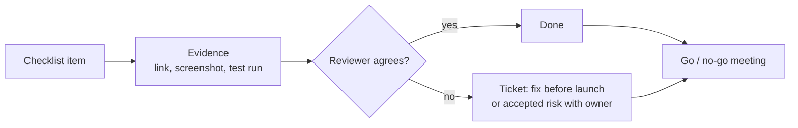

# Pre-Launch Checklist — Overview
[← Topic](../README.md)

**TECH:** the Roastery system from [01-design-build](../../01-design-build/README.md), reviewed with the tools from every module: OWASP Top 10:2025 and ASP.NET Core security features, Azure SQL backups and restore drills, OpenTelemetry and Azure Monitor, k6 and Lighthouse CI, axe and manual accessibility passes, Bicep what-if and deployment stacks, GitHub Actions with OIDC, feature flags
**LEVEL:** senior: this is the review a team does before real customers and real money arrive
**KIND:** capstone: these documents are the checklist and the evidence to collect; the final task is running it

## Why this matters in production
- Launch is when every shortcut becomes visible at once: the missing alert, the untested restore, the admin endpoint without authorization.
- A checklist turns "we think we're ready" into evidence: links to test runs, dashboards, drills, and ADRs.
- Launching gradually (flags, small audience first) with rollback rehearsed turns launch day into a non-event.

## How to use it

| Rule | Practice |
|:--|:--|
| ⭐ evidence, not opinions | every item links to proof (test output, dashboard, drill notes, ADR) |
| ⭐ owners | each section has a named owner |
| blockers vs accepted risks | critical items block launch; others become dated tickets with an owner |
| run it twice | a dry run two weeks before launch, the real one in launch week |
| keep it | the checklist becomes the template for later launches |

## Documents
| Document | Checklist items |
|:--|:--|
| [01 · Security and privacy review](01-security-privacy-review.md) | 1, 2 |
| [02 · Reliability, data safety, observability, and operations](02-reliability-data-observability-ops.md) | 3, 4, 5, 6 |
| [03 · Performance, accessibility, and SEO](03-performance-accessibility-seo.md) | 7, 8, 9 |
| [04 · Infrastructure, code health, and the launch plan](04-infrastructure-code-launch.md) | 10, 11, 12 |
| [Cheatsheet](cheatsheet.md) | all |

## Suggested order
1. Finish [01-design-build](../../01-design-build/README.md) M1–M8.
2. Work through 01 → 04, collecting evidence in `docs/launch/checklist.md`.
3. Hold the go/no-go review; launch with the plan in document 04.
4. As tasks: `/learn csharp/07-capstone/02-pre-launch mode=tasks` (the final milestone is the full checklist).

## Version notes
- OWASP Top 10:2025 (final, January 2026) adds A03 Software Supply Chain Failures and A10 Mishandling of Exceptional Conditions.
- .NET 8 and .NET 9 reach end of support on 2026-11-10; Roastery runs on .NET 10 LTS (supported to November 2028). Check every container image and dependency is on supported versions.
- WCAG 2.2 AA is the accessibility target; the European Accessibility Act applies to e-commerce in the EU since June 2025.

## Sources
- [OWASP Top 10:2025](https://owasp.org/Top10/)
- [Google SRE — Production readiness review](https://sre.google/sre-book/evolving-sre-engagement-model/)
- [Azure Well-Architected review](https://learn.microsoft.com/assessments/azure-architecture-review/)
- [.NET support policy](https://dotnet.microsoft.com/platform/support/policy/dotnet-core)
- [European Accessibility Act](https://commission.europa.eu/strategy-and-policy/policies/justice-and-fundamental-rights/disability/european-accessibility-act-eaa_en)
