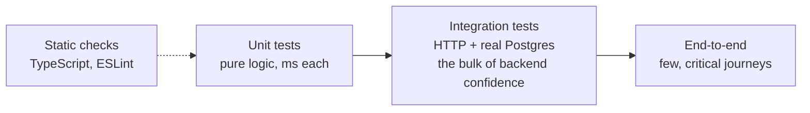

# Testing — Overview
[← Topic](../README.md)

**TECH:** Vitest 4 · Supertest · Testcontainers · TypeScript 6 (strict) on Node.js 26
**LEVEL:** intermediate (mid-level, has shipped production code)

## Why this matters in production
- Tests are what let you change code on a Friday. Without them every refactor is a gamble.
- Most production bugs live at boundaries: SQL, HTTP, time, and error paths. Unit tests alone miss them.
- Flaky or slow suites get ignored, then deleted. Test design matters as much as test count.
- A failing test written before a bug fix proves the fix and stops the bug coming back.

## Mental model
A test is a small program that makes a claim about behavior and checks it automatically. Pick the cheapest test that would catch the bug you fear.

- Test behavior through public interfaces, not implementation details.
- Fake what you don't own and can't run locally (payments, email). Run what you own for real (your database, in a container).

## Prerequisites
- TypeScript basics, `async`/`await`, and a small Express app.
- Docker Desktop with WSL2 for Testcontainers ([04-shipping/01-containers](../../../04-shipping/01-containers/README.md) goes deeper).
- pnpm: `pnpm add -D vitest supertest @types/supertest @testcontainers/postgresql`.

## Lesson map
| Lesson | Checklist items |
|:--|:--|
| [01 · Why and how to test](01-why-and-how-to-test.md) | 1, 2, 12 |
| [02 · Vitest essentials](02-vitest-essentials.md) | 3, 6, 9 |
| [03 · Test doubles, time, and modules](03-test-doubles.md) | 4, 5 |
| [04 · Integration tests: Supertest and Testcontainers](04-integration-tests.md) | 7, 8 |
| [05 · Coverage, flaky tests, and CI](05-coverage-flakiness-ci.md) | 10, 11, 13 |
| [Cheatsheet](cheatsheet.md) | all |

## Suggested order
1. 01 → 02 → 03 in order: principles, then tools, then doubles.
2. 04 after [02-http-networking](../../02-http-networking/README.md) lessons 01–02.
3. 05 before [04-ci-cd](../../04-ci-cd/README.md).
4. Frontend testing (Testing Library, MSW, Playwright) is in [02-frontend/13-testing-monitoring](../../../02-frontend/13-testing-monitoring/README.md).
5. Ready to build: `/learn typescript/01-foundations/03-testing mode=tasks`.

## Version notes
- Vitest 4 (October 2025): browser mode is stable, `workspace` is gone (use `projects`), and coverage should list files with `coverage.include`.
- Vitest runs TypeScript directly through Vite; no separate build step for tests.
- Testcontainers needs a running Docker engine; GitHub-hosted Ubuntu runners have one.
- also seen: `node:test`, Node's built-in runner. Good for tiny libraries; Vitest has richer mocking, watch mode, and coverage UX.

## Sources
- [Vitest guide](https://vitest.dev/guide/)
- [Vitest 4 announcement](https://vitest.dev/blog/vitest-4)
- [Supertest](https://github.com/forwardemail/supertest)
- [Testcontainers for Node.js](https://node.testcontainers.org/)
- [Martin Fowler — The Practical Test Pyramid](https://martinfowler.com/articles/practical-test-pyramid.html)
