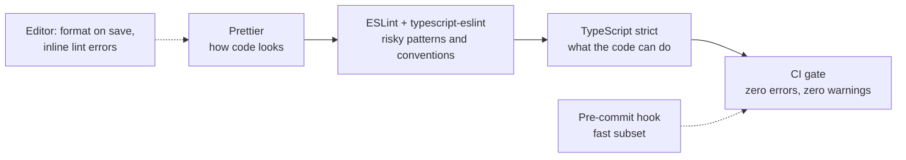

# Code Quality & Tooling — Overview
[← Topic](../README.md)

**TECH:** TypeScript 6.0 (strict) · ESLint 10 (flat config) · typescript-eslint 8 · Prettier 3
**LEVEL:** intermediate (mid-level, has shipped production code)

## Why this matters in production
- A forgotten `await` or an unchecked `undefined` is a production incident. Type-aware lint rules and strict types catch both before review.
- Formatting debates waste review time. A formatter ends them, so reviews focus on behavior.
- Consistent code is faster to read, onboard into, and change safely.
- Tooling that is too slow or noisy gets bypassed. Fast, low-noise gates stick.

## Mental model
Three layers, each with one job, all enforced in CI:

- The editor gives instant feedback, hooks give early feedback, CI is the only real enforcement.
- Types describe what is possible; lint rules ban what is legal but dangerous; formatting is not a review topic.

## Prerequisites
- TypeScript basics: types, interfaces, generics, `async`/`await`.
- A Node project with pnpm. VS Code (or another editor with ESLint and Prettier plugins).
- [01-git lesson 02](../../01-git/docs/02-repo-setup-and-secrets.md) for hooks via `core.hooksPath`.

## Lesson map
| Lesson | Checklist items |
|:--|:--|
| [01 · Strict TypeScript and safe boundaries](01-strict-typescript.md) | 1, 2, 3 |
| [02 · ESLint with type-aware rules](02-eslint-type-aware.md) | 4, 5 |
| [03 · Prettier, the editor, and pre-commit checks](03-prettier-editor-hooks.md) | 6, 7, 8 |
| [04 · Quality gates, reviews, and tech debt](04-quality-gates-and-debt.md) | 9, 10, 11, 12 |
| [Cheatsheet](cheatsheet.md) | all |

## Suggested order
1. 01 → 02 → 03 to set up a project from scratch.
2. 04 together with [04-ci-cd](../../04-ci-cd/README.md) lesson 02.
3. Reuse this setup in every later topic; reviews judge code against it.
4. Ready to build: `/learn typescript/01-foundations/05-code-quality mode=tasks`.

## Version notes
- TypeScript 6.0 (March 2026) turns `strict` on by default and deprecates old options (ES5 target, `node10` resolution, `baseUrl`) that TypeScript 7 removes. Set options explicitly anyway.
- TypeScript 7.0 (native Go compiler, July 2026) is much faster, but its API is not stable yet; typescript-eslint supports TypeScript below 6.1. Stay on 6.0 for now (STACK.md).
- ESLint 10 removed eslintrc completely: flat config (`eslint.config.js`) only. ESLint 9 reached end of life in August 2026.
- typescript-eslint 8.56+ supports ESLint 10. Some plugins (jsx-a11y, import) lagged on ESLint 10; check peer ranges before upgrading.
- Node 26 runs TypeScript directly but only strips types: use `erasableSyntaxOnly` so `tsc` rejects `enum`, `namespace`, and parameter properties.

## Sources
- [TypeScript — TSConfig reference](https://www.typescriptlang.org/tsconfig/)
- [typescript-eslint — Getting started](https://typescript-eslint.io/getting-started/)
- [ESLint — Configuration files](https://eslint.org/docs/latest/use/configure/configuration-files)
- [Prettier — Rationale](https://prettier.io/docs/rationale)
- [Node.js — TypeScript type stripping](https://nodejs.org/api/typescript.html)
