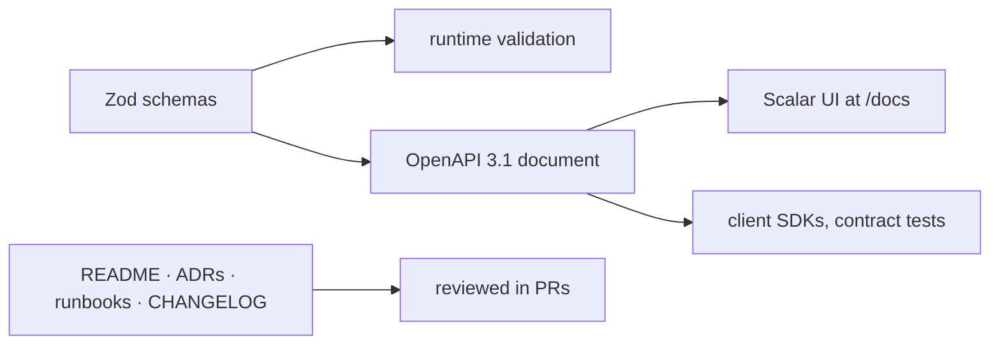

# Documentation — Overview
[← Topic](../README.md)

**TECH:** Markdown (GitHub Flavored) · OpenAPI 3.1 generated from Zod · Scalar API Reference
**LEVEL:** intermediate (mid-level, has shipped production code)

> STACK.md marks the API docs row as **tentative**. These lessons use it as recorded. Change it with `/stack revisit API docs`.

## Why this matters in production
- Onboarding, incident response, and integrations all depend on docs. Missing docs turn into Slack interruptions and slow incidents.
- API docs that drift from the code cause broken integrations; docs generated from the same schemas can't drift.
- Decisions without recorded reasons get re-argued every six months.
- A runbook turns a 2 a.m. outage from guesswork into a checklist.

## Mental model
Docs are part of the product and live with the code: written in Markdown, reviewed in PRs, checked in CI. Write the kind of doc the reader needs (Diátaxis), and generate reference docs from the source of truth.

## Prerequisites
- An Express API with Zod validation ([05-code-quality](../../05-code-quality/README.md), [07-config-environments](../../07-config-environments/README.md)).
- Git and PR workflow ([01-git](../../01-git/README.md)).

## Lesson map
| Lesson | Checklist items |
|:--|:--|
| [01 · Docs that work: Diátaxis, README, Markdown](01-docs-that-work.md) | 1, 2, 3 |
| [02 · ADRs, runbooks, and changelogs](02-decisions-runbooks-changelogs.md) | 4, 8, 10 |
| [03 · OpenAPI 3.1 from Zod, served with Scalar](03-openapi-from-zod.md) | 5, 6, 7 |
| [04 · Code comments and docs as code](04-comments-and-docs-as-code.md) | 9, 11 |
| [Cheatsheet](cheatsheet.md) | all |

## Suggested order
1. 01 and 02 apply to every repo you touch; start there.
2. 03 together with [03-backend/02-api-design](../../../03-backend/02-api-design/README.md).
3. 04 when setting up CI for a project.
4. Ready to build: `/learn typescript/01-foundations/08-documentation mode=tasks`.

## Version notes
- OpenAPI 3.1 aligns schemas with JSON Schema 2020-12, which is what Zod 4's `z.toJSONSchema()` produces. OpenAPI 3.2 (September 2025) adds features like the `QUERY` method and streaming media types; tool support is still catching up, so these lessons target 3.1.
- zod-openapi 5 supports Zod 4 and reads Zod's native `.meta()` for descriptions, examples, and component IDs. also seen: `@asteasolutions/zod-to-openapi`.
- Scalar's Express package is `@scalar/express-api-reference`.
- GitHub renders Mermaid diagrams and alert blocks (`> [!NOTE]`) in Markdown.

## Sources
- [Diátaxis](https://diataxis.fr/)
- [GitHub Flavored Markdown spec](https://github.github.com/gfm/)
- [OpenAPI Specification 3.1](https://spec.openapis.org/oas/v3.1.0)
- [zod-openapi](https://github.com/samchungy/zod-openapi)
- [Scalar](https://github.com/scalar/scalar)
