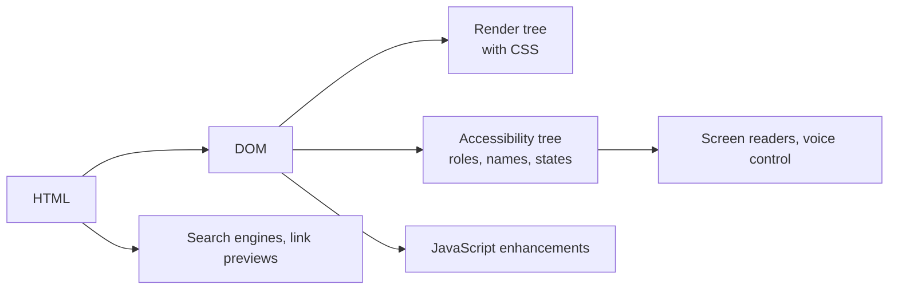

# HTML — Overview
[← Topic](../README.md)

**TECH:** HTML (WHATWG Living Standard), checked against Baseline browser support
**LEVEL:** intermediate (mid-level, has shipped production code)

## Why this matters in production
- HTML is the API your users' browsers, screen readers, search engines, and link previews consume. Wrong elements break all four at once.
- Native elements give keyboard support, focus handling, and form validation for free. Rebuilding them in `
`s costs weeks and still misses cases.
- Loading attributes (`defer`, `loading`, `fetchpriority`, `width`/`height`) decide much of your Core Web Vitals score.
- Pages that work before JavaScript loads survive slow networks, script errors, and blocked third parties.

## Mental model
The browser turns HTML into the DOM, and from it builds the **accessibility tree** that assistive technology reads. Choose elements for meaning; CSS handles looks; JavaScript enhances.

## Prerequisites
- You can write basic HTML and use browser DevTools.
- Chrome or Firefox DevTools; the W3C Nu HTML Checker for validation.

## Lesson map
| Lesson | Checklist items |
|:--|:--|
| [01 · Semantic structure and the document](01-semantic-structure.md) | 1, 2, 6, 10 |
| [02 · Interactive elements, forms, and progressive enhancement](02-interactive-and-forms.md) | 3, 4, 9 |
| [03 · Media, loading, and metadata](03-media-loading-metadata.md) | 5, 7, 8 |
| [Cheatsheet](cheatsheet.md) | all |

## Suggested order
1. 01 → 02 → 03.
2. Continue with [02-css](../../02-css/README.md); revisit lesson 02 before [10-forms](../../10-forms/README.md) and [08-accessibility](../../08-accessibility/README.md).
3. Ready to build: `/learn typescript/02-frontend/01-html mode=tasks`.

## Version notes
- Baseline (web.dev) tells you when a feature works in all major browsers. "Newly available" = all current browsers; "widely available" = 30 months later.
- Widely usable now: `<dialog>` with `showModal()`, the Popover API, `
` exclusive accordions, `inert`, `:user-invalid`, `loading="lazy"`, `fetchpriority`.
- Newer (check support before relying on them): invoker commands (`commandfor`/`command`), `<dialog closedby>`, customizable `<select>` (`appearance: base-select`), Speculation Rules.

## Sources
- [HTML Living Standard](https://html.spec.whatwg.org/)
- [MDN — HTML elements reference](https://developer.mozilla.org/en-US/docs/Web/HTML/Element)
- [web.dev — Baseline](https://web.dev/baseline)
- [W3C Nu HTML Checker](https://validator.w3.org/nu/)
