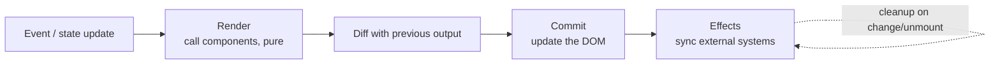

# Framework (React) — Overview
[← Topic](../README.md)

**TECH:** React 19.2 · React Compiler 1.0 · TypeScript 6.0 · Vite 8 (Rolldown)
**LEVEL:** intermediate (mid-level, has shipped production code)

## Why this matters in production
- Most React bugs are model bugs: effects used for the wrong job, state duplicated in two places, missing keys, stale closures.
- React 19 changed how forms, async updates, and refs work; old patterns (`forwardRef`, manual pending flags) are now extra code.
- The React Compiler removes most manual memoization, but only for code that follows the Rules of React.
- A clean Vite setup (proxy, env, aliases, type checks) keeps the dev loop fast and the build predictable.

## Mental model
A component is a pure function from props and state to UI. React calls it to **render**, compares the result, and **commits** only the DOM changes. Effects run after commit to sync with the outside world.

## Prerequisites
- [03-javascript](../../03-javascript/README.md): closures, references, the event loop, TypeScript basics.
- Node 26 and pnpm; an Express API running locally helps for lessons 04–05.

## Lesson map
| Lesson | Checklist items |
|:--|:--|
| [01 · The React model: components, props, state, lists](01-react-model.md) | 1, 2, 5 |
| [02 · Effects, hooks, and React 19.2 additions](02-effects-and-hooks.md) | 3, 4, 8 |
| [03 · Composition, structure, and error boundaries](03-composition-structure-errors.md) | 6, 11, 13 |
| [04 · Actions, transitions, and Suspense](04-actions-transitions-suspense.md) | 7, 9 |
| [05 · React Compiler and the Vite 8 setup](05-compiler-and-vite.md) | 10, 12 |
| [Cheatsheet](cheatsheet.md) | all |

## Suggested order
1. 05's Vite setup first if you need a project, then 01 → 04.
2. Next: [05-state-management](../../05-state-management/README.md) (TanStack Query) and [10-forms](../../10-forms/README.md).
3. Ready to build: `/learn typescript/02-frontend/04-framework mode=tasks`.

## Version notes
- React 19.2 (October 2025) added `<Activity>`, `useEffectEvent`, `cacheSignal`, and React performance tracks in Chrome DevTools. 19.x patches include security fixes for Server Components; stay on the latest 19.2 patch.
- React Compiler 1.0 is stable. With Vite 8, `@vitejs/plugin-react` v6 no longer bundles Babel: run the compiler through `@rolldown/plugin-babel` with the plugin's `reactCompilerPreset` (check the plugin README; newer versions may add a built-in option).
- `eslint-plugin-react-hooks` 7: `configs.flat.recommended` includes the compiler-powered rules.
- Vite 8 bundles with Rolldown (Rust); dev uses native ESM with Oxc transforms. Vite doesn't type-check: run `tsc -b`.

## Sources
- [react.dev — Learn](https://react.dev/learn)
- [React 19.2 release](https://react.dev/blog/2025/10/01/react-19-2)
- [React Compiler](https://react.dev/learn/react-compiler)
- [Vite 8 announcement](https://vite.dev/blog/announcing-vite8)
- [eslint-plugin-react-hooks README](https://github.com/facebook/react/blob/main/packages/eslint-plugin-react-hooks/README.md)
