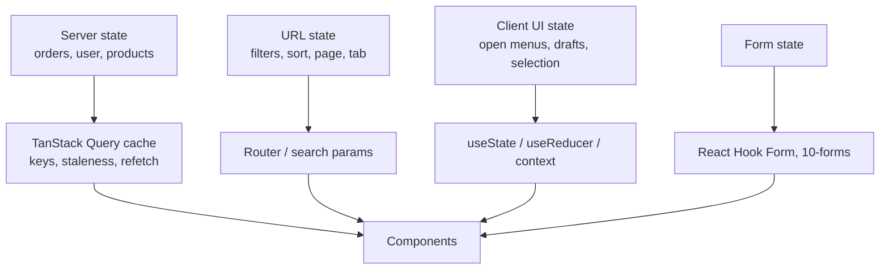

# State Management — Overview
[← Topic](../README.md)

**TECH:** React 19.2 · TanStack Query v5 (server state) · React state and context (client state)
**LEVEL:** intermediate (mid-level, has shipped production code)

## Why this matters in production
- Most "global state" in older apps is a hand-written, buggy cache of server data. A server-state library removes most of it.
- Stale data, duplicate requests, missing loading states, and lost filters on refresh are state-placement bugs.
- Optimistic updates and cache invalidation decide whether an app feels instant or broken.
- Filters and pagination in the URL make views shareable, bookmarkable, and back-button friendly.

## Mental model
Put each piece of state where it belongs. **Server state** is a cache of data owned by your API: it can go stale and must be refetched. **Client state** belongs to the UI. The **URL** holds state the user should be able to share.

## Prerequisites
- [04-framework](../../04-framework/README.md): hooks, effects, composition.
- An API to talk to (your Express app from [03-backend](../../../03-backend/README.md) or any JSON API).

## Lesson map
| Lesson | Checklist items |
|:--|:--|
| [01 · Kinds of state and where they live](01-kinds-of-state.md) | 1, 8, 9 |
| [02 · Queries, keys, and caching](02-queries-and-keys.md) | 2, 6, 7 |
| [03 · Mutations and optimistic updates](03-mutations-and-optimistic.md) | 3, 4 |
| [04 · Pagination, errors, retries, and devtools](04-pagination-errors-devtools.md) | 5, 10, 11 |
| [Cheatsheet](cheatsheet.md) | all |

## Suggested order
1. 01 first: deciding where state lives prevents most bugs.
2. 02 → 03 → 04 with a real API.
3. Then [09-ux-states](../../09-ux-states/README.md) (loading, empty, error UX) and [06-rendering](../../06-rendering/README.md) (server data in Next.js).
4. Ready to build: `/learn typescript/02-frontend/05-state-management mode=tasks`.

## Version notes
- TanStack Query v5: `gcTime` (was `cacheTime`), `isPending` (was `isLoading` for "no data yet"), single object signature for all hooks, `throwOnError` (was `useErrorBoundary`), `placeholderData: keepPreviousData`, `queryOptions()` helper, first-class Suspense hooks (`useSuspenseQuery`), `skipToken`. Query callbacks (`onSuccess` on `useQuery`) were removed.
- STACK.md: use TanStack Query only in Client Components; in Next.js Server Components, fetch on the server instead ([06-rendering](../../06-rendering/README.md)).
- also seen for client state: Zustand, Jotai, Redux Toolkit. Reach for them only when React state and context become painful.

## Sources
- [TanStack Query — Overview](https://tanstack.com/query/latest/docs/framework/react/overview)
- [TanStack Query — Important defaults](https://tanstack.com/query/latest/docs/framework/react/guides/important-defaults)
- [TanStack Query — Migrating to v5](https://tanstack.com/query/latest/docs/framework/react/guides/migrating-to-v5)
- [react.dev — Managing state](https://react.dev/learn/managing-state)
