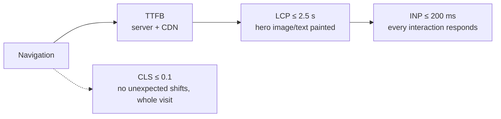

# Performance — Overview
[← Topic](../README.md)

**TECH:** Core Web Vitals · Lighthouse and Chrome DevTools · `web-vitals` (RUM) · Next.js 16 · React 19.2 · Vite 8
**LEVEL:** intermediate (mid-level, has shipped production code)

## Why this matters in production
- Slow pages lose users and revenue; Core Web Vitals also feed Google search ranking.
- Your laptop on fiber is not your users' mid-range Android on 4G. Field data tells the truth; lab data helps you debug.
- Most frontend slowness comes from a few causes: too much JavaScript, an unprioritized LCP resource, long main-thread tasks, and late-loading content shifting the layout.
- Without budgets in CI, performance degrades one "small" dependency at a time.

## Mental model
Performance has three moments users feel, each with a metric: **seeing** the main content (LCP), **interacting** without lag (INP), and a **stable** page that doesn't jump (CLS).

## Prerequisites
- [01-html](../../01-html/README.md) lesson 03 (images, loading), [03-javascript](../../03-javascript/README.md) lesson 02 (event loop).
- [04-framework](../../04-framework/README.md) and [06-rendering](../../06-rendering/README.md).
- Chrome with DevTools; a deployed page (or `next start` / `vite preview`) to measure.

## Lesson map
| Lesson | Checklist items |
|:--|:--|
| [01 · Core Web Vitals and how to measure them](01-web-vitals-and-measuring.md) | 1, 2, 11 |
| [02 · The loading path: TTFB, priorities, images, fonts, caching](02-loading-path-images-fonts.md) | 3, 5, 6, 10 |
| [03 · JavaScript cost and third-party scripts](03-javascript-cost.md) | 4, 12 |
| [04 · Runtime performance: INP, CLS, and React rendering](04-runtime-inp-cls-react.md) | 7, 8, 9 |
| [Cheatsheet](cheatsheet.md) | all |

## Suggested order
1. 01 first: measure before fixing.
2. 02 and 03 for loading; 04 for interaction and stability.
3. Ready to build: `/learn typescript/02-frontend/07-performance mode=tasks`.

## Version notes
- INP replaced FID as a Core Web Vital in March 2024. Thresholds (75th percentile of page loads): LCP ≤ 2.5 s, INP ≤ 200 ms, CLS ≤ 0.1.
- Chrome DevTools' Performance panel shows live LCP/INP/CLS and "insights"; recent Lighthouse versions use the same insight-based audits. React 19.2 adds React tracks to the Performance panel.
- Next.js 16: `next/image` `priority` is deprecated in favor of `preload`; in most cases use `fetchPriority="high"` (or `loading="eager"`) on the LCP image. Image `quality` values must be allowlisted (`images.qualities`, default `[75]`).
- Sentry's SDK v10 dropped FID; alerting should use INP.

## Sources
- [web.dev — Web Vitals](https://web.dev/articles/vitals)
- [web.dev — Learn Performance](https://web.dev/learn/performance)
- [Chrome DevTools — Performance panel](https://developer.chrome.com/docs/devtools/performance)
- [web-vitals library](https://github.com/GoogleChrome/web-vitals)
- [Next.js — Image component](https://nextjs.org/docs/app/api-reference/components/image)
