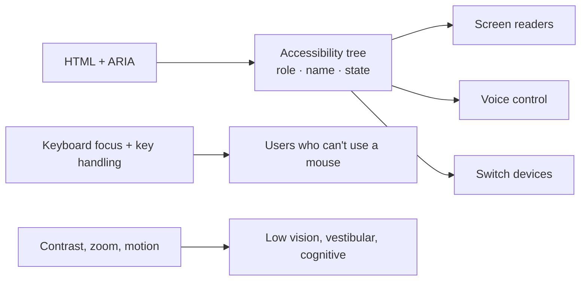

# Accessibility — Overview
[← Topic](../README.md)

**TECH:** semantic HTML · React 19.2 · axe-core with Playwright · screen readers (NVDA, VoiceOver)
**LEVEL:** intermediate (mid-level, has shipped production code)

## Why this matters in production
- Around one in six people has a disability; many more use keyboards, zoom, captions, or voice control situationally.
- It's a legal requirement in many markets: the European Accessibility Act applies to e-commerce, banking, and many other services since June 2025; ADA lawsuits are common in the US.
- Accessible markup is also better for SEO, automated testing (`getByRole`), and usability for everyone.
- Fixing accessibility in design and code review is cheap; retrofitting a component library is not.

## Mental model
Assistive technology doesn't see pixels. It reads the **accessibility tree**: every element's **role** (button, link, heading), **name** ("Delete order #1043"), and **state** (expanded, checked, invalid). Native HTML fills the tree correctly; custom widgets must do it with ARIA and keyboard support.

## Prerequisites
- [01-html](../../01-html/README.md) (semantic elements, forms) and [04-framework](../../04-framework/README.md).
- Playwright installed for lesson 04 ([13-testing-monitoring](../../13-testing-monitoring/README.md) covers it in depth).
- A screen reader: NVDA (Windows, free) or VoiceOver (built into macOS/iOS).

## Lesson map
| Lesson | Checklist items |
|:--|:--|
| [01 · Why, semantics, names, and images](01-why-semantics-images.md) | 1, 2, 8 |
| [02 · Keyboard, focus, and forms](02-keyboard-focus-forms.md) | 3, 4, 6 |
| [03 · ARIA, custom components, and visual design](03-aria-components-visual.md) | 5, 7, 9 |
| [04 · Testing and process](04-testing-and-process.md) | 10, 11, 12 |
| [Cheatsheet](cheatsheet.md) | all |

## Suggested order
1. 01 → 04 in order. Do the keyboard pass from lesson 02 on your own app right away.
2. Then add the axe checks from lesson 04 to your Playwright suite.
3. Ready to build: `/learn typescript/02-frontend/08-accessibility mode=tasks`.

## Version notes
- WCAG 2.2 (W3C Recommendation, 2023) is the current target at level AA. New AA criteria include Focus Not Obscured, Dragging Movements, Target Size (24×24 px minimum), and Accessible Authentication. WCAG 3.0 is still a draft.
- European Accessibility Act: in force since 28 June 2025; the harmonized standard EN 301 549 maps to WCAG AA.
- `@axe-core/playwright` runs axe-core inside Playwright tests. Playwright's `toMatchAriaSnapshot` checks the accessibility tree structure.
- `eslint-plugin-jsx-a11y` was slow to declare ESLint 10 support; check its peer range before adding it to an ESLint 10 config.

## Sources
- [W3C — WCAG 2.2](https://www.w3.org/TR/WCAG22/)
- [W3C — What's new in WCAG 2.2](https://www.w3.org/WAI/standards-guidelines/wcag/new-in-22/)
- [W3C — ARIA Authoring Practices Guide (APG)](https://www.w3.org/WAI/ARIA/apg/)
- [European Commission — European Accessibility Act](https://commission.europa.eu/strategy-and-policy/policies/justice-and-fundamental-rights/disability/union-equality-strategy-rights-persons-disabilities-2021-2030/european-accessibility-act_en)
- [Playwright — Accessibility testing](https://playwright.dev/docs/accessibility-testing)
