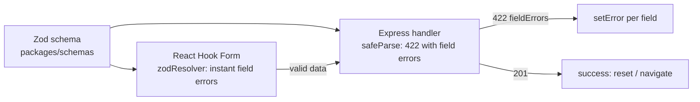

# Forms & Validation — Overview
[← Topic](../README.md)

**TECH:** React Hook Form 7 · Zod 4 (shared with Express) · React 19.2 · Testing Library + user-event
**LEVEL:** intermediate (mid-level, has shipped production code)

## Why this matters in production
- Forms are where money and data enter the system: sign-up, checkout, settings. Friction here costs conversions directly.
- Client validation is for users; server validation is for security. Using one Zod schema for both keeps them from drifting.
- Server errors (email taken, card declined) must land on the right field, or users can't fix them.
- Accessible error handling and focus management are legal requirements and better UX for everyone.

## Mental model
One schema describes valid data. The form uses it for instant feedback; the API uses the same schema as the gate. The server's answer can still add errors the client can't know (uniqueness, business rules).

## Prerequisites
- [01-html](../../01-html/README.md) lesson 02 (form elements), [04-framework](../../04-framework/README.md) lesson 04 (Actions).
- [08-accessibility](../../08-accessibility/README.md) lesson 02 (accessible forms).
- An Express endpoint to submit to ([03-backend/02-api-design](../../../03-backend/02-api-design/README.md)).

## Lesson map
| Lesson | Checklist items |
|:--|:--|
| [01 · Form fundamentals, accessibility, and submission UX](01-form-fundamentals.md) | 1, 7, 8 |
| [02 · React Hook Form with a shared Zod schema](02-react-hook-form-and-zod.md) | 2, 3, 6 |
| [03 · Dynamic fields, controlled inputs, and uploads](03-dynamic-fields-and-uploads.md) | 4, 5, 10 |
| [04 · Multi-step forms, drafts, and testing](04-multistep-and-testing.md) | 9, 11 |
| [Cheatsheet](cheatsheet.md) | all |

## Suggested order
1. 01 → 04 in order.
2. Pair lesson 02 with [03-backend/05-validation-abuse](../../../03-backend/05-validation-abuse/README.md), where the same schemas guard the API.
3. Ready to build: `/learn typescript/02-frontend/10-forms mode=tasks`.

## Version notes
- `@hookform/resolvers` v5 supports Zod 4 and infers the form's input and output types from the schema (they differ when you use `z.coerce` or transforms).
- Zod 4: `z.email()`, `z.url()` are top-level; `z.flattenError()` and `z.treeifyError()` format errors (the old `.flatten()`/`.format()` methods are deprecated).
- React 19 `<form action>` + `useActionState` suits simple forms; React Hook Form remains the better tool for validation-heavy, dynamic forms.

## Sources
- [React Hook Form — Get started](https://react-hook-form.com/get-started)
- [React Hook Form — API](https://react-hook-form.com/docs)
- [@hookform/resolvers](https://github.com/react-hook-form/resolvers)
- [Zod 4 documentation](https://zod.dev/)
- [react.dev — `<form>`](https://react.dev/reference/react-dom/components/form)
